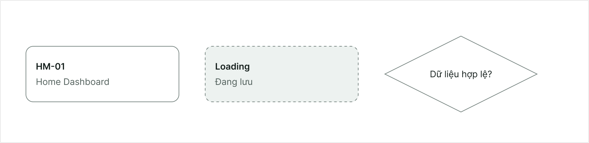
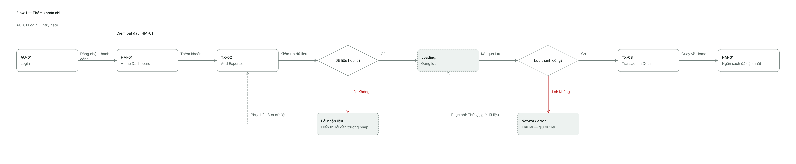
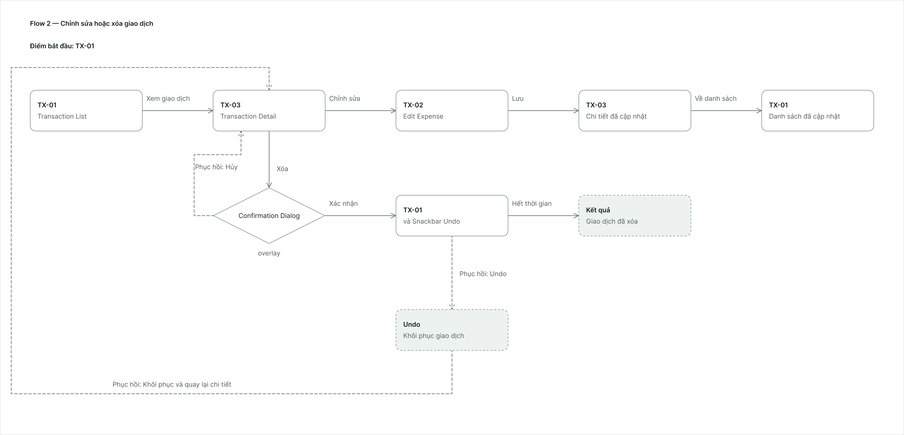
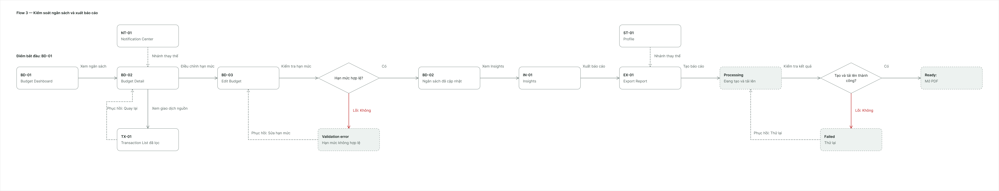
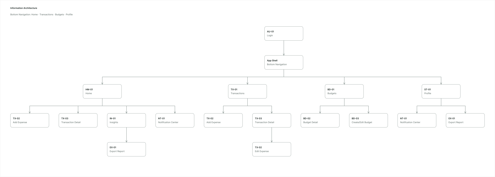
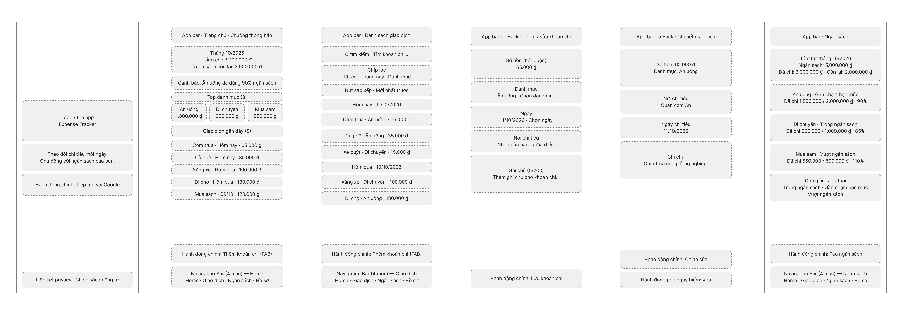
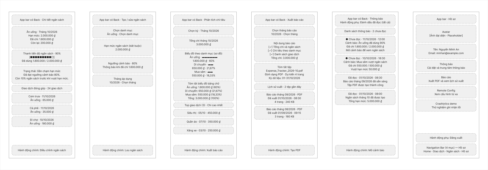
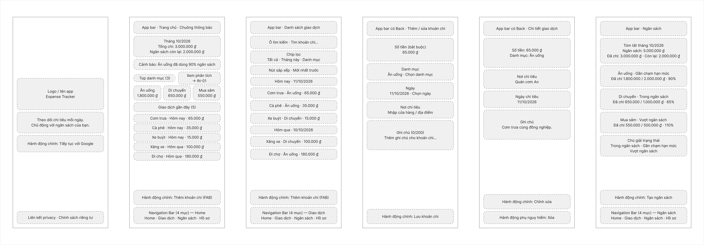
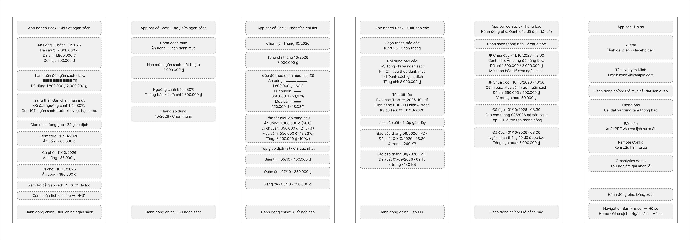

# AI Design Log

Tài liệu này phải được cập nhật trong lúc làm. Không điền kết quả, quyết định hoặc đường dẫn ảnh nếu chưa thực hiện thật.

Bổ sung hiện tại (2026-10-15): [Nhật ký tinh chỉnh Proto-Persona](persona-refinement-log.md). Giữ nguyên lịch sử prompt bên dưới; hai Secondary mới không được trình bày như đầu vào của các vòng UI đã làm trước đó.

## 1. AI tools declaration

| Công cụ | Mục đích | Ngày sử dụng | Bằng chứng |
| --- | --- | --- | --- |
| ChatGPT/Codex | Phân tích đề, thu gọn phạm vi và soạn tài liệu nền | 2026-10-06 | Repository documents |
| Google Stitch | Tạo UI ban đầu và 3 vòng chỉnh sửa | 2026-10-10 đến 2026-10-11 | assets/stitch/ |
| AI tích hợp trong Figma | Dựng component Page 05 | 2026-10-09| Phụ lục A |


## 2. Initial Google Stitch generation

### Mục tiêu

Tạo UI ban đầu bao phủ Flow 1 - Thêm khoản chi và các màn hình liên quan.

### Prompt nguyên văn

```text
Design a 3-screen Android mobile app flow (360 x 800 dp) for a Vietnamese personal expense tracker. All UI text must be in Vietnamese.

Persona: Nguyễn Minh, 21, third-year university student living away from home in Ho Chi Minh City. He receives 5,000,000 VND monthly allowance plus irregular part-time internship income. He uses a mid-range Android phone, mostly with one hand, often on weak mobile data, and opens the app for under a minute at a time.

Task: Minh has just paid for a small expense and wants to record it in a few taps and immediately see how it affects his monthly budget. Success criterion: add an expense and see the budget updated in under 20 seconds.

Screens:
1. Home Dashboard: app bar, total spent this month, remaining monthly budget with a budget status (icon + text label + progress bar), top categories, 5 recent transactions, an extended FAB "Thêm khoản chi", and bottom navigation with 4 destinations: Home, Giao dịch, Ngân sách, Hồ sơ.
2. Add Expense: fields for amount (VND, numeric keyboard), category, date, merchant, and note (max 200 characters), plus a sticky "Lưu khoản chi" button. Show a clear inline validation error state when amount is 0.
3. Transaction Detail: amount, category, merchant, date, note, a primary "Chỉnh sửa" action, and a secondary destructive "Xóa" action.

Constraints: one clear primary action per screen; body text at least 14sp; touch targets at least 48x48dp; amounts with high contrast; status never conveyed by color alone; errors shown next to the field and entered data is kept; calm, non-judgmental tone; no extra features (no receipt OCR, bank sync, social, AI coach, debt tracking, or investing).

Style: calm, clear, trustworthy. Primary #146C5A, on-primary #FFFFFF, background #F7F9F8, surface #FFFFFF, text primary #17211E, text secondary #52605C, outline #73817D, error #BA1A1A, warning #9A5B00, success #197A49. Font Inter. Corner radius 12-16dp, content padding 16dp. Material 3 inspired.
```

### Kết quả

- Ngày/giờ: 2026-10-10, khoảng 10:45
- Màn hình được tạo: Home Dashboard, Add Expense, Transaction Detail
- Ảnh:
  - assets/stitch/initial-home.png
  - assets/stitch/initial-add-expense.png
  - assets/stitch/initial-transaction-detail.png
- Nhận xét ban đầu: Bố cục đã bao phủ đúng luồng thêm khoản chi, nhưng thẻ ngân sách trên Home có quá nhiều yếu tố cạnh tranh; trạng thái lưu/lỗi mạng chưa đầy đủ; cảnh báo ngân sách chưa chứng minh được accessibility. Ba vấn đề này được xử lý lần lượt ở các vòng 1–3 bên dưới.

## 3. Iteration 1 - Visual hierarchy

### Vấn đề cụ thể

Thẻ ngân sách trên Home cùng lúc hiển thị chip phần trăm, tổng chi, số còn lại, hạn mức, dòng trạng thái, thanh tiến độ có mốc và gợi ý theo ngày. Quá nhiều điểm nhấn làm số tiền còn lại — thông tin Minh cần đọc nhanh — không có thứ bậc rõ ràng.

### Prompt nguyên văn

```text
Revise only the Home Dashboard screen to improve visual hierarchy. Keep the Add Expense and Transaction Detail screens unchanged.

Problem: the top budget card has too many competing elements (a "65% chi tiêu" chip, total spent, remaining budget, monthly limit, a status row, a progress bar with 50/80/100% markers, and a daily suggestion box). The remaining budget, which answers Minh's main question, has the same small size as the monthly limit.

Changes: keep total spent this month as the largest number. Make "Còn lại" the clear second level, larger than the monthly limit. Merge the "65% chi tiêu" chip into the single budget status row (icon + text label + percentage) and remove the duplicate chip. Keep one progress bar and remove the 50/80/100% markers. Keep the daily suggestion as one short line of secondary text. Keep body text at least 14sp and touch targets at least 48x48dp. Do not add new features.

```

### Bằng chứng

- Before: `assets/stitch/iteration-1-before.png`
- After: `assets/stitch/iteration-1-after.png`


### Quyết định

- Trạng thái: Chỉnh sửa
- Lý do liên quan persona/heuristic/ràng buộc: Giữ thứ bậc Stitch đề xuất (tổng chi lớn nhất, "Còn lại" nổi hơn "Hạn mức", một dòng trạng thái có icon, nhãn chữ và phần trăm, một thanh tiến độ) vì Minh chỉ mở app dưới một phút và cần biết ngay còn bao nhiêu trong ngân sách; phù hợp nguyên tắc "Số tiền và ngân sách quan trọng hơn trang trí" trong DESIGN.md. Không sao chép nguyên bố cục Stitch: dựng lại bằng Financial Card và Budget Progress có sẵn, và sửa các chữ bị cắt để giữ cỡ chữ nội dung tối thiểu 14 sp.
- Figma evidence: Page 05 có Financial Card và Budget Progress; ảnh Final UI hiện tại của HM-01 được lưu trong `assets/figma/final-ui/`.

## 4. Iteration 2 - Error recovery

### Vấn đề cụ thể

Spec TX-02 yêu cầu có trạng thái đang lưu (submitting) và lỗi mạng (network error), nhưng bản Stitch ban đầu chỉ có lỗi nhập liệu khi số tiền bằng 0. Minh thường gặp mạng yếu và sợ mất dữ liệu đã nhập, nên form cần cho biết đang lưu, báo lỗi mạng dễ hiểu và có đường thử lại mà không mất dữ liệu.

### Prompt nguyên văn

```text
Revise only the Add Expense screen to improve error recovery. Keep the Home Dashboard and Transaction Detail screens unchanged.

Problem: the screen only shows an inline validation error for amount = 0. It has no state for saving in progress or for a network failure, even though Minh often has weak mobile data.

Changes: create two additional states of the Add Expense screen with all entered data kept in the fields.
1. Submitting: the "Lưu khoản chi" button shows a loading indicator with the label "Đang lưu..." and is disabled, keeping the same width and height.
2. Network error: an error banner near the top of the form with an icon and the text "Không thể lưu khoản chi. Kết nối mạng bị gián đoạn. Dữ liệu bạn nhập vẫn được giữ." and a "Thử lại" button. The fields stay editable.
Keep body text at least 14sp and touch targets at least 48x48dp. Status must not rely on color alone. Do not add new features.
```

### Câu trả lời của Stitch

```text
[Đã tạo thành công 2 trạng thái phục hồi lỗi & xử lý mạng yếu cho màn hình Thêm khoản chi, giữ nguyên vẹn màn hình Trang chủ và Chi tiết giao dịch:

1. Trạng thái Đang lưu (Submitting) — Thêm khoản chi - Đang lưu
Bảo toàn dữ liệu đã nhập: Giữ nguyên số tiền hợp lệ và các trường thông tin (Danh mục Ăn uống, Ngày 24/10/2024, Địa điểm Cơm trưa căn tin trường, Ghi chú).
Nút hành động chính: Nút "Lưu khoản chi" chuyển sang trạng thái disabled, giữ nguyên kích thước chiều rộng và chiều cao (chuẩn touch target ≥ 48dp), hiển thị biểu tượng xoay vòng (loading spinner) cùng nhãn chữ "Đang lưu..." nhằm ngăn người dùng bấm nhiều lần khi mạng chậm.
2. Trạng thái Lỗi kết nối mạng (Network Error) — Thêm khoản chi - Lỗi mạng
Thẻ thông báo lỗi (Error Banner) ở đầu biểu mẫu:
Kết hợp biểu tượng mất kết nối mạng (wifi_off) cùng màu sắc cảnh báo, đảm bảo không phụ thuộc vào màu sắc đơn thuần.
Thông điệp điềm tĩnh, rõ ràng: "Không thể lưu khoản chi. Kết nối mạng bị gián đoạn. Dữ liệu bạn nhập vẫn được giữ nguyên vẹn."
Nút "Thử lại" tích hợp trực tiếp trên thẻ cảnh báo với vùng chạm chuẩn ≥ 48x48dp để Minh có thể nhanh chóng gửi lại yêu cầu ngay khi sóng điện thoại ổn định.
Biểu mẫu giữ nguyên tính sẵn sàng: Toàn bộ dữ liệu vừa nhập không bị mất, các ô nhập liệu vẫn duy trì khả năng chỉnh sửa và nút "Lưu khoản chi" ở chân màn hình sẵn sàng hoạt động trở lại.
Tất cả thành phần đều tuân thủ chặt chẽ cỡ chữ ≥ 14sp, vùng chạm ≥ 48x48dp, tông màu nhã nhặn #146C5A / #BA1A1A và triệt để không thêm tính năng thừa.]

```

### Bằng chứng

- Before: `assets/stitch/iteration-2-before.png`
- After (đang lưu): `assets/stitch/iteration-2-after-submitting.png`
- After (lỗi mạng): `assets/stitch/iteration-2-after-network-error.png`

### Quyết định

- Trạng thái: Chỉnh sửa
- Lý do: Giữ cấu trúc Stitch đề xuất: nút Lưu hiện vòng xoay và chữ "Đang lưu...", banner lỗi mạng có icon, nguyên nhân dễ hiểu, câu "Dữ liệu bạn nhập vẫn được giữ nguyên vẹn" và nút "Thử lại", vì phù hợp nguyên tắc "Form ngắn, giữ dữ liệu khi có lỗi" và persona mạng yếu. Chỉnh sửa hai điểm khi dựng Figma: (1) cả hai trạng thái Stitch vẫn vẽ số tiền 0 với viền đỏ, trong khi số tiền 0 là lỗi nhập liệu không thể gửi đi, nên dùng số tiền hợp lệ và viền bình thường; (2) nút "Thử lại" Stitch vẽ màu đỏ, trong khi đỏ dành cho lỗi nhập liệu và hành động nguy hiểm, nên dùng màu primary cho nhất quán với Error State và Dialog lỗi.
- Figma evidence: Page 05 có Primary Button (Loading), Error State và Dialog; các ảnh TX-02 default, submitting và error hiện nằm trong `assets/figma/final-ui/`.

## 5. Iteration 3 - Accessibility and budget status

### Vấn đề cụ thể

Home chỉ có trạng thái "đang kiểm soát tốt". Trạng thái cảnh báo (90%) và vượt ngân sách (120%), nơi dễ chỉ dùng màu và dễ thiếu contrast nhất, chưa được thiết kế. Kết quả đo: chữ và icon `#9A5B00` trên nền `#FFE2B8` đạt 4.35:1, chưa đạt 4.5:1 cho chữ nhỏ; hàng "Vượt ngân sách" `#BA1A1A` trên `#FFDAD6` đạt 5.0:1. Cặp màu này lấy từ token baseline trong DESIGN.md và Stitch dùng đúng như prompt chỉ định.

### Prompt nguyên văn

```text
[Revise only the Home Dashboard screen and add two new states of its budget status. Keep the Add Expense and Transaction Detail screens unchanged.

Problem: the screen only shows the "on track" budget status. The warning state (90% of budget used) and the over-budget state (120% of budget used) are not designed, even though they are where color-only signaling and low contrast are most likely.

Changes: create two additional versions of the Home Dashboard.
1. Warning at 90%: status row with a warning icon, the label "Sắp vượt ngân sách", the percentage, and the progress bar. Use warning #9A5B00 for text and icon on a light warning container #FFE2B8. Add one short calm line with a concrete next step, for example how much can still be spent per day.
2. Over budget at 120%: status row with an error icon, the label "Vượt ngân sách", the amount over the limit, and a full progress bar. Use error #BA1A1A on #FFDAD6. Add one short calm, non-judgmental line with a next step.
Status must never rely on color alone: always icon + text label. Keep body text at least 14sp and touch targets at least 48x48dp. Do not add new features.]
```

### Câu trả lời của Stitch

```text
[Đã hoàn thiện thiết kế 2 trạng thái ngân sách mới cho Trang chủ (Home Dashboard) theo đúng yêu cầu, giữ nguyên vẹn hai màn hình Thêm khoản chi và Chi tiết giao dịch:

1. Trạng thái Cảnh báo 90% (Warning at 90%) — Trang chủ - Cảnh báo ngân sách (90%)
Số liệu tài chính:
Tổng chi tiêu tháng: 4.500.000 đ (số lớn nhất, độ tương phản cao).
Còn lại: 500.000 đ (cấp độ ưu tiên thứ hai, to rõ ràng) trên Hạn mức 5.000.000 đ.
Dòng trạng thái đa yếu tố:
Nền hộp cảnh báo nhạt #FFE2B8.
Màu chữ và biểu tượng: Vàng hổ phách #9A5B00.
Kết hợp biểu tượng tam giác cảnh báo (warning) + nhãn chữ rõ ràng "Sắp vượt ngân sách" + tỷ lệ 90% (không truyền tải thông tin bằng màu sắc đơn thuần).
Thanh tiến trình: Lấp đầy 90% với tông màu #9A5B00.
Bước tiếp theo bình tĩnh: "Hạn mức còn lại: ~70.000 đ/ngày cho 7 ngày tới." kèm icon lịch trực quan, giúp Minh nắm được ngưỡng chi tiêu hàng ngày khả thi.
2. Trạng thái Vượt ngân sách 120% (Over budget at 120%) — Trang chủ - Vượt ngân sách (120%)
Số liệu tài chính:
Tổng chi tiêu tháng: 6.000.000 đ (nổi bật nhất).
Khoản đã vượt: Đã vượt: 1.000.000 đ (màu đỏ đậm, thay thế vị trí của "Còn lại") bên cạnh hạn mức 5.000.000 đ.
Dòng trạng thái đa yếu tố:
Nền hộp cảnh báo lỗi nhạt #FFDAD6.
Màu chữ và biểu tượng: Đỏ #BA1A1A.
Kết hợp biểu tượng chấm than tròn (error_outline) + nhãn chữ "Vượt ngân sách" + số tiền vượt cụ thể: +1.000.000 đ (120%).
Thanh tiến trình: Lấp đầy toàn bộ (100% full bar) màu đỏ #BA1A1A.
Thông điệp hỗ trợ không phán xét: "Gợi ý: Cân đối chi tiêu thiết yếu hoặc cập nhật hạn mức tháng mới." nhẹ nhàng và mang tính hành động, tránh gây cảm giác tiêu cực cho sinh viên.
Cả hai màn hình đều bảo toàn nghiêm ngặt các quy chuẩn: cỡ chữ body ≥ 14sp, vùng chạm ≥ 48x48dp, giữ nguyên bố cục danh mục và danh sách giao dịch, không phát sinh tính năng thừa.]
```

### Bằng chứng

- Before: `assets/stitch/iteration-3-before.png`
- After (cảnh báo 90%): `assets/stitch/iteration-3-after-warning.png`
- After (vượt ngân sách 120%): `assets/stitch/iteration-3-after-over-budget.png`

### Quyết định

- Trạng thái: Chỉnh sửa
- Lý do: Giữ cách thể hiện trạng thái của Stitch (icon, nhãn chữ, phần trăm, thanh tiến độ, một dòng gợi ý không phán xét, không chỉ dùng màu) vì phù hợp nguyên tắc "Cảnh báo luôn có nguyên nhân và bước tiếp theo" và nhu cầu accessibility của Minh. Chỉnh sửa contrast: chữ nhãn "Sắp vượt ngân sách" dùng `color/textPrimary` (khoảng 13:1 trên `#FFE2B8`), còn `color/warning` chỉ dùng cho icon và thanh tiến độ, nên không phải đổi token. Các phần trăm danh mục (57%, 20%, 13%) và danh sách giao dịch trong hai bản này chưa đổi theo tổng chi, nên không sao chép sang Figma.
- Figma evidence: Page 05 có Budget Progress cho Safe, Warning và Over; ảnh Final UI hiện tại của HM-01 nằm trong `assets/figma/final-ui/`.

## 6. AI critique

### Prompt nguyên văn

Prompt cần yêu cầu đánh giá theo 10 Nielsen heuristics, WCAG contrast/touch target và persona Nguyễn Minh; mỗi finding phải nêu màn hình, vấn đề, mức độ, heuristic và đề xuất.

```text
[You are a UX reviewer. Review the attached 3 mobile screens (Home Dashboard, Add Expense, Transaction Detail) of a Vietnamese expense tracker for this persona: Nguyễn Minh, 21, student in Ho Chi Minh City, one-handed use, weak mobile data, uses the app for under a minute. Evaluate against Nielsen's 10 usability heuristics, and also check accessibility (contrast 4.5:1, touch targets 48x48dp, body text 14sp, no color-only status).

Return at least 8 findings. For each finding give: screen, specific issue, severity (high/medium/low), the violated heuristic, and a concrete recommendation. Do not invent features outside this scope: personal expense tracking, budgets, insights, and PDF export.]
```

### Toàn bộ câu trả lời

```text
[ Báo cáo đánh giá UX & Khả năng tiếp cận (Accessibility Review)
Đối tượng mục tiêu (Persona): Nguyễn Minh, 21 tuổi, sinh viên tại TP.HCM. Thói quen sử dụng bằng 1 tay khi di chuyển, mạng 3G/4G chập chờn, thời gian mỗi phiên dùng dưới 1 phút.
Bộ màn hình đánh giá:

Home Dashboard (Trang chủ - Quản lý chi tiêu Trang chủ - Quản lý chi tiêu và các biến thể cảnh báo Trang chủ - Cảnh báo ngân sách (90%), Trang chủ - Vượt ngân sách (120%))
Add Expense (Thêm khoản chi Thêm khoản chi cùng các trạng thái lỗi/lưu Thêm khoản chi - Lỗi mạng, Thêm khoản chi - Đang lưu)
Transaction Detail (Chi tiết giao dịch Chi tiết giao dịch)
Tóm tắt đánh giá chung
Thiết kế đã bám sát ngôn ngữ Material 3 với bảng màu dịu mắt (#146C5A), giọng văn không phán xét, và đã có tính năng bàn phím số nhanh phục vụ ghi chép tức thì. Tuy nhiên, khi đối chiếu thực tế với hành vi thao tác 1 tay và mạng dữ liệu yếu trong vòng 20 giây của sinh viên, hệ thống bộc lộ một số rào cản nghiêm trọng về vùng với ngón tay cái (Thumb zone), xác nhận thao tác nguy hiểm và độ tương phản của một số nhãn thông tin phụ.

Chi tiết 9 điểm đánh giá (UX & Accessibility Findings)
1. Nút "Xóa giao dịch" thiếu hộp thoại xác nhận thứ cấp (Destructive Action without Confirmation)
Màn hình: Chi tiết giao dịch (Transaction Detail)
Vấn đề cụ thể: Nút "Xóa giao dịch" màu đỏ nhạt nằm ngay phía dưới nút "Chỉnh sửa". Khi cầm điện thoại một tay lúc đang đi bộ hoặc trên xe buýt, người dùng rất dễ bấm nhầm vào nút xóa và giao dịch có thể bị mất ngay lập tức.
Mức độ nghiêm trọng (Severity): Cao (High)
Heuristic vi phạm: H5: Phòng ngừa lỗi (Error prevention)
Khuyến nghị cụ thể: Bổ sung hộp thoại xác nhận kiểu Bottom Sheet hoặc Modal: "Bạn có chắc chắn muốn xóa giao dịch này không?" kèm 2 nút: "Hủy" (mặc định) và "Xóa" (đỏ), tránh việc thao tác một chạm gây mất dữ liệu không thể hoàn tác.
2. Thao tác điều hướng quay lại & đóng nằm ngoài "Vùng ngón tay cái" (Thumb Zone)
Màn hình: Thêm khoản chi (Add Expense) & Chi tiết giao dịch (Transaction Detail)
Vấn đề cụ thể: Nút mũi tên quay lại (arrow_back) và ảnh đại diện góc phải được đặt ở đỉnh màn hình (cách cạnh trên 16-24dp). Với kích thước màn hình 360 x 800 dp khi cầm bằng một tay, Minh không thể với ngón cái lên góc trên cùng bên trái mà không phải đổi thế cầm máy.
Mức độ nghiêm trọng (Severity): Cao (High)
Heuristic vi phạm: H7: Tính linh hoạt và hiệu quả sử dụng (Flexibility and efficiency of use)
Khuyến nghị cụ thể: Cho phép thao tác vuốt từ cạnh trái sang phải (swipe-to-dismiss gesture) để quay lại màn hình trước, hoặc đối với màn hình dạng Bottom Sheet / Modal thì hỗ trợ vuốt xuống (pull-down to dismiss).
3. Thiếu phản hồi ngay lập tức sau khi lưu thành công (Missing Immediate Feedback on Save)
Màn hình: Thêm khoản chi (Add Expense) $\rightarrow$ Trang chủ (Home Dashboard)
Vấn đề cụ thể: Trạng thái đang lưu (Thêm khoản chi - Đang lưu) chỉ hiển thị spinner trên nút. Khi hoàn tất và quay lại Trang chủ, không có tín hiệu phản hồi xác nhận (Snackbar/Toast) thông báo số tiền vừa được cộng/trừ và ngân sách vừa được cập nhật như thế nào, khiến người dùng không chắc liệu mạng yếu đã ghi nhận xong chưa.
Mức độ nghiêm trọng (Severity): Cao (High)
Heuristic vi phạm: H1: Nhận biết trạng thái hệ thống (Visibility of system status)
Khuyến nghị cụ thể: Khi chuyển về Trang chủ, kích hoạt một Snackbar ngắn ở đáy màn hình trong 3 giây: "Đã lưu 45.000 đ vào Ăn uống. Ngân sách còn 1.705.000 đ" kèm nút hành động "Hoàn tác" (Undo).
4. Độ tương phản chữ phụ của dòng tỷ lệ & ngày tháng chưa đạt chuẩn WCAG AA 4.5:1
Màn hình: Trang chủ (Home Dashboard) & Chi tiết giao dịch (Transaction Detail)
Vấn đề cụ thể: Các dòng chữ phụ như 57% tổng, 20% tổng, 13% tổng dưới các thẻ danh mục, cũng như dòng ngày giờ phụ Hôm qua, 15:40 và dung lượng file đính kèm 240 KB • Đã lưu trữ an toàn sử dụng màu xám sáng trên nền container sáng, có tỷ lệ tương phản chỉ khoảng 3.2:1 - 3.8:1, gây khó đọc dưới ánh sáng ngoài trời tại TP.HCM.
Mức độ nghiêm trọng (Severity): Trung bình (Medium)
Tiêu chuẩn vi phạm: Accessibility: Contrast Ratio (< 4.5:1 đối với văn bản thông thường) & H8: Thiết kế thẩm mỹ và tối giản (Aesthetic and minimalist design)
Khuyến nghị cụ thể: Tăng độ đậm nét hoặc điều chỉnh mã màu chữ phụ (text-secondary) từ tông xám nhạt hiện tại sang #3F4946 hoặc đậm hơn để đảm bảo độ tương phản tối thiểu đạt 4.5:1 trên cả nền thẻ #FFFFFF và nền màn hình #F7F9F8.
5. Cụm nút số và nút "+10.000đ" có khoảng cách đệm (Padding) sát mép, rủi ro chạm nhầm khi dùng 1 tay
Màn hình: Thêm khoản chi (Add Expense)
Vấn đề cụ thể: Hàng chip cộng nhanh tiền (+10.000đ, +25.000đ, +50.000đ, +100.000đ) và bàn phím số tích hợp được đặt rất sát cạnh nhau (khoảng cách giữa các phím chỉ khoảng 4-6dp). Khi ngón tay cái cử động nhanh, người dùng dễ chạm nhầm giữa phím 000 và 0, hoặc bấm nhầm phím xóa backspace.
Mức độ nghiêm trọng (Severity): Trung bình (Medium)
Heuristic vi phạm: H5: Phòng ngừa lỗi (Error prevention) & Accessibility: Touch targets (Tối thiểu 48x48dp)
Khuyến nghị cụ thể: Mở rộng khoảng cách (gap) giữa các phím số lên tối thiểu 8-10dp, tăng chiều cao các phím bấm và phân tách rõ ràng phím chức năng (phím xóa ⌫) bằng màu nền tương phản nhẹ (ví dụ nền xám ấm hơn) để ngón cái định vị chính xác.
6. Trường "Nơi chi tiêu" và "Ghi chú" hiển thị như ô đã nhập tĩnh, thiếu trực quan về affordance nhập liệu
Màn hình: Thêm khoản chi (Add Expense)
Vấn đề cụ thể: Trường Nơi chi tiêu (Địa điểm) và Ghi chú chi tiết có nền xám phẳng không có đường viền viền rõ rệt (borderless container), khiến người dùng mới khó phân biệt đây là văn bản tĩnh hay trường nhập liệu có thể bấm vào gõ bàn phím chữ.
Mức độ nghiêm trọng (Severity): Trung bình (Medium)
Heuristic vi phạm: H6: Nhận biết thay vì nhớ lại (Recognition rather than recall)
Khuyến nghị cụ thể: Áp dụng chuẩn Material 3 Outlined Text Field hoặc Filled Text Field có gạch chân/viền outline mỏng (#73817D) cùng con trỏ nhấp nháy hoặc placeholder rõ ràng khi trường chưa có nội dung.
7. Vị trí nút FAB "Thêm khoản chi" có nguy cơ che khuất giao dịch cuối cùng
Màn hình: Trang chủ (Home Dashboard)
Vấn đề cụ thể: Extended FAB "Thêm khoản chi" (+ Thêm khoản chi) là nút nổi cố định (fixed/floating) ở góc dưới bên phải, ngay phía trên thanh Bottom Nav. Khi danh sách 5 giao dịch gần đây mở rộng, nút FAB này đè trực tiếp lên phần đuôi và số tiền của giao dịch thứ 5 (Mua đồ bách hóa Coop Smile -115.000 đ).
Mức độ nghiêm trọng (Severity): Trung bình (Medium)
Heuristic vi phạm: H8: Thiết kế thẩm mỹ và tối giản (Aesthetic and minimalist design) & H7: Tính linh hoạt và hiệu quả sử dụng
Khuyến nghị cụ thể: Bổ sung padding-bottom (khoảng 88-96dp) cho toàn bộ danh sách cuộn để khi cuộn đến cuối trang, giao dịch thứ 5 nằm hoàn toàn phía trên nút FAB; hoặc cấu hình FAB tự động thu nhỏ thành icon tròn 56x56dp khi người dùng cuộn xuống.
8. Thiếu lối tắt trực tiếp để xem hạn mức từng danh mục từ Thẻ chi tiêu lớn nhất
Màn hình: Trang chủ (Home Dashboard)
Vấn đề cụ thể: Thẻ "Nhóm chi tiêu lớn nhất" hiển thị 3 danh mục (Ăn uống: 1.850k, Học tập: 650k, Đi lại: 420k) nhưng chỉ hiển thị tỷ lệ phần trăm tổng chi tiêu mà không hiển thị hạn mức riêng của danh mục đó (ví dụ: Ăn uống còn lại bao nhiêu). Người dùng muốn biết có được ăn ngoài tiếp không lại phải nhớ hoặc tự tính nhẩm.
Mức độ nghiêm trọng (Severity): Thấp (Low)
Heuristic vi phạm: H6: Nhận biết thay vì nhớ lại (Recognition rather than recall)
Khuyến nghị cụ thể: Thêm một chỉ số tiến độ vi mô (micro progress bar) hoặc nhãn nhỏ dưới mỗi thẻ (ví dụ: "Ăn uống: 1.850k / 2.500k") để Minh kiểm soát ngay danh mục mà không phải vào màn hình Ngân sách.
9. Trạng thái lỗi mạng thiếu tính năng lưu trữ ngoại tuyến tạm thời (Offline Draft / Outbox)
Màn hình: Thêm khoản chi - Lỗi mạng (Add Expense - Network Error)
Vấn đề cụ thể: Khi gặp lỗi mạng, hệ thống hiển thị thông báo "Không thể lưu khoản chi" và bắt người dùng bấm "Thử lại". Với trường hợp sinh viên hay đi tầng hầm hoặc sóng yếu, việc bắt giữ nguyên màn hình chờ có mạng sẽ làm đứt đoạn thời gian sử dụng (Minh chỉ mở app dưới 1 phút).
Mức độ nghiêm trọng (Severity): Trung bình (Medium)
Heuristic vi phạm: H9: Giúp người dùng nhận biết, chẩn đoán và khắc phục lỗi (Help users recognize, diagnose, and recover from errors)
Khuyến nghị cụ thể: Cho phép lưu tạm ngoại tuyến vào máy: đổi nút hoặc bổ sung tùy chọn "Lưu tạm trên máy (Tự đồng bộ khi có mạng)". Khoản chi vẫn lập tức được trừ vào ngân sách cục bộ để Minh yên tâm cất điện thoại.
Bảng tổng hợp mức độ ưu tiên xử lý
STT	Vấn đề	                                     |Màn hình	        			|      Heuristic / Tiêu chuẩn	  	|  Mức độ
1	Nút Xóa thiếu bước xác nhận	             |Chi tiết giao dịch			|H5: Error prevention	          	|Cao
2	Nút điều hướng ngoài vùng ngón cái	     |Thêm khoản chi & Chi tiết			|H7: Flexibility & Efficiency		|Cao
3	Thiếu phản hồi Snackbar sau khi lưu	     |Thêm khoản chi $\rightarrow$ Trang chủ	|H1: Visibility of system status	Cao
4	Độ tương phản chữ phụ chưa đạt 4.5:1	     |Trang chủ & Chi tiết			|WCAG AA / H8				|Trung bình
5	Khoảng cách phím số hẹp, dễ chạm nhầm	     |Thêm khoản chi				|H5: Error prevention / 48dp		|Trung bình
6	Affordance trường nhập địa điểm/ghi chú yếu  |Thêm khoản chi				|H6: Recognition rather than recall	Trung bình
7	Nút FAB đè lên giao dịch thứ 5	             |Trang chủ    				|H8: Aesthetic & Minimalist		|Trung bình
8	Thiếu hạn mức con trên thẻ nhóm chi tiêu     |Trang chủ					|H6: Recognition rather than recall	|Thấp
9	Chưa có cơ chế lưu tạm khi mạng yếu          |Thêm khoản chi (Lỗi mạng)			|H9: Error recovery			|Trung bình]
```

### Hạn chế của lần phản biện

- AI phản biện chỉ được xem ảnh màn hình, không được đọc screen-spec.md, user-flow.md và flutter-handoff.md, nên một số finding mâu thuẫn với tài liệu dự án và được đối chiếu thủ công ở mục 7.
- Các con số trong báo cáo (ví dụ contrast 3.2 đến 3.8:1, khoảng cách phím 4 đến 6dp) là ước lượng của AI, chưa đo.

## 7. Finding decisions

| # | Màn hình | Finding | Heuristic/accessibility | Quyết định | Lý do | Figma evidence |
| --- | --- | --- | --- | --- | --- | --- |
| 1 | Transaction Detail | Nút Xóa thiếu hộp thoại xác nhận (AI #1) | H5 Error prevention | Chấp nhận | Flow 2 trong user-flow.md đã có dialog xác nhận rồi Snackbar Undo; nút xóa ghi cụ thể "Xóa giao dịch" để tránh chạm nhầm khi dùng một tay | Dialog (Confirmation) và Snackbar Undo, Page 05 |
| 2 | Add Expense, Transaction Detail | Nút Back ngoài vùng ngón cái, đề xuất vuốt để quay lại (AI #2) | H7 Flexibility | Từ chối | Android đã có nút và cử chỉ Back hệ thống; handoff yêu cầu Back quay về màn hình nguồn và prototype phải có nút Back hiển thị; cử chỉ vuốt không dựng được trong Figma | App Bar có Leading=Back, Page 05 |
| 3 | Add Expense, Transaction Detail | Thiếu phản hồi sau khi lưu (AI #3) | H1 Visibility of system status | Chỉnh sửa | Spec nói lưu thành công thì chuyển tới TX-03 chứ không về Home, nên phản hồi xác nhận được thể hiện tại màn hình đích thay vì chuyển thẳng về Home | Component Snackbar Undo (Page 05) và ảnh TX-03 trong `assets/figma/final-ui/` |
| 4 | Home, Transaction Detail | Chữ phụ tương phản thấp (AI #4) | WCAG contrast 4.5:1 | Chỉnh sửa | Con số của AI là ước lượng nên đo lại bằng ống hút; nếu Stitch dùng xám nhạt hơn token thì thay bằng color/textSecondary (#52605C, khoảng 6:1 trên nền trắng); không dùng mã #3F4946 của AI vì nằm ngoài token | Design System, Variables color/textSecondary (Page 04) |
| 5 | Add Expense | Phím số tự vẽ và chip cộng nhanh sát nhau (AI #5) | H5 Error prevention, touch target 48dp | Chỉnh sửa | Handoff TX-02 dùng bàn phím số hệ thống nên bỏ bàn phím số tự vẽ; chip cộng nhanh là tùy chọn, nếu giữ thì chạm tối thiểu 48dp và khoảng cách tối thiểu 8dp | Amount Field (Page 05), không có bàn phím tự vẽ |
| 6 | Add Expense | Ô nhập thiếu dấu hiệu có thể nhập liệu (AI #6) | H6 Recognition | Chấp nhận | Component Text Field đã có viền 1dp color/outline, nhãn và placeholder | Text Field, Page 05 |
| 7 | Home, Add Expense | Gợi ý lưu tạm ngoại tuyến (Outbox) khi mất mạng (AI #9) | H9 Error recovery | Từ chối | Lưu cục bộ và đồng bộ là tính năng hệ thống ngoài phạm vi thiết kế Lab 2 và thêm trạng thái chưa có trong screen-spec.md; Flow 1 đã có nhánh lỗi, dữ liệu được giữ và nút Thử lại | Error State, Page 05 |

## 8. Final declaration

- [x] Mọi prompt đã sử dụng trong ba vòng Stitch được lưu nguyên văn.
- [x] Ảnh before/after của ba vòng tồn tại trong `assets/stitch/`.
- [x] Có 3 iteration với ba mục tiêu khác nhau: hierarchy, error recovery và accessibility/status.
- [x] Có ít nhất 5 findings gắn với màn hình cụ thể.
- [x] Các finding được chọn đều có quyết định Chấp nhận, Chỉnh sửa hoặc Từ chối kèm lý do.
- [x] Ảnh Final UI và component export hiện có phản ánh các quyết định được giữ lại; hành vi prototype vẫn phải được kiểm tra trực tiếp khi demo.

## Phụ lục A - Prompt dựng component trong Figma

### A.0 Phân chia công việc

- Công cụ AI: AI tích hợp trong Figma (tên hiển thị trong mục Agents)
- Tự làm tay (không dùng AI): Variables màu, spacing và radius; text styles; chuẩn hóa tên component, kiểm tra nội dung, sửa lỗi bố cục sau khi AI tạo và nối prototype.
- Dùng AI: Text Field, Amount Field, Financial Card, Category Card, Navigation Bar, App Bar, Dialog, Secondary Button, Text Button, Transaction Row, Snackbar Undo, FAB, Budget Progress, Loading Skeleton, Empty State, Error State
### A.1 TextField

### Prompt nguyên văn
```text
1.[Hoàn thiện riêng component TextField đang được chọn trên page 05 Components. Không thay đổi Button, các page khác hoặc nội dung không liên quan.

Tạo một Amount Field cho ứng dụng Expense Tracker, dùng Auto Layout và các color/text variables hiện có trong file; không tạo token mới và không nhập màu hard-code.

Yêu cầu:

Nhãn “Số tiền” luôn hiển thị phía trên ô nhập, không dùng placeholder thay cho nhãn.
Ô nhập rộng 320 dp, cao 56 dp, bo góc 12 dp, có padding hợp lý; nền dùng color.surface, viền dùng color.outline.
Nội dung mẫu là “0” và đơn vị “VND” hiển thị trong ô; dùng chữ dễ đọc tối thiểu 14 sp.
Tạo component variants với property State: Default, Focused, Filled, Error, Disabled.
Focused dùng color.primary cho viền; Error có thông báo lỗi dễ hiểu ngay dưới ô, dùng color.error và không chỉ dựa vào màu; Disabled phải nhìn rõ là không khả dụng.
Giữ label, ô nhập và thông báo lỗi trong một Auto Layout dọc; các thành phần không chồng lên nhau.
Giữ component trong khu vực TextField hiện có. Không detach component instance và không chỉnh sửa các component khác.
Sau khi làm, cho tôi biết tên các layer/component và những variable đã áp dụng.]
2.[Trong frame TextField hiện có, tạo thêm một component set “Text Field” làm layer cùng cấp (sibling) với component set “Amount Field”. Không đặt Text Field bên trong Amount Field.

Giữ nguyên hoàn toàn Amount Field, tất cả variants của nó và Button. Không xóa, đổi tên hay di chuyển chúng.

Text Field mới là ô nhập chữ thông thường, không có đơn vị VND; có 5 variants với property State: Default, Focused, Filled, Error, Disabled. Dùng label “Tên cửa hàng”, ví dụ Filled có nội dung “Circle K”. Dùng Auto Layout và các variables có sẵn.]
```

### Câu trả lời của AI:
```text
1.[Tôi đã hoàn thiện Amount Field
 trong TextField
, với property State gồm Default, Focused, Filled, Error, Disabled.

Ô nhập 320 × 56 dp, bo góc 12 dp, padding ngang 16 dp.
Nhãn “Số tiền” luôn phía trên; chữ 14–16 sp.
Error có thông báo dưới ô; Disabled có nền dịu và thông báo không khả dụng.
Giữ Auto Layout dọc, không detach instance hay chỉnh sửa nội dung ngoài phạm vi.
Các layer chính: 
.

Variable đã áp dụng:

Màu: color/surface, color/outline, color/primary, color/error, color/textPrimary, color/textSecondary, color/surfaceVariant.
Khoảng cách và bo góc: space/2, space/4, radius/medium.
Không tạo token mới hoặc dùng màu hard-code. Trong thiết kế hiện có không có variable typography, nên tôi dùng text style sẵn có và variable màu chữ.]
2.[Tôi đã tạo Text Field
 trong TextField
, cùng cấp với Amount Field
, không nằm bên trong nó.

Property State có đủ: Default, Focused, Filled, Error, Disabled.
Label “Tên cửa hàng”; Filled hiển thị “Circle K”.
Không có đơn vị VND; dùng Auto Layout và variables hiện có.
Tôi giữ nguyên toàn bộ Amount Field
, các variants của nó và Button
, không xóa, đổi tên hay di chuyển chúng ]
```
### A.2 Financial Card & Category Card
### Prompt nguyên văn
1.[Tạo hai component set mới trên page “05 Components”, nằm ngoài và cùng cấp với frame TextField hiện có. Không đặt chúng bên trong TextField hoặc Amount Field.

Tạo:

Financial Card — hiển thị tiêu đề, số tiền nổi bật, dòng mô tả ngắn và action tùy chọn.
Category Card — hiển thị icon danh mục, tên danh mục, số tiền đã chi và tiến độ ngân sách.
Mỗi component set có property State với hai variants: Default và Pressed. Nếu cần chọn tương tác để thể hiện trạng thái Pressed, dùng style khác biệt nhẹ nhưng vẫn dễ đọc.

Yêu cầu:

Dùng Auto Layout; nội dung không chồng lấn và số tiền không bị cắt.
Dùng các Figma Variables và text styles đã có; không dùng màu hard-code, không tạo token mới.
Card nền dùng color.surface; chữ chính dùng color.textPrimary; chữ phụ dùng color.textSecondary.
Với Category Card, trạng thái ngân sách phải thể hiện bằng icon, nhãn chữ và màu, không chỉ bằng màu; có progress bar và phần trăm/giá trị dạng text.
Dùng radius.large cho góc card và elevation/low nếu phù hợp.
Giữ các component hiện có nguyên trạng: Button, Amount Field và Text Field. Không xóa, di chuyển, đổi tên hay detach chúng.
Sau khi tạo, cho biết tên component set, property/variants và variables đã áp dụng.]
2.[Trong component set Category Card trên page 05 Components, thay phần thanh tiến độ, phần trăm, nhãn và icon trạng thái bằng một instance của Budget Progress (Status = Safe). Giữ nguyên hai variant Default và Pressed, tên, kích thước và các phần còn lại. Không detach, không sửa Budget Progress, không tạo token mới. Báo lại những gì đã thay.]
### Câu trả lời của AI:
1.[Tôi đã tạo hai component set mới trên 05 Components, nằm ngoài và cùng cấp với TextField
:

Component set	Property / variants
Financial Card  State: Default, Pressed; Show action: bật/tắt action
Category Card   State: Default, Pressed
Cả hai dùng Auto Layout, nền color/surface, góc radius/large và effect style elevation/low. Pressed có viền xanh nhẹ; số tiền hiển thị đầy đủ.

Category Card thể hiện ngân sách bằng icon xác nhận, nhãn “Trong ngân sách”, màu, progress bar 60% và số tiền ngân sách/còn lại.

Variables đã áp dụng:

Chung: color/surface, color/surfaceVariant, color/textPrimary, color/textSecondary, color/primary, radius/large, space/3, space/6.
Financial Card: thêm color/onPrimary.
Category Card: thêm color/primaryContainer, color/onPrimaryContainer, color/success, radius/small, radius/full, space/2.
Tôi dùng text styles hiện có, không tạo token mới. 
 Button, Amount Field,...được giữ nguyên.]
 2.[Tôi đã cập nhật Category Card:

Trong cả Default và Pressed, thanh tiến độ, phần trăm, nhãn và icon trạng thái cũ được thay bằng Budget Progress instance — Status=Safe.
Giữ nguyên tên và kích thước mỗi card 360 × 312 dp, icon/tên danh mục và phần số tiền đã chi.
Giữ thông tin ngân sách và số tiền còn lại trong một dòng bên dưới.
Tôi không detach, không sửa Budget Progress và không tạo token mới.]
### A.3 Navigation Bar
### Prompt nguyên văn
[Tạo một component set mới tên “Navigation Bar” trên page “05 Components”, nằm riêng ở cấp cao nhất của page; không đặt bên trong Button, TextField, Amount Field hoặc Card.

Tạo thanh điều hướng dưới cho ứng dụng Expense Tracker với 4 destination:

Home
Giao dịch
Ngân sách
Hồ sơ
Mỗi destination phải có icon và nhãn chữ. Tạo trạng thái Selected và Unselected cho từng destination, dùng variants/properties rõ ràng, có thể chọn destination và trạng thái từ panel Properties. Selected dùng color.primary và indicator; Unselected dùng color.textSecondary. Không chỉ thể hiện trạng thái bằng màu — giữ icon/nhãn và indicator dễ nhận biết.

Yêu cầu:

Dùng Auto Layout theo chiều ngang, chia đều 4 destination.
Thanh dùng color.surface; giữ touch target mỗi destination tối thiểu 48 × 48 dp.
Dùng các Figma Variables và text styles đã có; không dùng màu hard-code, không tạo token mới.
Dùng icon nhất quán, dễ hiểu; nhãn luôn hiển thị.
Tạo component instances cho 4 destination trong thanh điều hướng, không detach.
Không sửa, di chuyển, đổi tên hoặc xóa các component hiện có: Button, Text Field, Amount Field và Card.
Sau khi tạo, cho biết tên component set và cách chọn destination/Selected state trong Properties.]
### Câu trả lời của AI:
[Tôi đã tạo Navigation Bar
 riêng ở cấp cao nhất của 05 Components, cùng bộ Navigation Destination
 để tái sử dụng.

Mỗi thanh có 4 destination dạng instance, chia đều bằng Auto Layout ngang.
Mỗi vùng chạm 96 × 72 dp; icon và nhãn luôn hiển thị.
Selected dùng color/primary và indicator dạng capsule; Unselected dùng color/textSecondary.
Cách chọn trong Properties:

Chọn instance của Navigation Bar → Active destination → Home, Giao dịch, Ngân sách hoặc Hồ sơ. Destination tương ứng sẽ Selected, ba mục còn lại Unselected.
Chọn instance destination bên trong thanh → Destination để đổi mục và State để chọn Selected hoặc Unselected.
Variables: color/surface, color/primary, color/primaryContainer, color/textSecondary, radius/full, space/1, space/2. Tôi dùng text styles có sẵn, không tạo token mới.

Các component hiện có được giữ nguyên, không di chuyển, đổi tên, xóa hoặc detach.]
 ### A.4 App Bar
### Prompt nguyên văn
1.[Tạo một component set mới tên “App Bar” trên page “05 Components”, nằm riêng cùng cấp với các component set hiện có. Không đặt component này bên trong Navigation Bar, Button, Card, TextField hoặc Amount Field.

Tạo App Bar cho ứng dụng Expense Tracker với property “Actions” gồm hai variants:
- Actions=No: tiêu đề màn hình, không có nút action bên phải.
- Actions=Yes: cùng tiêu đề và có hai nút action bên phải, ví dụ Search và Notifications.

Yêu cầu cho cả hai variants:
- Chiều cao chính xác 56 dp.
- Chiều rộng responsive: dùng Fill container khi đặt trong màn hình; không cố định rộng hơn frame điện thoại 360 dp.
- Dùng Auto Layout ngang; các phần tử thẳng hàng theo chiều dọc, không chồng lấn.
- Padding trái/phải 16 dp; tiêu đề căn trái và chiếm phần không gian còn lại.
- Tiêu đề mẫu “Giao dịch”, dùng text style type.titleLarge.
- Nền color.surface; tiêu đề color.textPrimary; icon action color.textSecondary.
- Mỗi nút action có vùng chạm tối thiểu 48 × 48 dp và có icon dễ hiểu. Không chỉ dùng màu để thể hiện ý nghĩa.
- Dùng Figma Variables và text styles hiện có; không tạo token mới, không dùng màu hard-code.
- Không sửa, di chuyển, đổi tên hoặc xóa Button, Text Field, Amount Field, Card hay Navigation Bar.
- Sau khi tạo, xác nhận Component Set có đúng hai variants và báo chiều cao riêng của mỗi variant.

Chỉ tạo component trên page 05 Components; không tạo màn hình Final UI.]
2.[Trong component set App Bar trên page 05 Components, thêm property Leading với hai giá trị: None và Back. Variant Back có nút mũi tên quay lại ở đầu thanh, vùng chạm 48 × 48 dp, icon dùng color/textPrimary, tiêu đề dịch sang phải sau nút. Kết quả là 4 variant (Leading × Actions). Giữ nguyên hai variant hiện có, tên component set và chiều cao 56 dp. Dùng Variables và text styles có sẵn, không tạo token mới. Không đụng các component khác. Cuối cùng báo lại tên property, variants và variables đã áp dụng.]
### Câu trả lời của AI:
1.[Tôi đã tạo App Bar
 riêng ở cấp cao nhất trên 05 Components, với đúng 2 variants:

Variant	   |  Chiều cao
Actions=No |  56 dp
Actions=Yes|  56 dp
Auto Layout ngang, căn giữa theo chiều dọc; padding trái/phải 16 dp.
Rộng mẫu 360 dp, hỗ trợ Fill container; tiêu đề “Giao dịch” chiếm phần không gian còn lại, dùng type/titleLarge.
Search và Notifications có vùng chạm 48 × 48 dp.
Dùng color/surface, color/textPrimary, color/textSecondary, space/4, space/2; không tạo token mới.
Trong Properties, chọn Actions → No / Yes. Tôi giữ nguyên các component hiện có và không tạo màn hình Final UI.]
2.[Tôi đã bổ sung property Leading cho App Bar
, giữ nguyên tên component set và nội dung hai variant cũ.

Properties:

Leading: None / Back
Actions: No / Yes
Có đúng 4 variants, tất cả cao 56 dp:

Leading=None, Actions=No
Leading=None, Actions=Yes
Leading=Back, Actions=No
Leading=Back, Actions=Yes
Hai variant Back có nút mũi tên với vùng chạm 48 × 48 dp, tiêu đề nằm bên phải nút.

Variables đã dùng: color/surface, color/textPrimary, color/textSecondary, space/4, space/2. Tiêu đề giữ text style type/titleLarge.

Tôi không tạo token mới và không chỉnh sửa các component khác.]
 ### A.5 Dialog
### Prompt nguyên văn
[Tạo một component set mới tên “Dialog” trên page “05 Components”, đặt riêng cùng cấp với các component set hiện có. Không đặt bên trong App Bar, Navigation Bar, Button, Card, Text Field hoặc Amount Field.

Tạo 2 variants bằng property “Type”:

1. Type=Confirmation
- Tiêu đề: “Xóa giao dịch?”
- Nội dung: “Giao dịch này sẽ bị xóa. Bạn có thể hoàn tác ngay sau đó.”
- Hai nút: “Hủy” và “Xóa giao dịch”.
- Nút “Xóa giao dịch” là destructive action; dùng color.error và chữ có độ tương phản phù hợp.
- Nút “Hủy” đóng dialog, không thực hiện xóa.

2. Type=Error
- Tiêu đề: “Không thể lưu giao dịch”
- Nội dung nêu nguyên nhân dễ hiểu: “Kết nối bị gián đoạn. Dữ liệu của bạn vẫn được giữ.”
- Hai nút: “Đóng” và “Thử lại”.
- Hiển thị biểu tượng lỗi kèm nội dung; không chỉ dựa vào màu.

Yêu cầu chung:
- Dùng Auto Layout; nội dung xếp theo chiều dọc, các nút nằm gọn ở cuối dialog và không chồng lấn.
- Chiều rộng dialog 320 dp, chiều cao Hug theo nội dung, padding 24 dp.
- Nền dùng color.surface, góc dùng radius.large, bóng dùng elevation/medium.
- Dùng Figma Variables và text styles đã có; không dùng màu hard-code, không tạo token mới.
- Nút có chiều cao tối thiểu 48 dp và dùng component Button hiện có làm instance nếu phù hợp; không detach.
- Giữ nguyên mọi component hiện có; không sửa, di chuyển, đổi tên hoặc xóa chúng.
- Chỉ tạo component trên page “05 Components”, không tạo màn hình Final UI hay prototype.
- Sau khi tạo, xác nhận component set “Dialog” có đúng 2 variants Confirmation và Error.]
### Câu trả lời của AI:
[Tôi đã tạo Dialog
 riêng ở cấp cao nhất trên 05 Components, có đúng 2 variants trong property Type:

Confirmation — giữ nguyên nội dung yêu cầu, có “Hủy” và “Xóa giao dịch”; nút xóa dùng color/error với chữ tương phản.
Error — có biểu tượng lỗi, thông báo nguyên nhân, “Đóng” và “Thử lại”.
Cả hai rộng 320 dp, chiều cao Hug, padding 24 dp, góc radius/large và bóng elevation/medium. Các nút cao 48 dp, là instance của Button hiện có, không detach.

Tôi dùng variables và text styles sẵn có, không tạo token mới, không chỉnh sửa component khác và không tạo màn hình hay prototype.]
 ### A.6 Secondary Button & Text Button
### Prompt nguyên văn
[ Trên page 05 Components, tạo thêm hai component set riêng cấp cao nhất: Secondary Button (viền color/outline, nền color/surface, chữ color/primary) và Text Button (không nền, chữ color/primary). Mỗi set có property State với 4 giá trị Default, Pressed, Disabled, Loading, cao 48 dp, bo radius/medium, dùng type/labelLarge. Sau đó trong component set Dialog, thay các nút Hủy và Đóng bằng instance của Text Button hoặc Secondary Button (State = Default), và đặt cả hai nút ở chế độ Fill container theo chiều rộng, xếp dọc, căn theo lề nội dung. Không sửa Primary Button, không detach, không tạo token mới. Cuối cùng báo lại tên component set, variants và variables đã dùng.]
### Câu trả lời của AI:
[Tôi đã tạo hai component set riêng ở cấp cao nhất trên 05 Components:Secondary Button, Text Button

Mỗi set có property State gồm Default, Pressed, Disabled, Loading, cao 48 dp, bo radius/medium và dùng text style type/labelLarge. Có thêm property Label để đổi chữ.

Trong Dialog: 
“Hủy” và “Đóng” dùng Text Button instance, State=Default.
Cả hai nút trong mỗi dialog đều Fill container, rộng 272 dp, xếp dọc và thẳng theo lề nội dung.
Các nút vẫn là instance, không detach; Primary Button không bị chỉnh sửa.
Variables đã dùng: color/outline, color/surface, color/primary, color/textSecondary, radius/medium, space/2, space/4. Các action chính trong Dialog giữ color/error, color/primary và color/onPrimary.

Không tạo token mới.]
 ### A.7 Transaction Row, Snackbar Undo & FAB
### Prompt nguyên văn
[Trên page 05 Components, tạo 3 component set mới ở cấp cao nhất, không đặt bên trong component nào, và không sửa, đổi tên, di chuyển hay detach các component hiện có.
1. Transaction Row: icon danh mục, merchant hoặc ghi chú, ngày, số tiền căn phải (khoản chi dùng dấu trừ, không phụ thuộc màu đỏ). Property State: Default, Pressed. Cao tối thiểu 56 dp, rộng Fill container.
2. Snackbar Undo: nội dung ngắn kèm nút "Hoàn tác" (Text Button instance), rộng Fill container, cao tối thiểu 48 dp.
3. FAB: nút nổi dạng extended, icon dấu cộng và nhãn "Thêm khoản chi", cao 56 dp. Property State: Default, Pressed.
Dùng Auto Layout, Variables và text styles có sẵn (color/surface, color/textPrimary, color/textSecondary, color/primary, radius, space, elevation), không dùng màu hard-code, không tạo token mới. Cuối cùng báo lại tên component set, property, variants và variables đã áp dụng.]
### Câu trả lời của AI:
[Tôi đã tạo riêng ở cấp cao nhất trên 05 Components:

Component set   |	Property / variants   | 	Chiều cao
Transaction Row |    State: Default, Pressed  |	        64 dp
Snackbar Undo   |    State: Default	      |         48 dp
FAB             |    State: Default, Pressed  |  	56 dp
Transaction Row và Snackbar Undo hỗ trợ Fill container.
Khoản chi hiển thị “−85.000 ₫”, căn phải, không phụ thuộc màu đỏ.
“Hoàn tác” là Text Button instance, State=Default, không detach.
FAB có icon dấu cộng và nhãn “Thêm khoản chi”.
Variables đã áp dụng:

Màu: color/surface, color/textPrimary, color/textSecondary, color/primary, color/onPrimary, color/primaryContainer, color/onPrimaryContainer, color/surfaceVariant.
Bo góc: radius/small, radius/medium, radius/large.
Khoảng cách: space/1, space/2, space/3, space/4.
Tôi dùng text styles và elevation styles có sẵn, không tạo token mới và giữ nguyên các component hiện có.]
 ### A.8 Budget Progress
### Prompt nguyên văn
[Trên page 05 Components, tạo component set mới Budget Progress ở cấp cao nhất, không sửa component hiện có. Property Status có 3 giá trị: Safe, Warning, Over. Mỗi variant gồm: thanh tiến độ, phần trăm dạng chữ, giá trị đã chi trên hạn mức dạng chữ, icon trạng thái và nhãn chữ ("Trong ngân sách", "Sắp vượt ngân sách", "Vượt ngân sách"). Màu theo color/success, color/warning, color/error nhưng phải có icon và nhãn chữ, không chỉ bằng màu. Rộng Fill container, Auto Layout, dùng Variables và text styles có sẵn, không tạo token mới. Báo lại tên, property, variants và variables đã dùng.]
### Câu trả lời của AI:
[Tôi đã tạo Budget Progress riêng ở cấp cao nhất trên 05 Components.

Property Status có đúng 3 variants:

Safe — “Trong ngân sách”, 60%, 2.400.000 ₫ / 4.000.000 ₫.
Warning — “Sắp vượt ngân sách”, 90%, 3.600.000 ₫ / 4.000.000 ₫.
Over — “Vượt ngân sách”, 120%, 4.800.000 ₫ / 4.000.000 ₫.
Mỗi variant dùng Auto Layout, hỗ trợ Fill container, có progress bar, icon và nhãn chữ. Thanh Over giới hạn ở 100%, nhưng số liệu vẫn thể hiện mức vượt ngân sách.

Variables đã áp dụng:

color/success, color/warning, color/error
color/surface, color/surfaceVariant, color/textPrimary, color/textSecondary
radius/medium, radius/full
space/2, space/3, space/4
Tôi dùng text styles có sẵn, không tạo token mới và không chỉnh sửa component hiện có.]
 ### A.9 Loading Skeleton, Empty State & Error State
### Prompt nguyên văn
[Trên page 05 Components, tạo 3 component set mới ở cấp cao nhất, không sửa component hiện có:
1. Loading Skeleton: khối placeholder màu color/surfaceVariant cho tiêu đề và vài dòng danh sách, có label accessibility "Đang tải".
2. Empty State: icon minh họa, tiêu đề, một câu giải thích, và một nút hành động (Primary Button instance).
3. Error State: icon lỗi, thông báo nguyên nhân dễ hiểu, và nút "Thử lại" (Primary Button instance).
Rộng Fill container, Auto Layout, canh giữa, dùng Variables và text styles có sẵn, không tạo token mới. Báo lại tên, property, variants và variables đã áp dụng.]
### Câu trả lời của AI:
[Tôi đã tạo ba component set riêng ở cấp cao nhất trên 05 Components:

Component set    |	Properties / variants
Loading Skeleton |   State=Default; Accessibility label="Đang tải"
Empty State      |   State=Default
Error State      |   State=Default
Cả ba dùng Auto Layout, Fill container và canh giữa. Loading Skeleton có placeholder tiêu đề và ba dòng danh sách. Empty State và Error State có icon, nội dung giải thích và Primary Button instance, không detach.

Variables đã áp dụng:

Màu: color/surface, color/surfaceVariant, color/textPrimary, color/textSecondary, color/primary, color/onPrimary, color/primaryContainer, color/onPrimaryContainer, color/error, color/errorContainer.
Bo góc: radius/small, radius/medium, radius/large, radius/full.
Khoảng cách: space/2, space/3, space/4, space/6.
Tôi dùng text styles có sẵn, không tạo token mới và không chỉnh sửa component hiện có.]
### A.10 Page 01 User Flow: bộ khối, Flow 1 đến 3 và sơ đồ IA

Mỗi prompt dưới đây được gửi kèm đoạn quy tắc chung này ở đầu:

```text
Chỉ làm trên page đang mở, không đụng các page khác. Không sửa, di chuyển, đổi tên hay xóa bất kỳ component hiện có nào trên page 05 Components. Dùng các Figma Variables và text styles đã có (color/surface, color/surfaceVariant, color/outline, color/textPrimary, color/textSecondary, color/error, radius/medium, type/labelLarge, type/bodyMedium); không dùng màu hard-code, không tạo token mới. Cuối cùng báo lại số khối, số mũi tên đã vẽ, tên Section/layer, và những gì không làm được.
```

#### A.10.1 Bộ khối và Flow 1

Prompt nguyên văn:
```text
Trên page 01 User Flow, tạo bộ khối sơ đồ dùng lại (component) và vẽ Flow 1.

Bộ khối: (1) Screen: khung Auto layout, nền color/surface, viền 1 dp color/outline, bo radius/medium, hai dòng chữ: ID (type/labelLarge) và tên màn hình (type/bodyMedium). (2) State: như Screen nhưng viền nét đứt và nền color/surfaceVariant, dùng cho Loading, lỗi, thử lại. (3) Decision: hình thoi, chữ là câu hỏi ngắn.

Vẽ Flow 1 trong một Section tên "Flow 1 - Thêm khoản chi". Luồng chính chạy từ trái sang phải, nhánh lỗi rẽ xuống dưới, mũi tên phục hồi quay lại đúng khối nguồn. Mũi tên có nhãn chữ; nhánh lỗi hoặc phục hồi có chữ "Lỗi:" hoặc "Phục hồi:" ở đầu nhãn, không chỉ dựa vào màu. Thêm khối AU-01 Login (entry gate) trước điểm bắt đầu, và nhãn "Điểm bắt đầu: HM-01".

Nội dung:
A[HM-01 Home Dashboard] -->|Thêm khoản chi| B[TX-02 Add Expense]
B --> C{Dữ liệu hợp lệ?}
C -->|Không| D[Hiển thị lỗi gần trường nhập]
D -->|Sửa dữ liệu| B
C -->|Có| E[Loading: Đang lưu]
E --> F{Lưu thành công?}
F -->|Không| G[Network error và Thử lại]
G -->|Thử lại, giữ dữ liệu| E
F -->|Có| H[TX-03 Transaction Detail]
H -->|Quay về Home| I[HM-01 Ngân sách đã cập nhật]
```

Câu trả lời của AI:
```text
Tôi đã hoàn thành trên 01 User Flow, không chỉnh sửa page khác hay các component trên 05 Components.

Kết quả:

3 component dùng lại: Screen, State,Decision, có text properties để đổi ID, tên hoặc câu hỏi.
10 khối instance trong Flow 1, gồm AU-01 Login và 9 khối của luồng yêu cầu.
11 mũi tên, 11 nhãn chữ. Nhánh lỗi đi xuống; hai mũi tên phục hồi trở lại TX-02 Add Expense và Loading: Đang lưu. Nhãn có tiền tố “Lỗi:” hoặc “Phục hồi:”.
Có nhãn “Điểm bắt đầu: HM-01”.
Section/layer: Flow Blocks - Screen, State,Decision
	       Flow 1 - Thêm khoản chi

Tôi dùng các variables color/surface, color/surfaceVariant, color/outline, color/textPrimary, color/textSecondary, color/error, radius/medium và styles type/labelLarge, type/bodyMedium; không tạo token mới.

Phần không làm được: Không có hạng mục yêu cầu nào còn thiếu.
```

Mình đã kiểm tra: Đối chiếu ảnh với khối Mermaid Flow 1 trong user-flow.md, đếm được 10 khối (9 khối của luồng và AU-01) và 11 mũi tên, khớp báo cáo của AI. Có đủ nhánh validation, network error, phục hồi giữ dữ liệu và nhãn "Điểm bắt đầu: HM-01"; nhánh lỗi có chữ "Lỗi:" nên không chỉ dựa vào màu. Nhãn "Đăng nhập thành công" đè lên đường nối.
Trạng thái: Chấp nhận
Thay đổi sau đó: Không




#### A.10.2 Flow 2

Prompt nguyên văn:
```text
Trên page 01 User Flow, dùng lại bộ khối Screen, State, Decision đã tạo để vẽ Flow 2 trong một Section tên "Flow 2 - Chỉnh sửa hoặc xóa giao dịch". Đặt nhãn "Điểm bắt đầu: TX-01". Khối "Confirmation Dialog" ghi chú "overlay". Cùng quy ước nhãn và bố cục như Flow 1.

Nội dung:
A[TX-01 Transaction List] --> B[TX-03 Transaction Detail]
B -->|Chỉnh sửa| C[TX-02 Edit Expense]
C -->|Lưu| D[TX-03 Chi tiết đã cập nhật]
D --> E[TX-01 Danh sách đã cập nhật]
B -->|Xóa| F{Confirmation Dialog}
F -->|Hủy| B
F -->|Xác nhận| G[TX-01 và Snackbar Undo]
G -->|Undo| H[Khôi phục giao dịch]
H --> B
G -->|Hết thời gian| I[Giao dịch đã xóa]
```

Câu trả lời của AI:
```text
Tôi đã tạo Flow 2 - Chỉnh sửa hoặc xóa giao dịch trên 01 User Flow, đặt dưới Flow 1.

9 khối instance, dùng lại Screen, State và Decision.
10 mũi tên, 10 nhãn chữ.
Có nhãn “Điểm bắt đầu: TX-01” và ghi chú “overlay” dưới Confirmation Dialog
.
Luồng chỉnh sửa chạy trái → phải; nhánh xóa nằm phía dưới. Các nhánh Hủy, Undo và quay lại chi tiết có tiền tố “Phục hồi:”, nối về đúng khối.
Các layer mũi tên và nhãn được đặt theo mẫu Arrow A → B và Arrow label A → B.

Tôi dùng variables và text styles hiện có, không tạo token mới, không thay đổi Flow 1, bộ khối hay bất kỳ page khác.

Phần không làm được: Không có hạng mục yêu cầu nào còn thiếu.
```

Mình đã kiểm tra: Đếm được 9 khối và 10 mũi tên, khớp Mermaid Flow 2. Confirmation Dialog là khối hình thoi có ghi chú "overlay"; có nhánh Hủy, Undo và hết thời gian. Nhãn "Phục hồi: Hủy" đè lên đường nối.
Trạng thái: Chấp nhận
Thay đổi sau đó: Không



#### A.10.3 Flow 3

Prompt nguyên văn:
```text
Trên page 01 User Flow, dùng lại bộ khối đã tạo để vẽ Flow 3 trong Section "Flow 3 - Kiểm soát ngân sách và xuất báo cáo". Nhãn "Điểm bắt đầu: BD-01". Cùng quy ước như các flow trước. Thêm hai nhánh thay thế bằng mũi tên nét đứt có nhãn "Nhánh thay thế": NT-01 Notification Center → BD-02, và ST-01 Profile → EX-01.

Nội dung:
A[BD-01 Budget Dashboard] --> B[BD-02 Budget Detail]
B -->|Xem giao dịch nguồn| C[TX-01 Transaction List đã lọc]
C -->|Quay lại| B
B -->|Điều chỉnh hạn mức| D[BD-03 Edit Budget]
D --> E{Hạn mức hợp lệ?}
E -->|Không| F[Validation error]
F --> D
E -->|Có| G[BD-02 Ngân sách đã cập nhật]
G --> H[IN-01 Insights]
H --> I[EX-01 Export Report]
I --> J[Processing]
J --> K{Tạo và tải lên thành công?}
K -->|Không| L[Failed và Thử lại]
L --> J
K -->|Có| M[Ready: Mở PDF]
```

Câu trả lời của AI:
```text
Tôi đã tạo Flow 3 - Kiểm soát ngân sách và xuất báo cáo
 trên 01 User Flow, đặt dưới Flow 2.

15 khối instance: 13 khối của luồng chính và 2 khối đầu vào thay thế.
17 mũi tên, 17 nhãn chữ.
Có nhãn “Điểm bắt đầu: BD-01”.
Hai nhánh NT-01 → BD-02 và ST-01 → EX-01 dùng mũi tên nét đứt, nhãn “Nhánh thay thế”.
Nhánh lỗi đi xuống với nhãn “Lỗi:”; nhánh quay lại/thử lại có nhãn “Phục hồi:”, nối đúng nguồn.
Các layer được đặt theo mẫu Arrow A → B và Arrow label A → B.

Tôi dùng lại bộ khối, variables và text styles hiện có; không tạo token mới, không chỉnh sửa các flow trước hay page khác.

Phần không làm được: Không có hạng mục yêu cầu nào còn thiếu.
```

Mình đã kiểm tra: Đếm được 15 khối và 17 mũi tên, khớp Mermaid Flow 3 cộng hai nhánh thay thế NT-01 và ST-01 (user-flow.md mục 6 có nêu hai nhánh này nhưng khối Mermaid chưa vẽ). Có validation error và Failed kèm đường phục hồi quay về đúng khối.
Trạng thái: Chấp nhận
Thay đổi sau đó: Không



#### A.10.4 Sơ đồ IA

Prompt nguyên văn:
```text
Trên page 01 User Flow, vẽ sơ đồ thông tin (IA) dạng cây trong Section "Information Architecture", dùng lại khối Screen, đủ 12 màn hình (khối lặp lại nếu màn hình xuất hiện ở hai nhánh):

Login
└── App Shell
    ├── Home
    │   ├── Add Expense
    │   ├── Transaction Detail
    │   ├── Insights
    │   │   └── Export Report
    │   └── Notification Center
    ├── Transactions
    │   ├── Add Expense
    │   └── Transaction Detail
    │       └── Edit Expense
    ├── Budgets
    │   ├── Budget Detail
    │   └── Create/Edit Budget
    └── Profile
        ├── Notification Center
        └── Export Report

Ghi chú: Bottom Navigation có bốn destination Home, Transactions, Budgets, Profile.
```

Câu trả lời của AI:
```text
Tôi đã tạo cây Information Architecture
 trên 01 User Flow, dùng lại Screen instance và giữ đầy đủ các nhánh bạn cung cấp.

18 khối: 17 lần xuất hiện màn hình và 1 khối App Shell.
17 mũi tên cha → con.
Có đủ 12 màn hình theo ID; Add Expense và Edit Expense dùng chung TX-02, nhất quán với các flow trước.
Có ghi chú Bottom Navigation gồm Home, Transactions, Budgets, Profile.
Các layer được đặt theo mẫu IA / Home/Add Expense và IA Arrow / Home → Home/Add Expense.

Tôi dùng variables và text styles hiện có, không tạo token mới; không thay đổi bộ khối, các flow trước hay page khác.

Phần không làm được: Không có hạng mục yêu cầu nào còn thiếu.
```

Mình đã kiểm tra: Đếm được 18 khối và 17 mũi tên trên ảnh, đủ 12 ID màn hình, bốn destination dưới App Shell, Insights lồng dưới Home và Export Report dưới Insights, khớp mục 1 của user-flow.md.
Trạng thái: Chấp nhận
Thay đổi sau đó: Không



### A.11 Page 02 Wireframe: 12 màn hình low-fi

Hai prompt dưới đây cũng được gửi kèm đoạn quy tắc chung ở đầu A.10.

#### A.11.1 Sáu màn đầu

Prompt nguyên văn:
```text
Trên page 02 Wireframe, dựng wireframe low-fi cho 6 màn hình dưới đây. Mỗi màn là một khung 360 x 800 dp, Auto layout dọc, nền color/surface, viền color/outline. Chỉ dùng xám và chữ đen, không dùng màu thương hiệu, không ảnh, không bóng đổ. Tạo component "WF/Block": hình chữ nhật viền nét đứt, nền color/surfaceVariant, chữ căn giữa (type/bodyMedium), và dùng lại cho mọi khối nội dung. Màn gốc có khối "Navigation Bar (4 mục)" ở đáy; màn lồng có khối "App bar có Back". Đặt tên khung đúng ID và tên. Mỗi màn hình có đúng một khối hành động chính, ghi rõ "Hành động chính: ...". Xếp các khung thành một hàng ngang, cách nhau 80 dp.

Các màn:
AU-01 Login: Logo/tên app, câu giá trị ngắn, nút "Tiếp tục với Google" (hành động chính), liên kết privacy. Không có thanh Navigation.
HM-01 Home Dashboard: App bar (chuông thông báo), thẻ tổng chi và ngân sách còn lại, cảnh báo ngân sách, top danh mục (3 khối), giao dịch gần đây (5 dòng), FAB "Thêm khoản chi" (hành động chính), Navigation Bar.
TX-01 Transaction List: App bar và ô tìm kiếm, chip lọc, nút sắp xếp, danh sách giao dịch nhóm theo ngày, FAB "Thêm khoản chi", Navigation Bar.
TX-02 Add/Edit Expense: App bar có Back, số tiền, danh mục, ngày, nơi chi tiêu, ghi chú (0/200), nút "Lưu khoản chi" cố định đáy (hành động chính).
TX-03 Transaction Detail: App bar có Back, số tiền và danh mục, nơi chi tiêu/ngày/ghi chú, nút "Chỉnh sửa" (hành động chính), nút "Xóa" (hành động nguy hiểm, phụ).
BD-01 Budget Dashboard: App bar, tóm tắt tháng, thẻ ngân sách theo danh mục, chú giải trạng thái, nút "Tạo ngân sách" (hành động chính), Navigation Bar.
```

Câu trả lời của AI:
```text
Tôi đã hoàn thành trên 02 Wireframe trong Section Wireframes — Expense Tracker
.

6 màn hình, mỗi khung 360 × 800 dp, Auto Layout dọc, xếp ngang cách nhau 80 dp.
54 khối nội dung, tất cả là instance của WF/Block
, có property Label để đổi chữ.
1 component mẫu WF/Block, 0 mũi tên.
Mỗi màn có đúng một khối “Hành động chính:”.
Home có đúng 3 khối danh mục và 5 dòng giao dịch; các màn gốc có Navigation Bar ở đáy, màn lồng có App bar có Back. Login không có Navigation.
Các khung được đặt đúng tên: AU-01 Login, HM-01 Home Dashboard, TX-01 Transaction List, TX-02 Add/Edit Expense, TX-03 Transaction Detail, BD-01 Budget Dashboard.
.

Tôi giữ giao diện grayscale, không ảnh, không bóng đổ; dùng variables/text styles hiện có, không tạo token mới và không chỉnh sửa page khác.

Phần không làm được: Không có hạng mục yêu cầu nào còn thiếu.
```

#### A.11.2 Sáu màn còn lại

Prompt nguyên văn:
```text
BD-02 Budget Detail: App bar có Back, hạn mức/đã chi/còn lại, thanh tiến độ, giải thích trạng thái, giao dịch đóng góp, nút "Điều chỉnh ngân sách" (hành động chính).
BD-03 Create/Edit Budget: App bar có Back, chọn danh mục, hạn mức, ngưỡng cảnh báo, tháng, nút "Lưu ngân sách" (hành động chính).
IN-01 Insights: App bar có Back, chọn kỳ, tổng chi, biểu đồ theo danh mục kèm tóm tắt bằng chữ tương đương, top giao dịch, nút "Xuất báo cáo" (hành động chính).
EX-01 Export Report: App bar có Back, chọn tháng, nội dung báo cáo, tóm tắt tệp, lịch sử xuất, nút "Tạo PDF" (hành động chính).
NT-01 Notification Center: App bar có Back và "Đánh dấu đã đọc", danh sách thông báo có chấm chưa đọc và thời gian; hành động chính: mở cảnh báo.
ST-01 Profile: Avatar, tên, email, mục Thông báo, Báo cáo, Remote Config, Crashlytics demo, nút "Đăng xuất" (hành động phụ), Navigation Bar.
```

Câu trả lời của AI:
```text
Tôi đã bổ sung sáu màn trong Section Wireframes — Ngân sách, báo cáo và hồ sơ
 trên 02 Wireframe.

Khung				|	Số khối
BD-02 Budget Detail		|9
BD-03 Create/Edit Budget	|6
IN-01 Insights			|10
EX-01 Export Report		|8
NT-01 Notification Center	|7
ST-01 Profile			|9
Tổng: 49 khối WF/Block instance, 0 mũi tên. Các màn đều 360 × 800 dp, Auto Layout dọc, xếp ngang cách nhau 80 dp, giữ phong cách grayscale.

Biểu đồ Insights có tóm tắt chữ tương đương; thông báo có dấu chưa đọc và thời gian. Profile giữ “Đăng xuất” là hành động phụ và Navigation Bar ở đáy.

Tôi dùng variables/text styles sẵn có, không tạo token mới, giữ nguyên sáu wireframe trước và không chỉnh sửa page khác.

Phần không làm được: Không có hạng mục yêu cầu nào còn thiếu.
```

Mình đã kiểm tra: Đếm lại số khối trong từng khung và khớp báo cáo (54 khối ở sáu màn đầu, 49 khối ở sáu màn sau). Đủ 12 khung đúng ID, các khung kiểm tra đều hiển thị 360 × 800, nền xám, mỗi màn có đúng một khối "Hành động chính". Biểu đồ Insights có tóm tắt bằng chữ tương đương. Dữ liệu mẫu nhất quán: 1.800.000 + 650.000 + 550.000 bằng tổng chi 3.000.000, Mua sắm 550.000/500.000 là 110%.
Trạng thái: Chỉnh sửa (xem A.11.3)




#### A.11.3 Sửa wireframe sau khi đối chiếu user-flow.md và screen-spec.md

Vấn đề tìm thấy khi đối chiếu bản AI vẽ với tài liệu dự án:
- BD-02 thiếu đường đi tới TX-01 đã lọc và IN-01 mà Flow 3 yêu cầu, TV3 sẽ không có nút để nối prototype; HM-01 cũng chưa có lối vào IN-01.
- "Giao dịch gần đây" ở HM-01 lệch với đầu danh sách TX-01 (thiếu Xe buýt 15.000 ₫, thừa Mua sách).
- ST-01 thiếu "Hành động chính" (screen-spec.md ghi là "Mở cài đặt liên quan"), và tên hồ sơ "Nguyễn Minh An" khác persona "Nguyễn Minh".

Prompt nguyên văn:
```text
Chỉ làm trên page đang mở, không đụng các page khác. Không sửa, di chuyển, đổi tên hay xóa bất kỳ component hiện có nào trên page 05 Components. Dùng các Figma Variables và text styles đã có; không dùng màu hard-code, không tạo token mới. Cuối cùng báo lại số khối đã thêm hoặc sửa trong từng khung và những gì không làm được.

Sửa các wireframe hiện có trên page 02 Wireframe, giữ nguyên tên khung, kích thước 360 x 800 và các khối còn lại; dùng lại component WF/Block.

1. BD-02 Budget Detail: thêm hai khối hành động phụ (không phải hành động chính) dưới danh sách giao dịch đóng góp và trên nút chính: "Xem tất cả giao dịch" (dẫn tới TX-01 đã lọc) và "Xem phân tích chi tiêu" (dẫn tới IN-01). Giữ nguyên nút "Điều chỉnh ngân sách" là hành động chính.
2. HM-01 Home Dashboard: thêm khối liên kết "Xem phân tích" (dẫn tới IN-01) cạnh tiêu đề "Top danh mục (3)".
3. HM-01: sửa "Giao dịch gần đây (5)" cho khớp TX-01: Cơm trưa · Hôm nay · 65.000 ₫; Cà phê · Hôm nay · 35.000 ₫; Xe buýt · Hôm nay · 15.000 ₫; Xăng xe · Hôm qua · 100.000 ₫; Đi chợ · Hôm qua · 180.000 ₫.
4. ST-01 Profile: thêm chữ "Hành động chính: Mở mục cài đặt liên quan" cho nhóm các mục Thông báo, Báo cáo, Remote Config, Crashlytics demo; giữ "Hành động phụ: Đăng xuất". Đổi tên hiển thị thành "Nguyễn Minh", email "minh@example.com".
```

Câu trả lời của AI:
```text
Tôi đã cập nhật trên 02 Wireframe, giữ nguyên tên và kích thước 360 × 800 dp:

Khung			|	Khối them	|	Khối sửa
BD-02 Budget Detail	|2			|0
HM-01 Home Dashboard	|1			|4
ST-01 Profile		|1			|1
BD-02: thêm hai hành động phụ dưới danh sách, ghi rõ đích TX-01 đã lọc và IN-01; giữ “Điều chỉnh ngân sách” là hành động chính.
HM-01: thêm “Xem phân tích → IN-01” cạnh tiêu đề danh mục. Bốn khối sửa gồm bố cục khối tiêu đề và ba dòng giao dịch; hai dòng đầu đã đúng nên giữ nguyên. Danh sách đủ năm dòng như yêu cầu.
ST-01: thêm nhãn hành động chính cho nhóm cài đặt; đổi thành Nguyễn Minh, minh@example.com; giữ Đăng xuất là hành động phụ.
Các khối mới đều là WF/Block instance. Không tạo token mới, không sửa component gốc hay page khác.

Phần chưa thực hiện: Đích điều hướng được ghi bằng nhãn wireframe, không gắn tương tác prototype.
```

Mình đã kiểm tra: BD-02 có thêm hai khối hành động phụ trên nút chính; năm giao dịch ở HM-01 khớp đầu danh sách TX-01; ST-01 đã đổi tên thành "Nguyễn Minh" và có nhãn hành động chính. Sau bước sửa còn ba lỗi do AI sinh ra: chữ "Top danh mục (3)" ở HM-01 bị cắt thành "Top dan" vì khối "Xem phân tích" chiếm chỗ bên cạnh, và một khối trống thừa ở BD-02 và ở ST-01. Mình đã sửa tay cả ba chỗ.
Trạng thái: Chỉnh sửa
Thay đổi sau đó: Sửa tay ba lỗi trên trong Figma; ghi nhận hai điểm còn lại gồm nhãn "Home" trong Navigation Bar chưa dịch sang tiếng Việt như ba mục còn lại, và một số nhãn mũi tên trong Flow 1 đến 3 còn đè lên đường nối (chỉnh bằng cách kéo nhãn).



