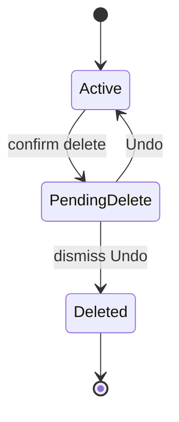
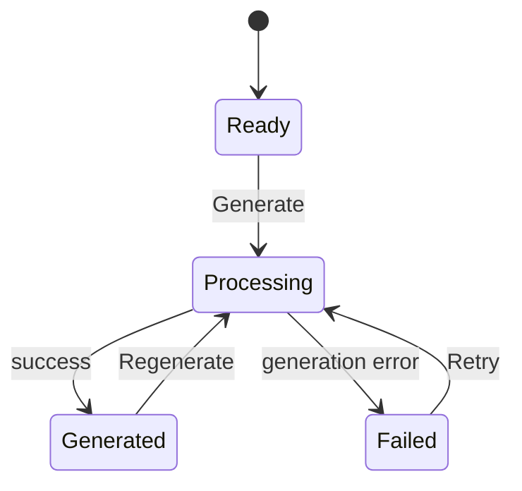
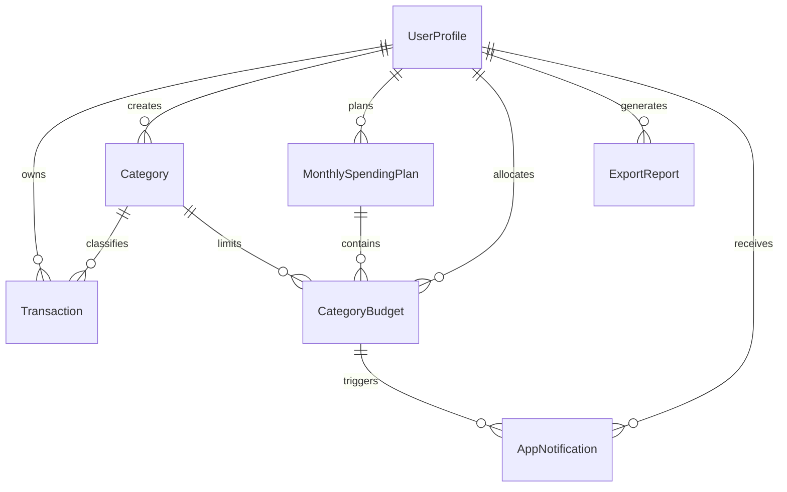

# Expense Tracker Software Requirements Specification

> Vietnamese source: [../../vi/requirements/expense-tracker-srs.md](../../vi/requirements/expense-tracker-srs.md).

## 0. Document Information

| Field | Value |
| --- | --- |
| Document ID | `SRS-EXPENSE-001` |
| Version | `0.3` |
| Status | Draft, not baselined |
| Requirements owner | PRM323 Lab 2 project team |
| Reviewers | Instructor and team members |
| Date | 2026-10-24 |
| Upstream | [`lab2.md`](lab2.md) |

### Revision History

| Version | Date | Change |
| --- | --- | --- |
| 0.1 | 2026-10-24 | Consolidated product scope, business rules, functional and non-functional requirements, and the data model. |
| 0.2 | 2026-10-24 | Standardized the SRS structure and added CRUD coverage, state machines, permissions, the error catalogue, interfaces, traceability, and change control. |
| 0.3 | 2026-10-24 | Standardized user flows, removed the Undo time limit, and added backdated-transaction behavior. |

This SRS has not been baselined. Legacy IDs in the forms `FR-01.01` and `NFR-01.01` are retained in this draft to preserve internal traceability. Before baselining, the team shall decide whether to retain the current ID scheme or migrate once to `FR-MODULE-NNN` and `NFR-CATEGORY-NNN`; IDs shall not be changed after baselining.

## 1. Purpose

This document defines the product requirements and business behavior of Expense Tracker. It is the source for the information architecture, user flows, wireframes, final UI, prototype, and Flutter handoff.

Lab 2 covers experience design and prototyping only. Storage, synchronization, performance, and security requirements are recorded so that the design does not introduce behavior that would be impractical to implement in Lab 3.

If this document conflicts with the Lab 2 brief or direct instructor guidance, the course requirement takes precedence.

### 1.1 Interpretation Precedence

When documents conflict, precedence is: official course requirements and direct instructor guidance; [`lab2.md`](lab2.md); this SRS; design specifications; then wireframes, prototypes, and handoff documents. Verbal or chat decisions take effect only after they are incorporated into the corresponding authoritative document.

### 1.2 Intended Audience

- The UX/UI team uses this SRS to define information architecture, flows, states, and the prototype.
- Reviewers use the acceptance criteria to assess scope and consistency.
- The Lab 3 implementation team uses this SRS as input to technical design and Flutter handoff.

### 1.3 References

| Document | Role |
| --- | --- |
| [`lab2.md`](lab2.md) | Mandatory lab requirements. |
| [`../research/personas/README.md`](../research/personas/README.md) | Target users, problem statement, and success criteria. |

There is no separate PRD. [`lab2.md`](lab2.md), the personas, and the decisions confirmed in this SRS are the upstream sources for this draft.

## 2. Product Overview

Expense Tracker is an Android application that helps students living away from home record daily expenses, track a monthly spending limit, and identify categories at risk of exceeding their budgets.

> Record an expense -> update totals -> review the remaining amount -> adjust spending -> export a monthly report.

The application manages a spending plan. The remaining amount shown by the application is not a bank-account balance and does not confirm that the user possesses that amount.

## 3. Users and Problem Definition

### 3.1 Target Users

The primary users are students aged 18 to 24 who:

- Live away from family and manage their own living expenses.
- Receive a monthly allowance, earn part-time income, or use both sources.
- Primarily use Android phones.
- Make many small purchases and sometimes record them after payment.
- Want to know how much they can still spend without reading complex financial reports.

The three product proto-personas are stored in [`../research/personas/`](../research/personas/README.md):

- P01, Nguyễn Minh: records an expense immediately after payment.
- P02, Trần Thảo: checks the budget before a meaningful purchase.
- P03, Lê Huy: reviews, corrects, and exports data at the end of a week or month.

### 3.2 Problem Statement

Students living away from home need a quick, understandable way to record daily expenses and track both an overall spending limit and category limits. When records are irregular or figures lack context, they often discover excessive spending only near the end of the month.

### 3.3 Measurable Goals

| ID | Goal |
| --- | --- |
| SC-01 | A user adds a valid expense and sees the spending limit updated in under 20 seconds. |
| SC-02 | From Home, a user identifies a category at risk of exceeding its budget in under 10 seconds. |
| SC-03 | A user corrects an incorrect transaction or restores a recently deleted transaction without unintended data loss. |
| SC-04 | A user selects a period, generates a PDF report, and opens it through a flow with no dead end. |

## 4. Scope

### 4.1 MVP In Scope

- Google Sign-In.
- Monthly dashboard.
- Overall monthly spending limit.
- Optional category budgets.
- Transaction list, search, filter, and sorting.
- Add, view, edit, and delete expenses.
- Default and user-created categories.
- Approaching-limit and exceeded-limit warnings.
- Monthly and category insights.
- On-device PDF report export.
- Notification Center, Profile, and sign-out.
- Loading, empty, validation-error, processing-error, and Undo states.
- Preservation of entered data after validation or save failures.

### 4.2 MVP Out of Scope

- Income tracking.
- Bank-account or e-wallet balances.
- Bank, wallet, or card synchronization.
- Transfers and payments.
- Receipt OCR and camera processing.
- Group expense sharing or social features.
- AI financial coaching.
- Investment, debt, asset, or warranty management.
- Multiple currencies and exchange rates.
- Accounting-period closing.
- iOS, web administration, and subscription billing.

## 5. Terms and Conventions

| Term | Definition |
| --- | --- |
| Period | A calendar month represented by a `YYYY-MM` string. |
| Monthly spending limit | The maximum amount a user plans to spend in a period. |
| Category budget | An optional limit assigned to one category in a period. |
| Total spent | The sum of transactions whose `occurredAt` falls within the viewed period. |
| Monthly remaining amount | Monthly spending limit minus total spent. The value may be negative. |
| Unallocated amount | Monthly spending limit minus the sum of all category-budget limits. |
| Soft limit | A warning limit. The system does not block transaction recording when the limit is reached or exceeded. |
| Backdated transaction | A transaction created today whose `occurredAt` belongs to an earlier date or period. |
| PDF snapshot | A report reflecting data at generation time that does not update afterward. |
| Default category | A category available to every user. |
| Archived category | A category unavailable for new transactions but retained for historical data. |

The terms “shall,” “shall not,” and “only” indicate mandatory requirements. “Should” indicates a recommendation that may change when the reason is documented.

## 6. Assumptions and Constraints

| ID | Constraint |
| --- | --- |
| CON-01 | The MVP uses VND only. |
| CON-02 | Monetary values are stored as integers in đồng. |
| CON-03 | Every transaction belongs to exactly one category. |
| CON-04 | All monthly calculations use `occurredAt`, never `createdAt`. |
| CON-05 | Lab 2 does not implement Flutter or a backend. |
| CON-06 | Final UI uses a `360 x 800 dp` frame and is also checked at `412 dp` width. |
| CON-07 | The system uses the device time zone to determine dates and periods. The MVP does not handle cross-time-zone transactions. |

## 7. Business Rules

### 7.1 Monthly Limits and Totals

| ID | Rule |
| --- | --- |
| BR-01 | A user shall have at most one monthly spending limit per period. |
| BR-02 | The monthly spending limit shall be an integer greater than 0. |
| BR-03 | Category budgets are optional and may be created only after a monthly plan exists for the period. A user may still record a transaction in a category without a category budget. |
| BR-04 | Monthly total spent includes every transaction in the period, including transactions in categories without a category budget. |
| BR-05 | `remainingAmount = spendingLimit - totalSpent`. |
| BR-06 | `usageRatio = totalSpent / spendingLimit`. If no monthly spending limit exists, the system shall not display a usage ratio. |
| BR-07 | `unallocatedAmount = spendingLimit - sum(categoryBudget.limitAmount)`. |
| BR-08 | The sum of category budgets shall not exceed the monthly spending limit. The form shall show the excess amount and shall not save. |
| BR-09 | Spending limits are soft limits. The system shall continue to allow transaction creation and editing after a limit is exceeded. |
| BR-10 | The remaining amount may be negative. The unallocated amount may be zero but shall not be negative. |

Example: the monthly spending limit is `5,000,000đ`; the Food budget is `2,000,000đ`; the Housing budget is `2,000,000đ`. The unallocated amount is `1,000,000đ`. A `500,000đ` vehicle-repair transaction is included in monthly total spent even though Vehicle Repair has no category budget.

### 7.2 Category Budgets and Warnings

| ID | Rule |
| --- | --- |
| BR-11 | A user shall have at most one budget for the same `categoryId` and `period`. |
| BR-12 | A category limit shall be an integer greater than 0. |
| BR-13 | The `warningThreshold` of a monthly plan or category budget is a decimal greater than 0 and less than 1. Its default is `0.8`. |
| BR-14 | `categorySpent` is the sum of transactions with the same `categoryId` whose `occurredAt` falls within the budget period. |
| BR-15 | A monthly plan or category budget is `safe` when its usage ratio is below `warningThreshold`. |
| BR-16 | The `warning` state applies from `warningThreshold` through 100%. |
| BR-17 | The `exceeded` state applies when the usage ratio is greater than 100%. |
| BR-18 | When a monthly or category limit is exceeded, the UI shall display the actual ratio and excess amount. The progress bar may stop at 100% width to preserve the layout. |
| BR-19 | Every budget state shall include text or an icon. Color shall not be the sole indicator. |

### 7.3 Transactions and Periods

| ID | Rule |
| --- | --- |
| BR-20 | A transaction period is determined from `occurredAt`. |
| BR-21 | `createdAt` and `updatedAt` are used only for auditing and technical sorting. They do not participate in budget calculations. |
| BR-22 | When a backdated transaction is added, the system updates the period containing its `occurredAt`. |
| BR-23 | When an edited date moves a transaction to another period, the system updates both the old and new periods. |
| BR-24 | When an amount or category is edited, the system updates the relevant totals immediately after a successful save. |
| BR-25 | When a transaction is deleted or restored, the system updates total spent, remaining amount, category budgets, and Insights. |
| BR-26 | An amount equal to or less than 0 is invalid. |
| BR-27 | A future transaction date is invalid. |

### 7.4 Categories

| ID | Rule |
| --- | --- |
| BR-28 | A default category has `ownerId = null` and `isDefault = true`. |
| BR-29 | A user-created category has that user's `ownerId` and `isDefault = false`. |
| BR-30 | A user shall not rename or archive a default category. |
| BR-31 | Custom category names shall be unique per user after trimming and case-insensitive comparison. |
| BR-32 | A category referenced by a transaction or budget shall not be physically deleted. The system archives it. |
| BR-33 | An archived category shall not appear when creating a transaction or budget. |
| BR-34 | Historical transactions and reports shall continue to display archived categories. |

### 7.5 Delete and Undo

| ID | Rule |
| --- | --- |
| BR-35 | Transaction deletion requires a confirmation dialog that clearly identifies the affected transaction. |
| BR-36 | After confirmation, the transaction enters pending deletion, disappears from the UI, and no longer participates in calculations. The record remains available for Undo. |
| BR-37 | The system displays an App Shell-level Snackbar with an Undo action until the user chooses Undo or explicitly dismisses the notification. The Snackbar shall not expire automatically and remains visible across destinations. |
| BR-38 | If the user chooses Undo, the system cancels pending deletion, returns the transaction to the UI, and recalculates totals. |
| BR-39 | If the user dismisses the Snackbar without choosing Undo, the system completes deletion. If the application closes while deletion is pending, the state shall persist and the Snackbar shall reappear in the next session. |
| BR-40 | If restoration fails, the system shall explain why and allow another attempt. |

### 7.6 PDF Reports

| ID | Rule |
| --- | --- |
| BR-41 | A report uses transactions whose `occurredAt` falls within the selected period. |
| BR-42 | A report is a snapshot at generation time. Later data changes do not modify an existing file. |
| BR-43 | If period data changes, the user may generate a new report. |
| BR-44 | If a period has no transactions, the system shall not create a PDF and shall display an empty state. |
| BR-45 | The PDF is generated on the device. The MVP does not require upload to cloud storage. |
| BR-46 | A report shall contain the period, generation time, total spent, category breakdown, and transaction list. |

## 8. Functional Requirements

### 8.0 Actors, Sources, and Priorities

The primary actor for every FR is an authenticated user, except FR-01 for unauthenticated users and explicitly identified system tasks. There is no AI-agent consumer.

| Module | ID | Priority | Rationale | Source |
| --- | --- | --- | --- | --- |
| Authentication | FR-01.01 through FR-01.07 | P0 | The sole entry point and Lab 3 owner-data boundary. | MVP scope, LAB2 handoff |
| Dashboard | FR-02.01 through FR-02.10 | P0 | Required for SC-01 and SC-02 and starts the primary flow. | P01, P02, SC-01, SC-02 |
| Transactions | FR-03.01 through FR-03.14 | P0 | Recording and correcting expenses is the product's core behavior. | P01, P03, FL-01, FL-02 |
| Monthly plan | FR-04.01 through FR-04.05 | P0 | Provides the denominator for remaining amount and usage ratio. | Business review, BR-01 through BR-10 |
| Category budget | FR-05.01 through FR-05.08 | P0 | Provides category warnings for SC-02. | P02, BR-11 through BR-19 |
| Category management | FR-06.01 through FR-06.06 | P1 | Default categories suffice for the demo; custom categories support real data. | MVP scope, data-integrity review |
| Insights | FR-07.01 through FR-07.06 | P1 | Supports review but does not block expense entry. | P02, P03 |
| PDF export | FR-08.01 through FR-08.08 | P0 | One of the three mandatory flows and SC-04. | LAB2 prototype, P03, SC-04 |
| Notifications | FR-09.01 through FR-09.05 | P1 | Home and Budget Detail provide alternative paths. | MVP scope |
| Profile | FR-10.01 through FR-10.04 | P1 | Required for account context and secondary entry points. | MVP scope |
| Navigation/recovery | FR-11.01 through FR-11.06 | P0 | A prototype fails if it contains dead ends or lacks recovery. | LAB2 §1 and §7 |

Each FR is accepted through the related business rules, input rules, error catalogue, and acceptance scenarios. Read-only FRs have no actor-supplied input; input FRs use §8.12. Main and alternative flows are standardized in FL-01 through FL-03; operations outside those flows follow the state and error behavior in §8.14 through §8.16.

### 8.1 FR-01 Authentication and User Session

| ID | Requirement |
| --- | --- |
| FR-01.01 | An unauthenticated user shall access only Login. |
| FR-01.02 | The system shall provide a Google Sign-In action. |
| FR-01.03 | During sign-in, the action shall show loading and reject repeated interaction. |
| FR-01.04 | If sign-in fails or is cancelled, the system shall retain the user on Login and display an appropriate message. |
| FR-01.05 | After successful sign-in, the system shall open Home. |
| FR-01.06 | Profile shall display the current account's avatar, name, and email. |
| FR-01.07 | Sign-out shall require confirmation. After completion, the system shall return to Login and shall not allow Back navigation into the App Shell. |

### 8.2 FR-02 Home Dashboard

| ID | Requirement |
| --- | --- |
| FR-02.01 | Home shall display the viewed period and allow navigation among periods with data. |
| FR-02.02 | When a period has a monthly plan, Home shall display the limit, total spent, remaining amount, and usage ratio. |
| FR-02.03 | When a period has no monthly plan, Home shall display total spent and an action to set a limit. |
| FR-02.04 | Home shall distinguish a negative remaining amount with text, an icon, or a status label. |
| FR-02.05 | Home shall display up to five most recent transactions ordered by `occurredAt` descending. |
| FR-02.06 | Home shall display up to three categories with the highest total spending in the period. |
| FR-02.07 | Home shall provide the primary action `Add expense`. |
| FR-02.08 | Selecting a recent transaction shall open the corresponding Transaction Detail. |
| FR-02.09 | Selecting a highlighted category shall open the transaction list filtered by that category and period. |
| FR-02.10 | Home shall provide loading, empty, populated, and error states. The error state shall provide Retry. |

### 8.3 FR-03 Transaction Management

| ID | Requirement |
| --- | --- |
| FR-03.01 | A user shall be able to view transactions by period. |
| FR-03.02 | The list shall support search by merchant or note. |
| FR-03.03 | The list shall support filtering by category. |
| FR-03.04 | The list shall support sorting by date or amount. |
| FR-03.05 | A user shall be able to view transaction details. |
| FR-03.06 | A user shall be able to add and edit a transaction. |
| FR-03.07 | The form shall require amount, category, and occurrence date. |
| FR-03.08 | Merchant and note are optional. |
| FR-03.09 | The form shall validate that amount is greater than 0 and that the date is not in the future. |
| FR-03.10 | The form shall display each error at the relevant field and preserve all entered data. |
| FR-03.11 | During saving, Save shall show loading and reject repeated interaction. |
| FR-03.12 | After a successful save, the system shall return to the source screen with updated figures. If `occurredAt` belongs to a period other than the viewed period, the system shall identify the updated period and provide an action to open it. |
| FR-03.13 | If saving fails, the system shall keep the user on the same TX-02 form, preserve the data, allow direct editing, explain the error, and provide Retry. Save Failed is not a separate screen and shall not show a `Back to Edit` action. |
| FR-03.14 | A user shall be able to delete a transaction according to BR-35 through BR-40. |

### 8.4 FR-04 Monthly Spending Plan

| ID | Requirement |
| --- | --- |
| FR-04.01 | A user shall be able to create and edit the monthly spending limit for a selected period. |
| FR-04.02 | The form shall validate that the limit is an integer greater than 0. |
| FR-04.03 | Plan detail shall display the limit, total spent, remaining amount, ratio, and unallocated amount. |
| FR-04.04 | If total spent exceeds a new limit, the system shall allow saving and warn that the period will be `exceeded`. |
| FR-04.05 | If total category budgets exceed a new limit, the system shall not save and shall display the amount requiring adjustment. |

### 8.5 FR-05 Category Budgets

| ID | Requirement |
| --- | --- |
| FR-05.01 | A user shall be able to create and edit a category budget for a period. |
| FR-05.02 | The system shall not create two budgets for the same category and period. |
| FR-05.03 | The form shall validate that the category limit is greater than 0. |
| FR-05.04 | The form shall validate that total allocation does not exceed the monthly spending limit. |
| FR-05.05 | Budget Detail shall display the limit, amount spent, remaining amount, ratio, status, and source transactions. |
| FR-05.06 | A warning shall identify the category, usage ratio or amount, and next step. |
| FR-05.07 | A user shall remain able to record transactions when a budget is `warning` or `exceeded`. |
| FR-05.08 | If a period has no monthly plan, the system shall direct the user to create one before creating a category budget. |

### 8.6 FR-06 Category Management

| ID | Requirement |
| --- | --- |
| FR-06.01 | The system shall provide a set of default categories. |
| FR-06.02 | A user shall be able to create a custom category with a name, icon, and color. |
| FR-06.03 | The form shall prevent duplicate names according to BR-31. |
| FR-06.04 | A user shall be able to edit a category they created. |
| FR-06.05 | A user shall be able to archive a custom category according to BR-32 through BR-34. |
| FR-06.06 | Before archiving, the dialog shall explain that historical data is retained and the category becomes unavailable for new transactions. |

### 8.7 FR-07 Insights

| ID | Requirement |
| --- | --- |
| FR-07.01 | Insights shall display total spending for the period. |
| FR-07.02 | Insights shall display spending distribution by category. |
| FR-07.03 | Every chart shall include a legend and a text summary conveying the same information. |
| FR-07.04 | Selecting a category shall open the filtered list of source transactions. |
| FR-07.05 | If the period has no transactions, Insights shall display an empty state and an action to add an expense. |
| FR-07.06 | Insights shall provide an action to open Export Report. |

### 8.8 FR-08 PDF Export

| ID | Requirement |
| --- | --- |
| FR-08.01 | A user shall be able to select the period to export. |
| FR-08.02 | Before generation, the screen shall identify report contents and the period's transaction count. |
| FR-08.03 | The system shall block report generation when the period has no transactions. |
| FR-08.04 | The UI shall represent processing, ready, and failed states. |
| FR-08.05 | During processing, Generate shall reject repeated interaction. |
| FR-08.06 | After successful generation, a user shall be able to open the PDF. |
| FR-08.07 | If generation fails, the system shall retain the selected period, explain the error, and provide Retry. |
| FR-08.08 | The report shall comply with BR-41 through BR-46. |

### 8.9 FR-09 Notifications

| ID | Requirement |
| --- | --- |
| FR-09.01 | Notification Center shall display the newest warnings first. |
| FR-09.02 | Every notification shall have a read or unread state. |
| FR-09.03 | Selecting a warning shall open the corresponding Budget Detail and period. |
| FR-09.04 | If the target budget is unavailable, the system shall explain the condition and direct the user to Budgets. |
| FR-09.05 | Notification status shall not be conveyed through color alone. |

### 8.10 FR-10 Profile

| ID | Requirement |
| --- | --- |
| FR-10.01 | Profile shall display current account information. |
| FR-10.02 | Profile shall display VND as the fixed currency. |
| FR-10.03 | Profile shall provide entry points to Notification Center and Export Report. |
| FR-10.04 | Profile shall provide sign-out according to FR-01.07. |

### 8.11 FR-11 Navigation and Recovery

| ID | Requirement |
| --- | --- |
| FR-11.01 | The App Shell has four destinations: Home, Transactions, Budgets, and Profile. |
| FR-11.02 | Add Expense shall be accessible from Home and Transactions. |
| FR-11.03 | Back shall return to the correct source and preserve current-session filters. |
| FR-11.04 | No flow shall end on a screen without an action to continue or return. |
| FR-11.05 | Every asynchronous operation shall have a loading or processing state. |
| FR-11.06 | Every recoverable error shall identify its cause and provide Retry. |

### 8.12 Input Field Rules

| Form / field | Type | Required | Constraints and default | Rejection |
| --- | --- | --- | --- | --- |
| Transaction `amount` | Int64 | Yes | `1..9,999,999,999` VND; no default | Out of range or not an integer: `VAL_AMOUNT_RANGE` |
| Transaction `categoryId` | String | Yes | Category exists, is permitted, and is not archived | Missing: `VAL_CATEGORY_REQUIRED`; invalid: `REF_CATEGORY_INVALID` |
| Transaction `occurredAt` | LocalDate | Yes | Defaults to current date; no later than current device-local date | Invalid format: `VAL_DATE_FORMAT`; future date: `VAL_DATE_FUTURE` |
| Transaction `merchant` | String | No | Trimmed; maximum 100 characters; empty string becomes null | Too long: `VAL_MERCHANT_LENGTH` |
| Transaction `note` | String | No | Trimmed; maximum 200 characters; empty string becomes null | Too long: `VAL_NOTE_LENGTH` |
| Monthly plan `period` | String | Yes | Valid `YYYY-MM`; defaults to current period | Invalid format: `VAL_PERIOD_FORMAT` |
| Monthly plan `spendingLimit` | Int64 | Yes | `1..99,999,999,999` VND | Out of range: `VAL_LIMIT_RANGE` |
| Budget `categoryId` | String | Yes | Valid category; one budget per category per period | Duplicate: `DUP_CATEGORY_BUDGET` |
| Budget `limitAmount` | Int64 | Yes | `1..spendingLimit`; total allocation does not exceed monthly limit | Out of range: `VAL_LIMIT_RANGE`; allocation exceeded: `BUDGET_ALLOCATION_EXCEEDED` |
| `warningThreshold` | Decimal | No | `0 < n < 1`; default `0.8` | Out of range or wrong type: `VAL_THRESHOLD_RANGE` |
| Category `name` | String | Yes | Trimmed; 1 to 50 characters; unique per owner, case-insensitive | Empty/too long: `VAL_CATEGORY_NAME`; duplicate: `DUP_CATEGORY_NAME` |
| Category `iconName` | String | Yes | A value from the design-system icon set | Unsupported: `VAL_ICON_INVALID` |
| Category `colorToken` | String | Yes | A semantic token from the design system | Unsupported: `VAL_COLOR_TOKEN_INVALID` |
| Export `period` | String | Yes | Valid `YYYY-MM`; defaults to viewed period | Invalid format: `VAL_PERIOD_FORMAT` |

### 8.13 CRUD Matrix

| Entity | Create | Read | Update | Delete / archive |
| --- | --- | --- | --- | --- |
| UserProfile | FR-01.02 | FR-01.06, FR-10.01 | Through the Google account, outside MVP | FR-01.07 ends the session only; it does not delete the profile |
| Transaction | FR-03.06 | FR-03.01, FR-03.05 | FR-03.06 | FR-03.14 |
| Category | FR-06.02 | FR-03.07, FR-06.01 | FR-06.04 | FR-06.05, archive |
| MonthlySpendingPlan | FR-04.01 | FR-02.02, FR-04.03 | FR-04.01 | Not supported in MVP |
| CategoryBudget | FR-05.01 | FR-05.05 | FR-05.01 | Not supported in MVP |
| ExportReport | FR-08.06 | FR-08.06 | N/A; a report is a snapshot | The user manages the file on the device |
| AppNotification | Created by the system under BR-15 through BR-17 | FR-09.01 | FR-09.02 | Not supported in MVP |

### 8.14 State Machines

#### Transaction Deletion

| From | To | Trigger | Guard | Requirement |
| --- | --- | --- | --- | --- |
| Active | PendingDelete | User confirms deletion | Transaction belongs to the current user | FR-03.14, BR-35 |
| PendingDelete | Active | Undo | Transaction remains in PendingDelete | BR-38 |
| PendingDelete | Deleted | User dismisses Snackbar | Undo was not selected | BR-39 |

Every other transition is hard-rejected with `STATE_TRANSACTION_INVALID`, does not change data, and produces no side effect. PendingDelete shall be persisted so that Undo can be restored after the application restarts.

#### Export Report

Generate for an empty period is rejected with `REPORT_EMPTY_PERIOD`. Generate while Processing is idempotently ignored and does not create a second job. All other transitions are rejected with `STATE_REPORT_INVALID` and produce no side effect.

### 8.15 Permission Matrix

| Role | Create | Read | Update | Delete | Data scope |
| --- | --- | --- | --- | --- | --- |
| Unauthenticated | No | Login only | No | No | No business data |
| Authenticated user | Yes | Yes | Yes | Yes, subject to entity limits | Records whose `ownerId` equals the current principal; may read default Categories whose `ownerId = null` |
| System | Notifications and report metadata | Principal data required for calculations | Notification state and calculated values | Completes Transaction deletion after the user dismisses Undo | Only within tasks initiated by the principal |

Access to another user's record is denied as not found (`RESOURCE_NOT_FOUND`) so that its existence is not disclosed. The UI shall not display unauthorized actions.

### 8.16 Error Catalogue

| Code | Condition | User message | Recovery | Source |
| --- | --- | --- | --- | --- |
| `AUTH_CANCELLED` | User cancels Google Sign-In | Sign-in was cancelled. | Try again when needed. | FR-01.04 |
| `AUTH_UNAVAILABLE` | Google Sign-In is unavailable | Unable to connect to Google. Please try again. | Fail closed; remain on Login. | FR-01.04 |
| `VAL_AMOUNT_RANGE` | Amount has the wrong type or is outside the range | Enter an amount greater than 0. | Correct the field; preserve other inputs. | FR-03.09 |
| `VAL_CATEGORY_REQUIRED` | Category is missing | Select a category. | Select a category. | FR-03.07 |
| `REF_CATEGORY_INVALID` | Category does not exist, is archived, or is unauthorized | This category is no longer available. Select another category. | Reload available choices. | FR-03.07 |
| `VAL_DATE_FORMAT` | Date format is invalid | Enter a valid date. | Correct the date. | FR-03.09 |
| `VAL_DATE_FUTURE` | `occurredAt` is after the current date | The transaction date cannot be in the future. | Select a valid date. | FR-03.09 |
| `VAL_MERCHANT_LENGTH` | Merchant exceeds 100 characters | Merchant name cannot exceed 100 characters. | Shorten the value. | FR-03.08 |
| `VAL_NOTE_LENGTH` | Note exceeds 200 characters | Note cannot exceed 200 characters. | Shorten the value. | FR-03.08 |
| `SAVE_LOCAL_FAILED` | Durable on-device save fails | Unable to save the expense. Your data is preserved. | Stay on TX-02 to edit directly or Retry; do not report success or show `Back to Edit`. | FR-03.13 |
| `DUP_CATEGORY_BUDGET` | A budget already exists for the category and period | This category already has a budget for the period. | Open and edit the existing budget. | FR-05.02 |
| `BUDGET_ALLOCATION_EXCEEDED` | Total sub-caps exceed `spendingLimit` | Total allocation exceeds the monthly limit. | Reduce one or more limits; the UI shows excess calculated from current input. | FR-05.04 |
| `VAL_THRESHOLD_RANGE` | Threshold is not between 0 and 1 | Warning threshold must be greater than 0% and less than 100%. | Correct the threshold. | BR-13 |
| `DUP_CATEGORY_NAME` | Category name is duplicated | This category already exists. | Rename it or use the existing category. | FR-06.03 |
| `REPORT_EMPTY_PERIOD` | Period has no transactions | This period has no expense data to export. | Select another period or add an expense. | FR-08.03 |
| `REPORT_GENERATION_FAILED` | PDF generation fails | Unable to generate the report. The selected period is preserved. | Retry; do not create successful metadata. | FR-08.07 |
| `RESOURCE_NOT_FOUND` | Record does not exist or does not belong to the principal | This data could not be found. | Return to the list and reload. | §8.15 |
| `STATE_TRANSACTION_INVALID` | Invalid deletion-state transition | This action cannot be performed in the current state. | Reload data. | §8.14 |
| `STATE_REPORT_INVALID` | Invalid report-state transition | The report is not in a suitable state. | Wait for the current state to finish or Retry. | §8.14 |

## 9. Information Architecture

The information architecture, screen catalogue, and navigation rules are maintained in [Information Architecture](../ux/information-architecture.md). That document is authoritative for screen structure; all screens remain subject to the FRs, BRs, and acceptance criteria in this SRS.

## 10. Three Mandatory User Flows

The SRS retains `FL-01`, `FL-02`, and `FL-03` as traceability contracts. Diagrams, interaction sequences, alternative branches, recovery paths, Back behavior, and the flow-to-screen matrix are maintained in [User Flows](../ux/user-flows.md).

## 11. Logical Data Model

The following types express logical constraints. A storage technology may map them to equivalent types.

### 11.1 UserProfile

| Field | Type | Required | Rule |
| --- | --- | --- | --- |
| `id` | String | Yes | Unique identifier from the authentication system. |
| `displayName` | String | Yes | Not empty after trimming. |
| `email` | String | Yes | Valid email from Google Sign-In. |
| `photoUrl` | String | No | Avatar image URL. |
| `currencyCode` | String | Yes | Fixed as `VND` in MVP. |
| `createdAt` | DateTime | Yes | Profile creation time. |
| `updatedAt` | DateTime | Yes | Most recent update time. |

### 11.2 Transaction

| Field | Type | Required | Rule |
| --- | --- | --- | --- |
| `id` | String | Yes | Unique identifier. |
| `ownerId` | String | Yes | References UserProfile. |
| `amount` | Int64 | Yes | In đồng; greater than 0. |
| `categoryId` | String | Yes | References Category. |
| `merchant` | String | No | Maximum 100 characters after trimming. |
| `note` | String | No | Maximum 200 characters. |
| `occurredAt` | LocalDate | Yes | Not in the future. |
| `createdAt` | DateTime | Yes | Record creation time. |
| `updatedAt` | DateTime | Yes | Most recent update time. |

### 11.3 Category

| Field | Type | Required | Rule |
| --- | --- | --- | --- |
| `id` | String | Yes | Unique identifier. |
| `ownerId` | String | No | Null for a default category. |
| `name` | String | Yes | 1 to 50 characters after trimming. |
| `iconName` | String | Yes | Supported icon name. |
| `colorToken` | String | Yes | Semantic token; arbitrary color codes are not stored. |
| `isDefault` | Boolean | Yes | True for a system category. |
| `isArchived` | Boolean | Yes | Defaults to false. |
| `createdAt` | DateTime | Yes | Creation time. |
| `updatedAt` | DateTime | Yes | Most recent update time. |

### 11.4 MonthlySpendingPlan

| Field | Type | Required | Rule |
| --- | --- | --- | --- |
| `id` | String | Yes | Unique identifier. |
| `ownerId` | String | Yes | References UserProfile. |
| `period` | String | Yes | `YYYY-MM` format. |
| `spendingLimit` | Int64 | Yes | In đồng; greater than 0. |
| `warningThreshold` | Decimal | Yes | Greater than 0 and less than 1; defaults to `0.8`. |
| `createdAt` | DateTime | Yes | Creation time. |
| `updatedAt` | DateTime | Yes | Most recent update time. |

Unique constraint: `ownerId + period`.

### 11.5 CategoryBudget

| Field | Type | Required | Rule |
| --- | --- | --- | --- |
| `id` | String | Yes | Unique identifier. |
| `ownerId` | String | Yes | References UserProfile. |
| `categoryId` | String | Yes | References Category. |
| `period` | String | Yes | `YYYY-MM` format. |
| `limitAmount` | Int64 | Yes | In đồng; greater than 0. |
| `warningThreshold` | Decimal | Yes | Greater than 0 and less than 1; defaults to `0.8`. |
| `createdAt` | DateTime | Yes | Creation time. |
| `updatedAt` | DateTime | Yes | Most recent update time. |

Unique constraint: `ownerId + categoryId + period`.

### 11.6 ExportReport

| Field | Type | Required | Rule |
| --- | --- | --- | --- |
| `id` | String | Yes | Unique identifier. |
| `ownerId` | String | Yes | References UserProfile. |
| `period` | String | Yes | `YYYY-MM` format. |
| `fileName` | String | Yes | Valid Android file name. |
| `itemCount` | Int32 | Yes | Number of transactions in the snapshot; greater than 0. |
| `totalAmount` | Int64 | Yes | Total spent in the snapshot. |
| `generatedAt` | DateTime | Yes | Report generation time. |

`ExportReport` stores only generation metadata. The URI used to open or share the file belongs to the PDF-generation session and is not stored as business data. If the device file no longer exists, the user regenerates the report from source data.

### 11.7 AppNotification

| Field | Type | Required | Rule |
| --- | --- | --- | --- |
| `id` | String | Yes | Unique identifier. |
| `ownerId` | String | Yes | References UserProfile. |
| `type` | Enum | Yes | `budgetWarning` or `budgetExceeded`. |
| `title` | String | Yes | Short, non-empty title. |
| `body` | String | Yes | States the cause and context. |
| `targetId` | String | Yes | ID of the related CategoryBudget. |
| `period` | String | Yes | Warning period. |
| `isRead` | Boolean | Yes | Defaults to false. |
| `createdAt` | DateTime | Yes | Creation time. |

### 11.8 Calculated Values

The following values need not be stored when they can be calculated consistently from source data:

- `totalSpent`
- `remainingAmount`
- `unallocatedAmount`
- `usageRatio`
- `categorySpent`
- `categoryRemaining`
- `budgetStatus`

If the implementation caches these values, the cache shall update after every transaction creation, edit, deletion, or restoration.

### 11.9 Integrity and Retention Policy

- Every user-owned record shall have a valid `ownerId`.
- `Transaction`, `MonthlySpendingPlan`, `CategoryBudget`, `ExportReport`, and `AppNotification` shall not be accessed across owners.
- VND values use integers; Float and Double shall not be used.
- Periods use `YYYY-MM`; business dates use `LocalDate`; audit timestamps use UTC `DateTime`.
- A referenced Category shall be archived instead of physically deleted.
- A Transaction is physically deleted when the user dismisses the Snackbar without choosing Undo. PendingDelete shall persist across restarts until the user completes or reverses the operation.
- The MVP does not define account deletion or data-retention periods. This is open question `OQ-01` before Lab 3.

## 11A. External Interface Requirements

### 11A.1 User Interface

- The application uses mobile-first Android screens, with a standard `360 x 800 dp` frame and a check at `412 dp`.
- The App Shell contains Home, Transactions, Budgets, and Profile.
- Text, touch targets, contrast, states, and responsive behavior shall comply with [`lab2.md`](lab2.md) and the design specification once that document has been approved.
- Every flow shall provide appropriate Back behavior and loading, empty, error, and recovery states.

### 11A.2 Hardware Interface

No peripheral is required. The application needs a touch screen and device storage for local data, PDF generation, and PDF opening. Camera, NFC, and biometrics are outside MVP scope.

### 11A.3 Software Interface

| Interface | Purpose | Behavior when unavailable |
| --- | --- | --- |
| Google Sign-In | Authenticate and obtain name, email, and avatar | Fail closed at Login; do not create a fake local session. |
| Android document/PDF viewer | Open or share a report | Preserve metadata; state that no application can open the file and allow retry/sharing. |
| Local persistence | Store transactions, plans, budgets, and categories | Do not report success; preserve the form and provide Retry. |
| Remote sync, if implemented in Lab 3 | Synchronize locally stored data | Local-first; queue retries and do not lose local records. Retry duration is open question `OQ-02`. |

### 11A.4 Communication Interface

Lab 2 does not define a network protocol. If Lab 3 has a backend, all traffic shall use HTTPS and payloads shall follow a schema defined by the technical design. This SRS does not mandate REST, GraphQL, Firebase, or a specific vendor.

## 12. Interface States

| Area | Required states |
| --- | --- |
| Login | Idle, loading, error. |
| Home | Loading, empty, populated, error, no monthly plan. |
| Transaction form | Default, validation error, saving, save failed. |
| Transaction list | Loading, empty, populated, filtered empty, error, deleted with Undo. |
| Monthly plan | No plan, safe, warning, exceeded, form error. |
| Category budget | Safe, warning, exceeded, no source transactions. |
| Insights | Loading, empty, populated, error. |
| Export report | Empty period, ready to generate, processing, generated, failed. |
| Notifications | Loading, empty, populated, error. |

## 13. Non-Functional Requirements

Each NFR uses Test, Demonstration, Inspection, or Analysis. Lab 2 accepts only NFRs measurable from the design; NFRs marked “Lab 3” are baselined for implementation.

### 13.1 NFR-01 Usability

| ID | Requirement |
| --- | --- |
| NFR-01.01 | A primary action shall use a label that describes its result, such as `Save expense` or `Generate report`. |
| NFR-01.02 | A form shall not clear entered data after a validation error or retryable save failure. |
| NFR-01.03 | Each screen shall have only one visually prominent primary action. |
| NFR-01.04 | Financial states shall use neutral, non-judgmental language. |

### 13.2 NFR-02 Accessibility

| ID | Requirement |
| --- | --- |
| NFR-02.01 | Normal text shall have a minimum contrast ratio of `4.5:1`. |
| NFR-02.02 | Large text and UI controls shall have a minimum contrast ratio of `3:1`. |
| NFR-02.03 | Touch targets shall be at least `48 x 48 dp`. |
| NFR-02.04 | Body text shall be at least `14 sp`. |
| NFR-02.05 | State shall not be conveyed through color alone. |
| NFR-02.06 | An actionable icon shall have a semantic label. |
| NFR-02.07 | Focus order shall follow reading and interaction order. |

### 13.3 NFR-03 Responsive Layout

| ID | Requirement |
| --- | --- |
| NFR-03.01 | The layout shall work at `360 dp` and `412 dp` without clipping content or actions. |
| NFR-03.02 | At `600 dp` and above, content shall have a maximum width or use the layout documented in the handoff. |
| NFR-03.03 | Screens shall support content longer than the mockup without overlap. |

### 13.4 NFR-04 Lab 3 Performance

Metrics are measured on an Android device with at least 4 GB RAM, using on-device data and up to 10,000 transactions for one user.

| ID | Requirement |
| --- | --- |
| NFR-04.01 | Home shall display the latest stored data within 1.5 seconds at the 95th percentile. |
| NFR-04.02 | After Save is selected, the UI shall show feedback within 300 milliseconds at the 95th percentile. |
| NFR-04.03 | Search and filtering shall update results within 500 milliseconds at the 95th percentile. |
| NFR-04.04 | PDF generation shall display processing when it takes longer than 300 milliseconds. |

### 13.5 NFR-05 Lab 3 Data and Connectivity

| ID | Requirement |
| --- | --- |
| NFR-05.01 | A transaction shall be persisted on the device before the system reports success. |
| NFR-05.02 | A user shall be able to add, edit, and view the latest stored data without network access. |
| NFR-05.03 | If remote synchronization exists, a synchronization failure shall not lose a record stored on the device. |
| NFR-05.04 | The UI shall distinguish validation, on-device persistence, and synchronization failures. |
| NFR-05.05 | This SRS does not mandate SQLite, Room, or a specific storage vendor. |

### 13.6 NFR-06 Lab 3 Security and Privacy

| ID | Requirement |
| --- | --- |
| NFR-06.01 | A user shall read and modify only data with their `ownerId`. |
| NFR-06.02 | Authentication tokens shall not be logged or stored as plain text. |
| NFR-06.03 | Logs shall not contain transaction notes, full email addresses, or private file paths. |
| NFR-06.04 | A PDF shall be shared only after an explicit user action. |
| NFR-06.05 | Sign-out shall clear session information. The offline-data retention policy shall be documented in the Lab 3 handoff. |

### 13.7 NFR-07 Consistency

| ID | Requirement |
| --- | --- |
| NFR-07.01 | The same monetary value shall use the same format on every screen. |
| NFR-07.02 | Every period shall display month and year. |
| NFR-07.03 | Totals on Home, Budgets, Insights, and PDF shall use the same transaction set and calculation rules. |
| NFR-07.04 | Components shall use semantic tokens and variants from the design system. |

### 13.8 Rationale and Verification Matrix

| NFR | Metric and target | Rationale | Verification |
| --- | --- | --- | --- |
| NFR-01.01 through 01.04 | 100% of actions/states comply with wording rules | Reduces incorrect actions in the three time-limited flows | Inspection of 10+ Final UI screens |
| NFR-02.01 through 02.07 | Contrast, 48 dp, 14 sp, icon/text, and focus order meet their stated targets | Mandatory thresholds from LAB2 §6 | Inspection using a contrast tool and Figma measurements at 360/412 dp |
| NFR-03.01 through 03.03 | No clipping/overlap at 360, 412, and 600+ dp | Three breakpoints specified by LAB2 and the design specification | Demonstration using frames and longest content |
| NFR-04.01 | Home p95 <= 1.5 seconds | Stakeholder-approved target for a local-first application | 30 test runs on a 4 GB RAM device with 10,000 transactions |
| NFR-04.02 | UI feedback p95 <= 300 ms | Prevents repeated taps during quick checkout entry | 30 test runs in the same environment |
| NFR-04.03 | Search/filter p95 <= 500 ms | Keeps review usable with the maximum dataset | 30 representative queries over 10,000 transactions |
| NFR-04.04 | Processing appears after 300 ms | Avoids an unresponsive state | Test with controlled delayed PDF generation |
| NFR-05.01 through 05.05 | 0 transactions lost during offline/sync-failure test suite | P01 requires input and data retention on weak connectivity | Test in airplane mode, after restart, and with sync failure; inspect that no vendor is mandated |
| NFR-06.01 through 06.05 | 0 cross-owner access; 0 prohibited secrets/PII in sample logs | Expense data is private, owner-scoped data | Security test with two principals and inspection of logs/configuration |
| NFR-07.01 through 07.04 | 100% of sample screens use the same formats, periods, formulas, and tokens | Prevents conflicting values across Home, Budget, Insights, and PDF | Inspection through design audit and test with one shared fixture |

## 14. Content Rules

- Content uses short, neutral sentences that accurately describe the state.
- Do not use judgmental language such as “You spend terribly” or “You failed.”
- A warning states the category, amount or ratio, and next action.
- Monetary values always use the `đ` symbol and consistent thousands separators.
- A period always displays both month and year.
- A destructive action explains its effect before confirmation.
- An error message states what failed and what the user can do next.

Examples:

- Use: `Food has used 84% of its October 2026 limit.`
- Use: `Unable to save the expense. Your data is preserved. Please try again.`
- Avoid: `You are spending too much!`
- Avoid: `An error occurred.`

## 15. Overall Acceptance Criteria

| ID | Criterion |
| --- | --- |
| AC-01 | Final UI contains at least 10 distinct screens across the three flows. Dialogs and state variants do not count as separate screens. |
| AC-02 | All three flows have a starting point, happy path, endpoint, and at least one alternative or recovery branch. |
| AC-03 | FL-01 includes validation-error and save-failed states and preserves entered data. |
| AC-04 | FL-02 includes a confirmation dialog, Cancel, and a non-expiring Undo Snackbar. |
| AC-05 | FL-03 includes empty-period, processing, failed, Retry, and ready states. |
| AC-06 | Monthly limit, total spent, remaining amount, and unallocated amount comply with BR-01 through BR-10. |
| AC-07 | Backdated and cross-period transactions comply with BR-20 through BR-25; after saving into another period, the UI identifies that period and provides an action to open it. |
| AC-08 | Category budgets communicate `safe`, `warning`, and `exceeded` with text or an icon in addition to color. |
| AC-09 | The prototype has no dead ends, and Back returns to the correct source. |
| AC-10 | The UI passes the accessibility and responsive checklist in [`lab2.md`](lab2.md). |
| AC-11 | A PDF is not generated for an empty period, and an existing file remains an immutable snapshot. |
| AC-12 | Figures shown on multiple screens use the same calculation rules. |

### 15.1 Acceptance Scenarios

| ID | Given | When | Then | Method |
| --- | --- | --- | --- | --- |
| AT-01 | A period has `spendingLimit = 5,000,000đ`, a Food transaction of `2,000,000đ`, and a Vehicle Repair transaction of `500,000đ` without a category budget | Home loads the period | `totalSpent = 2,500,000đ`, `remainingAmount = 2,500,000đ`, `usageRatio = 50%` | Test and demonstration |
| AT-02 | A transaction has `occurredAt = 2026-09-30` | The user creates it while viewing October | September figures change; October excludes it; the UI reports that it was saved to September and provides an action to open September | Test and demonstration |
| AT-03 | A transaction is in September | The user changes `occurredAt` to `2026-10-02` | September total decreases and October total increases by the amount exactly once | Test |
| AT-04 | A category budget is `2,000,000đ` and `categorySpent = 2,400,000đ` | Budget Detail opens | The UI displays `120%`, `Over by 400,000đ`, and an exceeded icon and label; the progress bar is no longer than 100% | Demonstration and inspection |
| AT-05 | Add Expense contains valid input | Local persistence fails | Input remains intact, no new transaction exists, and Retry is available | Test |
| AT-06 | A transaction belongs to the current owner | The user confirms Delete | The transaction disappears, totals are recalculated, and Undo Snackbar remains until the user resolves it | Demonstration |
| AT-07 | A transaction is PendingDelete | The user chooses Undo, including after restarting the application | The transaction returns exactly once and totals return to their pre-deletion values | Test |
| AT-08 | A period has no transactions | The user opens Export Report | Generate is disabled or the empty state appears with the `REPORT_EMPTY_PERIOD` message | Demonstration |
| AT-09 | A period has transactions and generation succeeds | The user selects Generate and then Open | The PDF contains period, `generatedAt`, summary, category breakdown, and transaction list | Test and inspection |
| AT-10 | Principal A knows the ID of principal B's record | A attempts to open the record | The system returns `RESOURCE_NOT_FOUND` and discloses no content | Test |

### 15.2 Acceptance Environment

| Item | Condition |
| --- | --- |
| Lab 2 | Figma prototype using `360 x 800 dp` and `412 dp` frames; links checked in a private browsing window. |
| Lab 3 | Android device or emulator with at least 4 GB RAM; up to 10,000 transactions; Asia/Ho_Chi_Minh time zone. |
| Accounts | One valid Google account, one cancelled sign-in, and one unavailable-dependency case. |
| Data | Empty, safe, warning, exceeded, backdated, and cross-period cases. |
| FR acceptance | All related acceptance scenarios pass with no blocker or major defect. |
| NFR acceptance | Measured values meet the target under the conditions stated by each NFR or the Lab 2 checklist. |

### 15.3 Change Control

1. Record the change request, requester, date, and rationale.
2. List affected IDs and impacts on personas, flows, design, handoff, tests, and Lab 2 scope.
3. The requirements owner decides Approved, Rejected, or Deferred.
4. When Approved, edit the SRS in place, increment the version, and run `spec-forge:propagate` for downstream documents.
5. Do not reuse retired IDs. If a requirement is split, retain the old ID for one part and assign new IDs to the others.

| CR ID | Description | Status |
| --- | --- | --- |
| None | The SRS has not been baselined and has no formal change request. | N/A |

### 15.4 Approval

This course project has no formal sign-off gate. The SRS is baselined after the team completes its review and the instructor accepts the scope; the date and approver shall be recorded in §0.

## 16. Traceability Matrix

| Goal | Persona | Flow | Requirement group |
| --- | --- | --- | --- |
| SC-01 | P01 | FL-01 | FR-03, FR-04, FR-05, NFR-01, NFR-04 |
| SC-02 | P02 | FL-03 | FR-02, FR-05, FR-07, NFR-02 |
| SC-03 | P03 | FL-02 | FR-03, BR-35 through BR-40 |
| SC-04 | P02, P03 | FL-03 | FR-07, FR-08, BR-41 through BR-46 |

### 16.1 Traceability from Lab 2 Requirements

| Upstream | Content | SRS | Coverage |
| --- | --- | --- | --- |
| LAB2 §1.1 | Application for a specific user group and problem | §2, §3 | Fully covered |
| LAB2 §1.2 | At least 8 distinct screens | AC-01 | Fully covered; SRS requires 10 |
| LAB2 §1.3-1.5 | Three flows, alternatives, and recovery | FL-01 through FL-03, AC-02 through AC-05 | Fully covered |
| LAB2 §1.6 | No Flutter implementation in Lab 2 | CON-05 | Fully covered |
| LAB2 §2 | Analyze-to-Handoff process | §17 | Partially covered; the SRS is an input and evidence resides in each step's artifact |
| LAB2 §3 | Evidence of AI use | §17 | Partially covered; AI log is a separate artifact |
| LAB2 §4 | Six Figma pages and `360 x 800 dp` frames | CON-06, §11A.1 | Fully covered |
| LAB2 §5 | Tokens, components, and variants | NFR-07.04, `design/DESIGN.md` | Fully covered by reference |
| LAB2 §6 | Accessibility and responsive behavior | NFR-02, NFR-03 | Fully covered |
| LAB2 §7 | Prototype behavior | FR-11, FL-01 through FL-03 | Fully covered |
| LAB2 §8 | Flutter handoff | §17 | Fully covered as required evidence |
| LAB2 §9 | Submission checklist | AC-01 through AC-12, §17 | Partially covered; repository/Figma access is verified at submission |

There are no PRD IDs from which to build a PRD-to-SRS RTM. Creating a retrospective PRD solely to populate traceability was rejected under doc-first discipline.

## 17. Required Lab 2 Evidence

- The user flow shows that a backdated transaction belongs to the correct period, identifies the updated period, and provides an action to open it.
- Wireframes include a state with no monthly plan.
- Final UI distinguishes the monthly limit, category budgets, and unallocated amount.
- Budget Detail includes safe, warning, and exceeded states.
- The deletion flow includes a confirmation dialog and Undo Snackbar.
- The export flow includes empty, processing, failed, and ready states.
- Accessibility audit measures contrast, touch-target size, and text size on actual frames.
- Responsive audit checks `360 dp` and `412 dp` widths.
- Handoff documents formulas, validation, navigation, Back behavior, and states for each screen.

## 18. Open Questions

| ID | Question | Impact | Status |
| --- | --- | --- | --- |
| OQ-01 | When a user requests account deletion, how long are offline data and report metadata retained? | Lab 3 privacy and data retention | Open; does not block Lab 2 |
| OQ-02 | If remote synchronization exists, what is the maximum retry period and which conflict-resolution rule applies? | Lab 3 technical design | Open; does not block Lab 2 |
| OQ-03 | Which categories are included in the final default Category set? | Seed data and mockups | Open; decide before Final UI |

The product scope includes no AI-agent consumer, public API, administrator role, or approval process. The SRS therefore does not define agent-facing flows, API response schemas, or an approval state machine.
