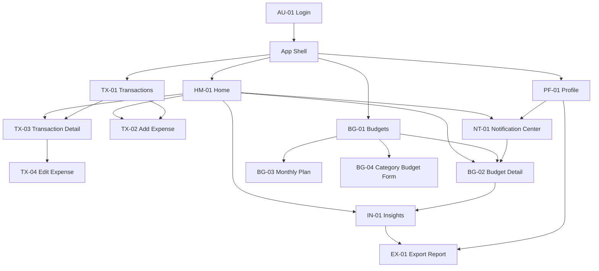

# Information Architecture

> Vietnamese source: [../../vi/ux/information-architecture.md](../../vi/ux/information-architecture.md).

## 1. Purpose

This document is the primary source for the navigation structure, screen relationships, and screen catalogue of Expense Tracker. The three main interaction flows are documented separately in [User Flows](user-flows.md).

Dialogs, Snackbars, loading, empty, and error are states or overlays and do not count as separate screens.

## 2. Navigation structure



Bottom Navigation contains Home, Transactions, Budgets, and Profile. These four destinations are peers under the App Shell and maintain separate navigation histories. `Add Expense` is a primary action on Home and Transactions, not a Bottom Navigation destination.

```text
Login
└── App Shell
    ├── Home
    │   ├── Monthly overview
    │   ├── Categories needing attention
    │   ├── Recent transactions
    │   ├── Add Expense
    │   ├── Insights
    │   └── Notification Center
    │       └── Budget Detail
    ├── Transactions
    │   ├── Search, Filter, Sort
    │   ├── Add Expense
    │   └── Transaction Detail
    │       ├── Edit Expense
    │       └── Delete Confirmation
    ├── Budgets
    │   ├── Monthly Plan
    │   ├── Category Budget Form
    │   └── Budget Detail
    │       └── Insights
    └── Profile
        ├── Notification Center
        ├── Export Report
        └── Sign Out Confirmation
```

## 3. Screen catalogue

| ID | Screen | Purpose | Required states |
| --- | --- | --- | --- |
| AU-01 | Login | Google Sign-In | Idle, loading, error |
| HM-01 | Home | Period overview | Loading, empty, populated, error, no plan |
| TX-01 | Transactions | Search and review | Loading, empty, populated, filtered empty, error, Undo |
| TX-02 | Add Expense | Record an expense | Default, validation error, saving, save failed |
| TX-03 | Transaction Detail | View, edit, and delete | Default, delete dialog |
| TX-04 | Edit Expense | Edit a transaction | Default, validation error, saving, save failed |
| BG-01 | Budgets | View the plan and allocations | No plan, safe, warning, exceeded, error |
| BG-02 | Budget Detail | Understand one category budget | Safe, warning, exceeded, no source data |
| BG-03 | Monthly Plan | Create or edit the monthly limit | Default, validation error, saving |
| BG-04 | Category Budget Form | Create or edit a sub-cap | Default, allocation exceeded, duplicate, saving |
| IN-01 | Insights | View allocation by period | Loading, empty, populated, error |
| EX-01 | Export Report | Generate and open a PDF | Empty, ready, processing, failed, generated |
| NT-01 | Notification Center | View warnings | Loading, empty, populated, error |
| PF-01 | Profile | Account information and secondary actions | Default, sign-out dialog |

There are 14 distinct screens. Dialogs and state variants are not included in this count.

## 4. Navigation rules

- Successful login opens HM-01 and Login is removed from the App Shell back stack.
- Switching Bottom Navigation destinations preserves each destination's period, search, filter, sort, and list position.
- Back returns to the preceding destination in the current flow's history.
- An action that opens a detail screen must pass the correct record ID, category, and period where required.
- EX-01 returns to its source: IN-01 when opened from Insights and PF-01 when opened from Profile.
- Dialogs and Snackbars are overlays; dismissing one does not automatically change the current destination.
- No destination may end without an action to continue, retry, or return.

## 5. Relationship to User Flows

The screen IDs in this document are the official identifiers used in [User Flows](user-flows.md), wireframes, Final UI, prototypes, and handoff. When a screen is added, renamed, or removed, update the screen catalogue first and then review the flow-to-screen matrix.
