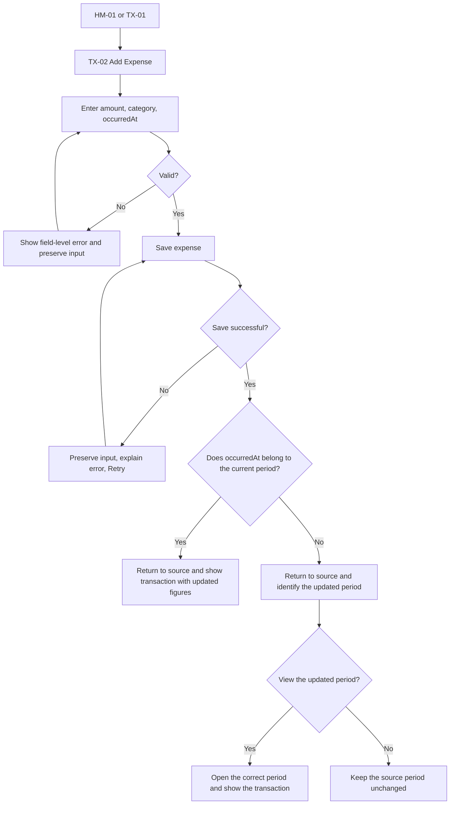
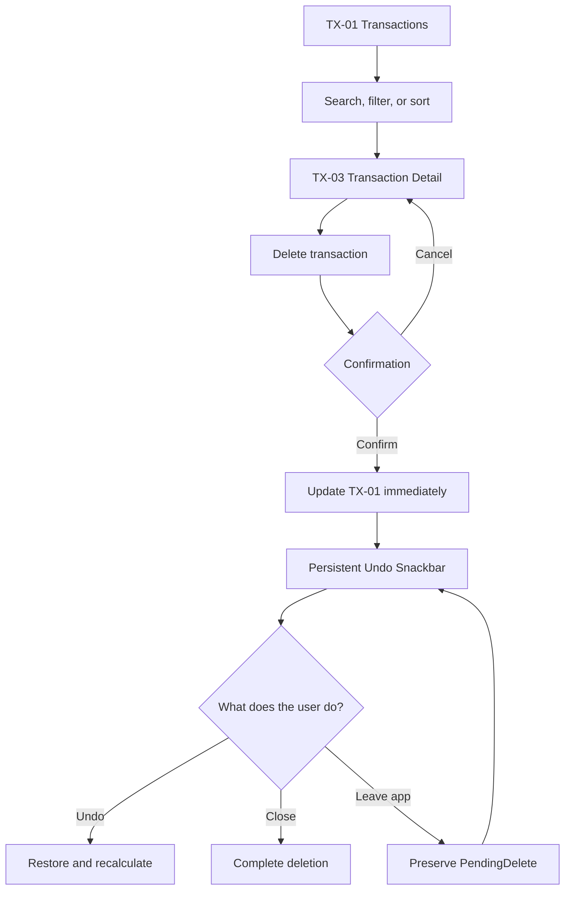
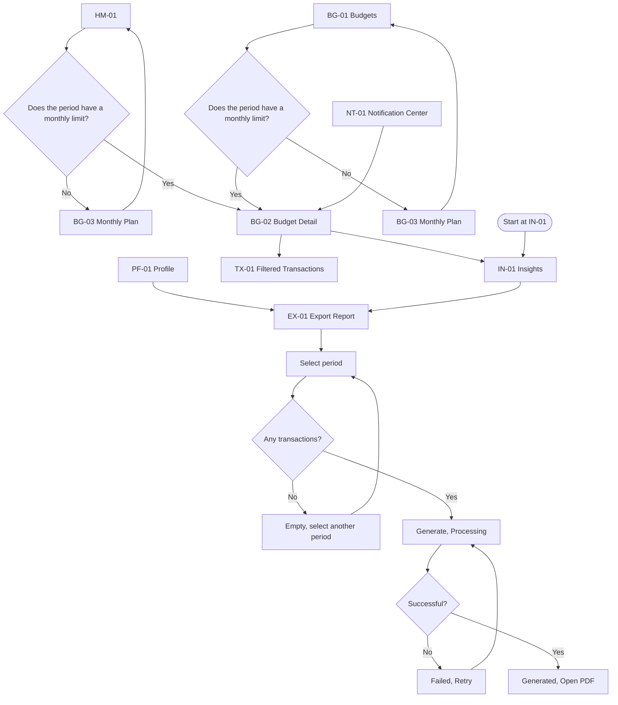

# User Flows

> Vietnamese source: [../../vi/ux/user-flows.md](../../vi/ux/user-flows.md).

## 1. Purpose

This is the English version of the Expense Tracker's three user flows. It is based on [Lab 2](../requirements/lab2.md), the [SRS](../requirements/expense-tracker-srs.md), the [Information Architecture](information-architecture.md), and the [proto-personas](../research/personas/README.md).

The diagrams are intended for the Figma page `01 User Flow`. Screen IDs and navigation relationships are maintained in the Information Architecture document.

## 2. UX principles

1. Fast capture: the form prioritizes amount, category, and occurredAt.
2. Contextual clarity: figures are always presented with their period, limit, and status.
3. Recovery support: validation preserves input, save failures offer Retry, and deletion includes confirmation and Undo.
4. No dead ends: every state provides an action to continue, retry, or go back.
5. Back returns users to the correct source while preserving the current session's search, filter, sort, and period.

## 3. FL-01 Add an expense

| Attribute | Details |
| --- | --- |
| Persona | P01 Nguyễn Minh |
| Starting point | HM-01 or TX-01 |
| Goal | Save an expense and see the updated figures |
| End state | The transaction is saved exactly once in the period determined by occurredAt; the user knows which period was updated |
| Trace | FR-03, BR-20 to BR-27, SC-01 |

### Happy path

1. Open TX-02 from Home or Transactions.
2. Enter amount, category, and occurredAt; merchant and note are optional.
3. Select `Lưu khoản chi`; the button enters a loading state and prevents repeated submission.
4. The app returns to the source screen after the data has been durably saved.
5. If `occurredAt` belongs to the period being viewed, the transaction appears exactly once and all figures are recalculated.
6. The app confirms the successful save so the user knows the action is complete.

### Alternatives and recovery

| ID | Condition | Behavior |
| --- | --- | --- |
| FL-01-A | Invalid input | Display a text error at the field, move focus to the first error, preserve input, and allow correction |
| FL-01-B | Save fails | Keep the user on the same TX-02 form, preserve input, explain the cause, and allow Retry without creating a duplicate record; do not open a separate error screen or show a `Back to Edit` action |
| FL-01-C | Back after the form has changed | Request Discard confirmation; Stay preserves the form |
| FL-01-D | occurredAt belongs to another period | Save to the period determined by occurredAt, clearly identify the updated period, and provide the `Xem kỳ này` action |

Save Failed is an inline state of TX-02: fields remain directly editable and `Retry` resubmits the current values. A `Back to Edit` action is unnecessary. Back from an unchanged form returns to the source. After Save, Back must not reopen the submitted form.

## 4. FL-02 Delete and restore

| Attribute | Details |
| --- | --- |
| Persona | P03 Lê Huy |
| Starting point | TX-01 |
| Goal | Delete with control or restore an accidental deletion |
| End state | TX-01 reflects the final state |
| Trace | FR-03.14, BR-35 to BR-40, SC-03 |

### Happy path

1. From TX-01, use search, filter, or sort to find the transaction to review.
2. Open TX-03 and select `Xóa giao dịch`.
3. The dialog states the amount, category, date, and impact.
4. Confirm returns the user to TX-01, hides the transaction, and recalculates the figures immediately.
5. The Snackbar displays `Đã xóa khoản chi` and the Undo action until the user resolves it.
6. Closing the Snackbar completes the deletion; selecting Undo restores the transaction.

The Snackbar is hosted at the App Shell level, does not expire automatically, and remains visible when the user changes destinations.

### Alternatives and recovery

| ID | Condition | Behavior |
| --- | --- | --- |
| FL-02-A | Select Cancel or Back in the dialog | Close the dialog without changing data |
| FL-02-B | Select Undo | Restore exactly one transaction and recalculate the figures |
| FL-02-C | Close the Snackbar | Complete deletion and stop offering Undo for that transaction |
| FL-02-D | Leave or close the app while the Snackbar is open | Preserve PendingDelete and display the Snackbar again in the next session |
| FL-02-E | Restore fails | Preserve PendingDelete, explain the cause, and allow Retry |

Back from TX-03 returns to the correct source list and preserves search, filter, and sort.

## 5. FL-03 Review a budget and export a PDF

| Attribute | Details |
| --- | --- |
| Persona | P02 Trần Thảo and P03 Lê Huy |
| Starting point | HM-01, BG-01, NT-01, IN-01, or PF-01 |
| Goal | Understand the period status and open the PDF |
| End state | The PDF opens or the user returns to the source |
| Trace | FR-05, FR-07, FR-08, BR-41 to BR-46, SC-02, SC-04 |

### Entry routes

| Source | Route | Back behavior |
| --- | --- | --- |
| HM-01 | Select a category requiring attention → BG-02 → IN-01 | BG-02 returns to Home; IN-01 returns to BG-02 |
| BG-01 | Select a category budget → BG-02 → IN-01 | BG-02 returns to Budgets; IN-01 returns to BG-02 |
| NT-01 | Select an alert → BG-02 for the correct category and period → IN-01 | BG-02 returns to Notification Center; IN-01 returns to BG-02 |
| IN-01 | Select `Xuất báo cáo` → EX-01 | EX-01 returns to Insights and preserves period |
| PF-01 | Select `Xuất báo cáo` → EX-01 | EX-01 returns to Profile |

### Shared happy path

1. From Home, Budgets, or Notification Center, open BG-02 to view the limit, amount spent, remaining amount or overage, and source transactions.
2. If the user starts from Home or Budgets and the period has no monthly limit, open BG-03; after saving, return to the correct source screen with recalculated figures.
3. Open IN-01 from BG-02, or start directly at IN-01 or PF-01.
4. Open EX-01; the period being viewed is selected by default.
5. Generate enters the Processing state and prevents repeated action.
6. Generated provides `Mở PDF`; the PDF includes period, generatedAt, summary, breakdown, and transaction list.

### Alternatives and recovery

| ID | Condition | Behavior |
| --- | --- | --- |
| FL-03-A | The period has no transactions | Disable Generate, display Empty, and allow selection of another period |
| FL-03-B | PDF generation fails | Preserve the period, explain the error, and let Retry return to Processing |
| FL-03-C | No application can open the PDF | Preserve Generated, explain the error, and offer Retry or Share |
| FL-03-D | Open EX-01 from Profile | Skip Budget Detail and Insights; Back returns to Profile |
| FL-03-E | The period has no monthly limit | From HM-01 or BG-01, open BG-03, save the limit, and return to the correct source and period; this state does not block PDF export if the period has transactions |
| FL-03-F | Open from an alert | NT-01 opens the correct BG-02 and period; if the destination no longer exists, return to BG-01 with an explanation |
| FL-03-G | Select source transactions | Open TX-01 filtered to the correct category and period; Back returns to BG-02 and preserves the filter |

Back follows the entry-routes table and the actual screen history. Processing must not create a dead end; if the user cannot leave safely, Back must request cancellation confirmation.

## 6. Flow-to-screen matrix

| Screen | FL-01 | FL-02 | FL-03 |
| --- | :---: | :---: | :---: |
| HM-01 | ✓ |  | ✓ |
| TX-01 | ✓ | ✓ | Alternative |
| TX-02 | ✓ |  |  |
| TX-03 |  | ✓ |  |
| BG-01 |  |  | Alternative |
| BG-02 |  |  | ✓ |
| BG-03 |  |  | Alternative |
| IN-01 |  |  | ✓ |
| EX-01 |  |  | ✓ |
| NT-01 |  |  | Alternative |
| PF-01 |  |  | Alternative |

TX-04 and BG-04 are part of the MVP but are not on a demo happy path. They still require Final UI and handoff if they remain in the submitted screen list.

## 7. Prototype states

| State / overlay | Flow |
| --- | --- |
| Unsaved changes dialog | FL-01 |
| Validation error, Save failed, Retry | FL-01 |
| Delete confirmation dialog | FL-02 |
| Snackbar Undo | FL-02 |
| Empty period | FL-03 |
| PDF Processing, Failed, Retry, Generated | FL-03 |

The prototype must demonstrate the FL-02 confirmation dialog and the FL-03 transition from Processing to Generated or Failed.

## 8. Pre-wireframe checklist

- [ ] The Figma page `01 User Flow` contains the IA and all three flows.
- [ ] Every flow has a starting point, goal, happy path, and end state.
- [ ] Every flow has at least one alternative branch.
- [ ] Validation, Save Failed, Undo, and PDF Failed provide recovery.
- [ ] Back behavior is documented on important connectors.
- [ ] The flow-to-screen matrix matches the planned frame IDs.
- [ ] Dialogs and states are not counted as separate screens.
- [ ] No terminal node lacks an action or a route back.
