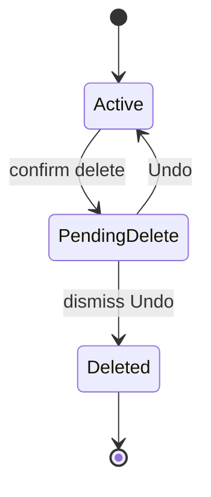
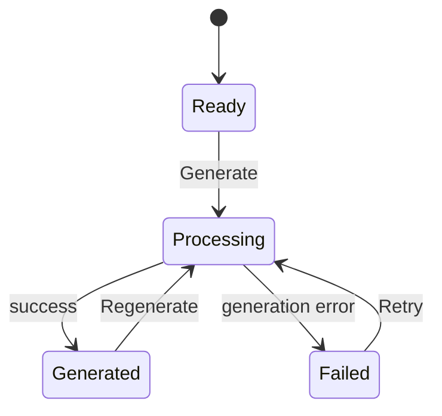
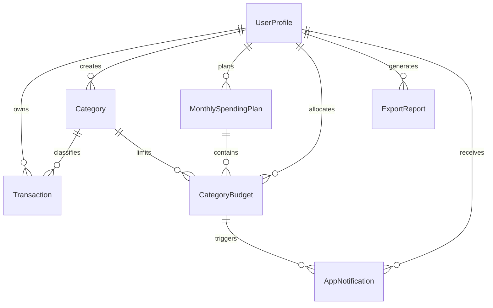

# Expense Tracker Software Requirements Specification

> English version: [../../en/requirements/expense-tracker-srs.md](../../en/requirements/expense-tracker-srs.md).

## 0. Thông tin tài liệu

| Trường | Giá trị |
| --- | --- |
| Document ID | `SRS-EXPENSE-001` |
| Phiên bản | `0.3` |
| Trạng thái | Draft, chưa baseline |
| Chủ sở hữu yêu cầu | Nhóm thực hiện PRM323 Lab 2 |
| Người review | Giảng viên và thành viên nhóm |
| Ngày | 2026-10-24 |
| Upstream | [`lab2.md`](lab2.md) |

### Lịch sử sửa đổi

| Phiên bản | Ngày | Nội dung |
| --- | --- | --- |
| 0.1 | 2026-10-24 | Hợp nhất phạm vi sản phẩm, business rules, FR, NFR và data model. |
| 0.2 | 2026-10-24 | Chuẩn hóa cấu trúc SRS, bổ sung CRUD, state machine, permission, error catalogue, interface, traceability và change control. |
| 0.3 | 2026-10-24 | Chuẩn hóa user flow, bỏ giới hạn thời gian Undo và bổ sung hành vi cho giao dịch lùi ngày. |

SRS chưa được baseline nên các ID cũ dạng `FR-01.01` và `NFR-01.01` vẫn được giữ trong bản nháp này để không làm đứt traceability nội bộ. Trước khi baseline, nhóm phải quyết định giữ hệ ID hiện tại hoặc chuyển một lần sang `FR-MODULE-NNN` và `NFR-CATEGORY-NNN`; sau baseline không được đổi lại ID.

## 1. Mục đích tài liệu

Tài liệu này mô tả yêu cầu sản phẩm và hành vi nghiệp vụ của Expense Tracker. Đây là nguồn tham chiếu cho information architecture, user flow, wireframe, final UI, prototype và handoff Flutter.

Lab 2 chỉ thiết kế trải nghiệm và prototype. Các yêu cầu liên quan đến lưu trữ, đồng bộ, hiệu năng và bảo mật được ghi lại để bản thiết kế không tạo ra hành vi khó triển khai ở Lab 3.

Khi tài liệu này khác với đề Lab 2 hoặc hướng dẫn trực tiếp của giảng viên, yêu cầu của môn học được ưu tiên.

### 1.1 Thứ tự ưu tiên khi diễn giải

Khi các tài liệu mâu thuẫn, thứ tự áp dụng là: yêu cầu chính thức của môn học và hướng dẫn trực tiếp của giảng viên; [`lab2.md`](lab2.md); SRS này; design specification; wireframe, prototype và handoff. Trao đổi miệng hoặc chat chỉ có hiệu lực sau khi được cập nhật vào tài liệu có thẩm quyền tương ứng.

### 1.2 Đối tượng đọc

- Nhóm UX/UI dùng SRS để xây information architecture, flow, state và prototype.
- Người review dùng acceptance criteria để đánh giá phạm vi và tính nhất quán.
- Nhóm triển khai Lab 3 dùng SRS làm đầu vào cho technical design và Flutter handoff.

### 1.3 Tài liệu tham chiếu

| Tài liệu | Vai trò |
| --- | --- |
| [`lab2.md`](lab2.md) | Yêu cầu bắt buộc của bài lab. |
| [`../research/personas/README.md`](../research/personas/README.md) | Target user, problem statement và success criteria. |

Không có PRD riêng. [`lab2.md`](lab2.md), persona và các quyết định đã được xác nhận trong SRS là nguồn upstream của bản nháp này.

## 2. Tổng quan sản phẩm

Expense Tracker là ứng dụng Android giúp sinh viên sống xa gia đình ghi lại chi tiêu hằng ngày, theo dõi hạn mức tháng và nhận biết sớm danh mục có nguy cơ vượt ngân sách.

> Ghi khoản chi -> cập nhật số liệu -> xem phần còn lại -> điều chỉnh chi tiêu -> xuất báo cáo tháng.

Ứng dụng quản lý kế hoạch chi tiêu. Số tiền còn lại trong ứng dụng không phải số dư tài khoản ngân hàng và không xác nhận người dùng đang sở hữu số tiền đó.

## 3. Người dùng và vấn đề cần giải quyết

### 3.1 Người dùng mục tiêu

Người dùng chính là sinh viên từ 18 đến 24 tuổi:

- Sống xa gia đình và tự quản lý tiền sinh hoạt.
- Nhận tiền theo tháng, có thu nhập bán thời gian hoặc sử dụng cả hai nguồn.
- Chủ yếu dùng điện thoại Android.
- Có nhiều khoản chi nhỏ và đôi khi ghi bù sau thời điểm thanh toán.
- Muốn biết mình còn có thể chi bao nhiêu mà không phải đọc báo cáo tài chính phức tạp.

Ba proto-persona của sản phẩm được lưu trong [`../research/personas/`](../research/personas/README.md):

- P01, Nguyễn Minh: ghi khoản chi ngay sau khi thanh toán.
- P02, Trần Thảo: kiểm tra ngân sách trước một khoản chi đáng cân nhắc.
- P03, Lê Huy: rà soát, sửa và xuất dữ liệu vào cuối tuần hoặc cuối tháng.

### 3.2 Problem statement

Sinh viên sống xa nhà cần một cách nhanh và dễ hiểu để ghi lại chi tiêu hằng ngày, theo dõi hạn mức chung và hạn mức theo danh mục. Khi ghi chép không đều hoặc số liệu thiếu ngữ cảnh, họ thường chỉ nhận ra mình đã chi quá nhiều lúc tháng gần kết thúc.

### 3.3 Mục tiêu đo lường

| ID | Mục tiêu |
| --- | --- |
| SC-01 | Người dùng thêm một khoản chi hợp lệ và thấy hạn mức được cập nhật trong dưới 20 giây. |
| SC-02 | Từ Home, người dùng xác định danh mục có nguy cơ vượt ngân sách trong dưới 10 giây. |
| SC-03 | Người dùng sửa được giao dịch sai hoặc khôi phục giao dịch vừa xóa mà không mất dữ liệu ngoài ý muốn. |
| SC-04 | Người dùng chọn kỳ, tạo báo cáo PDF và mở báo cáo qua một flow không có ngõ cụt. |

## 4. Phạm vi

### 4.1 Trong phạm vi MVP

- Google Sign-In.
- Dashboard theo tháng.
- Hạn mức chi tiêu chung theo tháng.
- Ngân sách tùy chọn theo danh mục.
- Danh sách, tìm kiếm, lọc và sắp xếp giao dịch.
- Thêm, xem, sửa và xóa khoản chi.
- Danh mục mặc định và danh mục do người dùng tạo.
- Cảnh báo sắp đạt hoặc đã vượt hạn mức.
- Insights theo tháng và danh mục.
- Xuất báo cáo PDF trên thiết bị.
- Notification Center, Profile và đăng xuất.
- Loading, empty, validation error, processing error và Undo.
- Giữ dữ liệu đã nhập khi validation hoặc lưu thất bại.

### 4.2 Ngoài phạm vi MVP

- Ghi nhận thu nhập.
- Hiển thị số dư tài khoản hoặc ví điện tử.
- Đồng bộ ngân hàng, ví hoặc thẻ.
- Chuyển tiền và thanh toán.
- OCR hóa đơn và xử lý camera.
- Chia sẻ chi phí nhóm hoặc tính năng mạng xã hội.
- AI financial coach.
- Quản lý đầu tư, nợ, tài sản hoặc bảo hành.
- Đa tiền tệ và tỷ giá.
- Cơ chế đóng sổ kỳ kế toán.
- iOS, web admin và subscription billing.

## 5. Thuật ngữ và quy ước

| Thuật ngữ | Định nghĩa |
| --- | --- |
| Kỳ | Một tháng dương lịch, biểu diễn bằng chuỗi `YYYY-MM`. |
| Hạn mức tháng | Số tiền tối đa người dùng dự định chi trong một kỳ. |
| Ngân sách danh mục | Hạn mức tùy chọn dành cho một danh mục trong một kỳ. |
| Tổng chi | Tổng giá trị giao dịch có `occurredAt` thuộc kỳ đang xem. |
| Còn lại trong tháng | Hạn mức tháng trừ tổng chi. Giá trị có thể âm. |
| Chưa phân bổ | Hạn mức tháng trừ tổng hạn mức của các ngân sách danh mục. |
| Soft limit | Hạn mức dùng để cảnh báo. Hệ thống không chặn việc ghi giao dịch khi đạt hoặc vượt hạn mức. |
| Giao dịch lùi ngày | Giao dịch được tạo hôm nay nhưng có `occurredAt` thuộc ngày hoặc kỳ trước. |
| PDF snapshot | Báo cáo phản ánh dữ liệu tại thời điểm tạo và không tự thay đổi sau đó. |
| Default category | Danh mục có sẵn cho mọi người dùng. |
| Archived category | Danh mục không còn dùng để tạo giao dịch mới nhưng vẫn được giữ cho dữ liệu cũ. |

Các từ “phải”, “không được” và “chỉ được” thể hiện yêu cầu bắt buộc. “Nên” thể hiện lựa chọn được khuyến nghị nhưng có thể thay đổi nếu có lý do được ghi lại.

## 6. Giả định và ràng buộc

| ID | Nội dung |
| --- | --- |
| CON-01 | MVP chỉ sử dụng VND. |
| CON-02 | Tiền được lưu dưới dạng số nguyên theo đơn vị đồng. |
| CON-03 | Mọi giao dịch phải thuộc đúng một danh mục. |
| CON-04 | Mọi phép tính theo tháng sử dụng `occurredAt`, không sử dụng `createdAt`. |
| CON-05 | Lab 2 không triển khai Flutter hoặc backend. |
| CON-06 | Final UI dùng frame `360 x 800 dp` và được kiểm tra thêm ở chiều rộng `412 dp`. |
| CON-07 | Hệ thống sử dụng múi giờ của thiết bị để xác định ngày và kỳ. MVP không xử lý giao dịch xuyên múi giờ. |

## 7. Quy tắc nghiệp vụ

### 7.1 Hạn mức và số liệu tháng

| ID | Quy tắc |
| --- | --- |
| BR-01 | Mỗi người dùng chỉ có tối đa một hạn mức tháng trong một kỳ. |
| BR-02 | Hạn mức tháng phải là số nguyên lớn hơn 0. |
| BR-03 | Ngân sách danh mục là tùy chọn và chỉ được tạo sau khi kỳ có hạn mức tháng. Người dùng vẫn được ghi giao dịch cho danh mục chưa có ngân sách. |
| BR-04 | Tổng chi tháng bao gồm mọi giao dịch thuộc kỳ, kể cả giao dịch thuộc danh mục chưa có ngân sách. |
| BR-05 | `remainingAmount = spendingLimit - totalSpent`. |
| BR-06 | `usageRatio = totalSpent / spendingLimit`. Nếu chưa có hạn mức tháng, hệ thống không hiển thị tỷ lệ đã dùng. |
| BR-07 | `unallocatedAmount = spendingLimit - sum(categoryBudget.limitAmount)`. |
| BR-08 | Tổng ngân sách danh mục không được vượt hạn mức tháng. Form phải báo số tiền vượt và không lưu. |
| BR-09 | Hạn mức là soft limit. Hệ thống phải tiếp tục cho phép thêm và sửa giao dịch khi hạn mức đã bị vượt. |
| BR-10 | Số còn lại có thể âm. Số chưa phân bổ có thể bằng 0 nhưng không được âm. |

Ví dụ: hạn mức tháng là `5.000.000đ`; ngân sách Ăn uống là `2.000.000đ`; ngân sách Nhà ở là `2.000.000đ`. Phần chưa phân bổ là `1.000.000đ`. Một giao dịch Sửa xe `500.000đ` vẫn được tính vào tổng chi tháng dù danh mục Sửa xe chưa có ngân sách riêng.

### 7.2 Ngân sách danh mục và cảnh báo

| ID | Quy tắc |
| --- | --- |
| BR-11 | Mỗi người dùng chỉ có tối đa một ngân sách cho cùng `categoryId` và `period`. |
| BR-12 | Hạn mức danh mục phải là số nguyên lớn hơn 0. |
| BR-13 | `warningThreshold` của hạn mức tháng và ngân sách danh mục là tỷ lệ thập phân lớn hơn 0 và nhỏ hơn 1. Giá trị mặc định là `0.8`. |
| BR-14 | `categorySpent` là tổng giao dịch có cùng `categoryId` và có `occurredAt` thuộc kỳ ngân sách. |
| BR-15 | Trạng thái `safe` của hạn mức tháng hoặc ngân sách danh mục áp dụng khi tỷ lệ sử dụng nhỏ hơn `warningThreshold`. |
| BR-16 | Trạng thái `warning` áp dụng từ `warningThreshold` đến hết 100%. |
| BR-17 | Trạng thái `exceeded` áp dụng khi tỷ lệ sử dụng lớn hơn 100%. |
| BR-18 | Khi hạn mức tháng hoặc ngân sách danh mục bị vượt, UI phải hiển thị tỷ lệ thực tế và số tiền vượt. Thanh tiến độ được phép dừng ở chiều dài 100% để giữ layout. |
| BR-19 | Mọi trạng thái ngân sách phải có text hoặc icon đi kèm. Màu không được là dấu hiệu duy nhất. |

### 7.3 Giao dịch và kỳ

| ID | Quy tắc |
| --- | --- |
| BR-20 | Kỳ giao dịch được xác định từ `occurredAt`. |
| BR-21 | `createdAt` và `updatedAt` chỉ phục vụ audit và sắp xếp kỹ thuật. Hai trường này không tham gia phép tính ngân sách. |
| BR-22 | Khi thêm giao dịch lùi ngày, hệ thống cập nhật số liệu của kỳ chứa `occurredAt`. |
| BR-23 | Khi sửa ngày làm giao dịch chuyển sang kỳ khác, hệ thống cập nhật cả kỳ cũ và kỳ mới. |
| BR-24 | Khi sửa số tiền hoặc danh mục, hệ thống cập nhật các tổng liên quan ngay sau khi lưu thành công. |
| BR-25 | Khi xóa hoặc khôi phục giao dịch, hệ thống cập nhật tổng chi, số còn lại, ngân sách danh mục và Insights. |
| BR-26 | Số tiền bằng 0 hoặc nhỏ hơn 0 không hợp lệ. |
| BR-27 | Ngày giao dịch trong tương lai không hợp lệ. |

### 7.4 Danh mục

| ID | Quy tắc |
| --- | --- |
| BR-28 | Danh mục mặc định có `ownerId = null` và `isDefault = true`. |
| BR-29 | Danh mục do người dùng tạo phải có `ownerId` của người dùng và `isDefault = false`. |
| BR-30 | Người dùng không được đổi tên hoặc lưu trữ danh mục mặc định. |
| BR-31 | Tên danh mục tùy chỉnh phải khác nhau trong phạm vi một người dùng sau khi trim và so sánh không phân biệt hoa thường. |
| BR-32 | Danh mục đã có giao dịch hoặc ngân sách không được xóa vật lý. Hệ thống chuyển danh mục sang archived. |
| BR-33 | Danh mục archived không xuất hiện khi tạo giao dịch hoặc ngân sách mới. |
| BR-34 | Giao dịch và báo cáo cũ vẫn hiển thị danh mục archived. |

### 7.5 Xóa và Undo

| ID | Quy tắc |
| --- | --- |
| BR-35 | Xóa giao dịch cần confirmation dialog mô tả rõ giao dịch bị ảnh hưởng. |
| BR-36 | Sau khi xác nhận, giao dịch chuyển sang trạng thái chờ xóa, biến mất khỏi UI và không còn tham gia các phép tính. Bản ghi vẫn được giữ để hỗ trợ Undo. |
| BR-37 | Hệ thống hiển thị Snackbar ở cấp App Shell với action Undo cho đến khi người dùng chọn Undo hoặc chủ động đóng thông báo. Snackbar không tự hết hạn và vẫn hiện khi chuyển giữa các destination. |
| BR-38 | Nếu người dùng chọn Undo, hệ thống hủy trạng thái chờ xóa, đưa giao dịch trở lại UI và tính lại số liệu. |
| BR-39 | Khi người dùng chủ động đóng Snackbar mà không chọn Undo, hệ thống hoàn tất việc xóa bản ghi. Nếu ứng dụng bị đóng khi giao dịch còn chờ xóa, trạng thái này phải được giữ và Snackbar xuất hiện lại ở phiên tiếp theo. |
| BR-40 | Nếu khôi phục thất bại, hệ thống phải thông báo lý do và cho phép thử lại. |

### 7.6 Báo cáo PDF

| ID | Quy tắc |
| --- | --- |
| BR-41 | Báo cáo sử dụng giao dịch có `occurredAt` thuộc kỳ được chọn. |
| BR-42 | Báo cáo là snapshot tại thời điểm tạo. Thay đổi dữ liệu sau đó không sửa file đã tạo. |
| BR-43 | Nếu dữ liệu của kỳ thay đổi, người dùng được phép tạo báo cáo mới. |
| BR-44 | Nếu kỳ không có giao dịch, hệ thống không tạo PDF và hiển thị empty state. |
| BR-45 | PDF được tạo trên thiết bị. MVP không yêu cầu tải file lên cloud storage. |
| BR-46 | Báo cáo phải có kỳ, thời điểm tạo, tổng chi, breakdown theo danh mục và danh sách giao dịch. |

## 8. Yêu cầu chức năng

### 8.0 Actor, nguồn và ưu tiên

Actor chính của toàn bộ FR là người dùng đã đăng nhập, trừ FR-01 cho người chưa đăng nhập và các tác vụ hệ thống được ghi rõ. Không có AI agent consumer.

| Module | ID | Priority | Lý do | Nguồn |
| --- | --- | --- | --- | --- |
| Authentication | FR-01.01 đến FR-01.07 | P0 | Là cổng vào duy nhất và ranh giới owner data của Lab 3. | MVP scope, LAB2 handoff |
| Dashboard | FR-02.01 đến FR-02.10 | P0 | Cần cho SC-01 và SC-02; là điểm bắt đầu của flow chính. | P01, P02, SC-01, SC-02 |
| Transactions | FR-03.01 đến FR-03.14 | P0 | Ghi và sửa chi tiêu là hành vi cốt lõi của sản phẩm. | P01, P03, FL-01, FL-02 |
| Monthly plan | FR-04.01 đến FR-04.05 | P0 | Cung cấp mẫu số cho số còn lại và usage ratio. | Business review, BR-01 đến BR-10 |
| Category budget | FR-05.01 đến FR-05.08 | P0 | Cung cấp cảnh báo theo danh mục cho SC-02. | P02, BR-11 đến BR-19 |
| Category management | FR-06.01 đến FR-06.06 | P1 | Default Category đủ cho demo; custom Category cần cho dữ liệu thực tế. | MVP scope, data integrity review |
| Insights | FR-07.01 đến FR-07.06 | P1 | Hỗ trợ review nhưng không chặn flow ghi chi. | P02, P03 |
| PDF export | FR-08.01 đến FR-08.08 | P0 | Là một trong ba flow bắt buộc và SC-04. | LAB2 prototype, P03, SC-04 |
| Notifications | FR-09.01 đến FR-09.05 | P1 | Có đường thay thế qua Home và Budget Detail. | MVP scope |
| Profile | FR-10.01 đến FR-10.04 | P1 | Cần cho account context và entry point phụ. | MVP scope |
| Navigation/recovery | FR-11.01 đến FR-11.06 | P0 | Prototype thất bại nếu có ngõ cụt hoặc không phục hồi được. | LAB2 §1 và §7 |

Mỗi FR được chấp nhận bằng các business rules, input rules, error catalogue và acceptance scenario liên quan. Các FR chỉ đọc không có actor-supplied input; FR có input dùng bảng §8.12. Main flow và alternative flow được chuẩn hóa trong FL-01 đến FL-03; các thao tác ngoài ba flow tuân theo state và error behavior của §8.14 đến §8.16.

### 8.1 FR-01 Authentication và phiên người dùng

| ID | Yêu cầu |
| --- | --- |
| FR-01.01 | Người chưa đăng nhập chỉ được truy cập Login. |
| FR-01.02 | Hệ thống phải cung cấp action đăng nhập bằng Google. |
| FR-01.03 | Trong lúc đăng nhập, action phải hiển thị loading và không nhận thao tác lặp. |
| FR-01.04 | Khi đăng nhập thất bại hoặc bị hủy, hệ thống giữ người dùng ở Login và hiển thị thông báo phù hợp. |
| FR-01.05 | Sau khi đăng nhập thành công, hệ thống mở Home. |
| FR-01.06 | Profile phải hiển thị avatar, tên và email của tài khoản hiện tại. |
| FR-01.07 | Đăng xuất phải yêu cầu xác nhận. Sau khi hoàn tất, hệ thống quay về Login và không cho Back vào app shell. |

### 8.2 FR-02 Home Dashboard

| ID | Yêu cầu |
| --- | --- |
| FR-02.01 | Home phải hiển thị kỳ đang xem và cho phép chuyển giữa các kỳ có dữ liệu. |
| FR-02.02 | Khi kỳ có hạn mức tháng, Home phải hiển thị hạn mức, tổng chi, số còn lại và tỷ lệ đã sử dụng. |
| FR-02.03 | Khi kỳ chưa có hạn mức, Home phải hiển thị tổng chi và action thiết lập hạn mức. |
| FR-02.04 | Home phải phân biệt số còn lại âm bằng text, icon hoặc nhãn trạng thái. |
| FR-02.05 | Home hiển thị tối đa năm giao dịch gần nhất theo `occurredAt` giảm dần. |
| FR-02.06 | Home hiển thị tối đa ba danh mục có tổng chi cao nhất trong kỳ. |
| FR-02.07 | Home phải có action chính `Thêm khoản chi`. |
| FR-02.08 | Chạm giao dịch gần đây phải mở đúng Transaction Detail. |
| FR-02.09 | Chạm danh mục nổi bật phải mở danh sách đã lọc theo danh mục và kỳ. |
| FR-02.10 | Home phải có loading, empty, populated và error state. Error state phải có Retry. |

### 8.3 FR-03 Transaction management

| ID | Yêu cầu |
| --- | --- |
| FR-03.01 | Người dùng phải xem được danh sách giao dịch theo kỳ. |
| FR-03.02 | Danh sách phải hỗ trợ tìm theo merchant hoặc ghi chú. |
| FR-03.03 | Danh sách phải hỗ trợ lọc theo danh mục. |
| FR-03.04 | Danh sách phải hỗ trợ sắp xếp theo ngày hoặc số tiền. |
| FR-03.05 | Người dùng phải xem được chi tiết một giao dịch. |
| FR-03.06 | Người dùng phải thêm và sửa giao dịch. |
| FR-03.07 | Form phải yêu cầu số tiền, danh mục và ngày phát sinh. |
| FR-03.08 | Merchant và ghi chú là trường tùy chọn. |
| FR-03.09 | Form phải kiểm tra số tiền lớn hơn 0 và ngày không nằm trong tương lai. |
| FR-03.10 | Form phải hiển thị lỗi tại trường liên quan và giữ mọi dữ liệu đã nhập. |
| FR-03.11 | Trong lúc lưu, Save phải hiển thị loading và không nhận thao tác lặp. |
| FR-03.12 | Sau khi lưu thành công, hệ thống quay về màn hình nguồn với số liệu đã cập nhật. Nếu `occurredAt` thuộc kỳ khác kỳ đang xem, hệ thống phải nêu rõ kỳ vừa cập nhật và cung cấp action mở kỳ đó. |
| FR-03.13 | Khi lưu thất bại, hệ thống phải giữ người dùng trên chính form TX-02, giữ dữ liệu, cho phép sửa trực tiếp, giải thích lỗi và cung cấp Retry. Save Failed không phải màn hình riêng và không được hiển thị action `Quay lại chỉnh sửa`. |
| FR-03.14 | Người dùng phải xóa được giao dịch theo BR-35 đến BR-40. |

### 8.4 FR-04 Monthly spending plan

| ID | Yêu cầu |
| --- | --- |
| FR-04.01 | Người dùng phải tạo và sửa hạn mức tháng cho kỳ được chọn. |
| FR-04.02 | Form phải kiểm tra hạn mức là số nguyên lớn hơn 0. |
| FR-04.03 | Chi tiết hạn mức phải hiển thị hạn mức, tổng chi, số còn lại, tỷ lệ và số chưa phân bổ. |
| FR-04.04 | Nếu tổng chi lớn hơn hạn mức mới, hệ thống vẫn cho lưu và cảnh báo kỳ sẽ ở trạng thái exceeded. |
| FR-04.05 | Nếu tổng ngân sách danh mục lớn hơn hạn mức mới, hệ thống không lưu và hiển thị số tiền cần điều chỉnh. |

### 8.5 FR-05 Category budgets

| ID | Yêu cầu |
| --- | --- |
| FR-05.01 | Người dùng phải tạo và sửa ngân sách cho một danh mục trong một kỳ. |
| FR-05.02 | Hệ thống không được tạo hai ngân sách cho cùng danh mục và kỳ. |
| FR-05.03 | Form phải kiểm tra hạn mức danh mục lớn hơn 0. |
| FR-05.04 | Form phải kiểm tra tổng phân bổ không vượt hạn mức tháng. |
| FR-05.05 | Budget Detail phải hiển thị hạn mức, đã chi, còn lại, tỷ lệ, trạng thái và giao dịch nguồn. |
| FR-05.06 | Cảnh báo phải giải thích danh mục, tỷ lệ hoặc số tiền đã dùng và bước tiếp theo. |
| FR-05.07 | Người dùng phải tiếp tục ghi giao dịch khi ngân sách ở trạng thái warning hoặc exceeded. |
| FR-05.08 | Nếu kỳ chưa có hạn mức tháng, hệ thống phải hướng người dùng thiết lập hạn mức trước khi tạo ngân sách danh mục. |

### 8.6 FR-06 Category management

| ID | Yêu cầu |
| --- | --- |
| FR-06.01 | Hệ thống phải cung cấp một tập danh mục mặc định. |
| FR-06.02 | Người dùng phải tạo được danh mục tùy chỉnh với tên, icon và màu. |
| FR-06.03 | Form phải ngăn tên trùng theo BR-31. |
| FR-06.04 | Người dùng phải sửa được danh mục do mình tạo. |
| FR-06.05 | Người dùng phải lưu trữ được danh mục tùy chỉnh theo BR-32 đến BR-34. |
| FR-06.06 | Trước khi lưu trữ, dialog phải giải thích dữ liệu cũ vẫn được giữ và danh mục không còn dùng cho giao dịch mới. |

### 8.7 FR-07 Insights

| ID | Yêu cầu |
| --- | --- |
| FR-07.01 | Insights phải hiển thị tổng chi của kỳ. |
| FR-07.02 | Insights phải hiển thị phân bổ chi tiêu theo danh mục. |
| FR-07.03 | Mỗi biểu đồ phải có legend và text summary truyền đạt cùng thông tin. |
| FR-07.04 | Chạm một danh mục phải mở danh sách giao dịch nguồn đã lọc. |
| FR-07.05 | Nếu kỳ không có giao dịch, Insights hiển thị empty state và action thêm khoản chi. |
| FR-07.06 | Insights phải có action mở Export Report. |

### 8.8 FR-08 PDF export

| ID | Yêu cầu |
| --- | --- |
| FR-08.01 | Người dùng phải chọn được kỳ cần xuất. |
| FR-08.02 | Trước khi tạo, màn hình phải cho biết nội dung báo cáo và số giao dịch của kỳ. |
| FR-08.03 | Hệ thống phải chặn tạo báo cáo khi kỳ không có giao dịch. |
| FR-08.04 | UI phải thể hiện processing, ready và failed state. |
| FR-08.05 | Trong processing, Generate không được nhận thao tác lặp. |
| FR-08.06 | Khi tạo thành công, người dùng phải mở được PDF. |
| FR-08.07 | Khi tạo thất bại, hệ thống phải giữ kỳ đã chọn, giải thích lỗi và cung cấp Retry. |
| FR-08.08 | Báo cáo phải tuân theo BR-41 đến BR-46. |

### 8.9 FR-09 Notifications

| ID | Yêu cầu |
| --- | --- |
| FR-09.01 | Notification Center hiển thị cảnh báo mới nhất trước. |
| FR-09.02 | Mỗi thông báo phải có trạng thái đã đọc hoặc chưa đọc. |
| FR-09.03 | Chạm cảnh báo phải mở đúng Budget Detail và đúng kỳ. |
| FR-09.04 | Nếu ngân sách đích không còn khả dụng, hệ thống giải thích và đưa người dùng về Budgets. |
| FR-09.05 | Trạng thái thông báo không được biểu đạt chỉ bằng màu. |

### 8.10 FR-10 Profile

| ID | Yêu cầu |
| --- | --- |
| FR-10.01 | Profile phải hiển thị thông tin tài khoản hiện tại. |
| FR-10.02 | Profile phải hiển thị đơn vị tiền tệ cố định là VND. |
| FR-10.03 | Profile phải có entry point đến Notification Center và Export Report. |
| FR-10.04 | Profile phải cung cấp action đăng xuất theo FR-01.07. |

### 8.11 FR-11 Điều hướng và phục hồi

| ID | Yêu cầu |
| --- | --- |
| FR-11.01 | App shell có bốn destination: Home, Transactions, Budgets và Profile. |
| FR-11.02 | Add Expense phải truy cập được từ Home và Transactions. |
| FR-11.03 | Back phải quay về đúng nguồn và giữ bộ lọc của phiên hiện tại. |
| FR-11.04 | Không flow nào được kết thúc tại màn hình không có action tiếp tục hoặc quay lại. |
| FR-11.05 | Mọi tác vụ bất đồng bộ phải có loading hoặc processing state. |
| FR-11.06 | Mọi lỗi có thể phục hồi phải nêu nguyên nhân và có Retry. |

### 8.12 Quy tắc trường nhập

| Form / trường | Kiểu | Bắt buộc | Ràng buộc và mặc định | Từ chối |
| --- | --- | --- | --- | --- |
| Transaction `amount` | Int64 | Có | `1..9.999.999.999` VND; không có mặc định | Ngoài khoảng hoặc không phải số nguyên: `VAL_AMOUNT_RANGE` |
| Transaction `categoryId` | String | Có | Category tồn tại, được phép sử dụng và chưa archived | Thiếu: `VAL_CATEGORY_REQUIRED`; không hợp lệ: `REF_CATEGORY_INVALID` |
| Transaction `occurredAt` | LocalDate | Có | Mặc định ngày hiện tại; không sau ngày hiện tại theo múi giờ thiết bị | Sai định dạng: `VAL_DATE_FORMAT`; ngày tương lai: `VAL_DATE_FUTURE` |
| Transaction `merchant` | String | Không | Trim; tối đa 100 ký tự; chuỗi rỗng thành null | Quá dài: `VAL_MERCHANT_LENGTH` |
| Transaction `note` | String | Không | Trim; tối đa 200 ký tự; chuỗi rỗng thành null | Quá dài: `VAL_NOTE_LENGTH` |
| Monthly plan `period` | String | Có | Đúng `YYYY-MM`; mặc định kỳ hiện tại | Sai định dạng: `VAL_PERIOD_FORMAT` |
| Monthly plan `spendingLimit` | Int64 | Có | `1..99.999.999.999` VND | Ngoài khoảng: `VAL_LIMIT_RANGE` |
| Budget `categoryId` | String | Có | Category hợp lệ; mỗi category chỉ có một budget trong kỳ | Trùng: `DUP_CATEGORY_BUDGET` |
| Budget `limitAmount` | Int64 | Có | `1..spendingLimit`; tổng phân bổ không vượt hạn mức tháng | Ngoài khoảng: `VAL_LIMIT_RANGE`; vượt tổng: `BUDGET_ALLOCATION_EXCEEDED` |
| `warningThreshold` | Decimal | Không | `0 < n < 1`; mặc định `0.8` | Ngoài khoảng hoặc sai kiểu: `VAL_THRESHOLD_RANGE` |
| Category `name` | String | Có | Trim; 1 đến 50 ký tự; duy nhất theo owner, không phân biệt hoa thường | Trống/quá dài: `VAL_CATEGORY_NAME`; trùng: `DUP_CATEGORY_NAME` |
| Category `iconName` | String | Có | Một giá trị trong bộ icon của design system | Không hỗ trợ: `VAL_ICON_INVALID` |
| Category `colorToken` | String | Có | Semantic token trong design system | Không hỗ trợ: `VAL_COLOR_TOKEN_INVALID` |
| Export `period` | String | Có | Đúng `YYYY-MM`; mặc định kỳ đang xem | Sai định dạng: `VAL_PERIOD_FORMAT` |

### 8.13 CRUD matrix

| Entity | Create | Read | Update | Delete / archive |
| --- | --- | --- | --- | --- |
| UserProfile | FR-01.02 | FR-01.06, FR-10.01 | Thông qua Google account, ngoài MVP | FR-01.07 chỉ kết thúc phiên; không xóa hồ sơ |
| Transaction | FR-03.06 | FR-03.01, FR-03.05 | FR-03.06 | FR-03.14 |
| Category | FR-06.02 | FR-03.07, FR-06.01 | FR-06.04 | FR-06.05, archive |
| MonthlySpendingPlan | FR-04.01 | FR-02.02, FR-04.03 | FR-04.01 | Không hỗ trợ trong MVP |
| CategoryBudget | FR-05.01 | FR-05.05 | FR-05.01 | Không hỗ trợ trong MVP |
| ExportReport | FR-08.06 | FR-08.06 | Không áp dụng; report là snapshot | File do người dùng quản lý trên thiết bị |
| AppNotification | Hệ thống tạo theo BR-15 đến BR-17 | FR-09.01 | FR-09.02 | Không hỗ trợ trong MVP |

### 8.14 State machines

#### Transaction deletion

| Từ | Đến | Trigger | Guard | Yêu cầu |
| --- | --- | --- | --- | --- |
| Active | PendingDelete | Người dùng xác nhận xóa | Giao dịch thuộc người dùng hiện tại | FR-03.14, BR-35 |
| PendingDelete | Active | Undo | Giao dịch vẫn ở trạng thái PendingDelete | BR-38 |
| PendingDelete | Deleted | Người dùng đóng Snackbar | Không chọn Undo | BR-39 |

Mọi chuyển trạng thái khác bị hard reject với `STATE_TRANSACTION_INVALID`, không thay đổi dữ liệu và không phát sinh side effect. PendingDelete phải được lưu bền vững để phục hồi trạng thái Undo sau khi ứng dụng khởi động lại.

#### Export report

Generate từ kỳ rỗng bị từ chối bằng `REPORT_EMPTY_PERIOD`. Generate khi đang Processing được idempotent-ignore, không tạo job thứ hai. Các chuyển trạng thái còn lại bị từ chối bằng `STATE_REPORT_INVALID` và không có side effect.

### 8.15 Permission matrix

| Vai trò | Create | Read | Update | Delete | Phạm vi dữ liệu |
| --- | --- | --- | --- | --- | --- |
| Chưa đăng nhập | Không | Chỉ Login | Không | Không | Không có dữ liệu nghiệp vụ |
| Người dùng đã đăng nhập | Có | Có | Có | Có theo giới hạn từng entity | Bản ghi có `ownerId` bằng principal hiện tại; được đọc default Category có `ownerId = null` |
| Hệ thống | Notification và metadata report | Dữ liệu cần tính toán của principal | Trạng thái notification và giá trị tính toán | Hoàn tất xóa Transaction sau khi người dùng đóng Undo | Chỉ trong tác vụ do principal khởi tạo |

Truy cập bản ghi của người dùng khác bị từ chối và được biểu diễn là không tìm thấy (`RESOURCE_NOT_FOUND`) để không tiết lộ sự tồn tại của dữ liệu. UI không hiển thị action không được phép.

### 8.16 Error catalogue

| Mã | Điều kiện | Thông báo cho người dùng | Phục hồi | Nguồn |
| --- | --- | --- | --- | --- |
| `AUTH_CANCELLED` | Người dùng hủy Google Sign-In | Đã hủy đăng nhập. | Thử lại khi cần. | FR-01.04 |
| `AUTH_UNAVAILABLE` | Google Sign-In không khả dụng | Không thể kết nối Google. Hãy thử lại. | Fail closed; giữ ở Login. | FR-01.04 |
| `VAL_AMOUNT_RANGE` | Amount sai kiểu hoặc ngoài khoảng | Nhập số tiền lớn hơn 0. | Sửa trường; giữ input khác. | FR-03.09 |
| `VAL_CATEGORY_REQUIRED` | Thiếu category | Chọn danh mục. | Chọn category. | FR-03.07 |
| `REF_CATEGORY_INVALID` | Category không tồn tại, archived hoặc không được phép | Danh mục này không còn dùng được. Hãy chọn danh mục khác. | Tải lại lựa chọn. | FR-03.07 |
| `VAL_DATE_FORMAT` | Ngày sai định dạng | Nhập ngày hợp lệ. | Sửa ngày. | FR-03.09 |
| `VAL_DATE_FUTURE` | `occurredAt` sau ngày hiện tại | Ngày giao dịch không thể nằm trong tương lai. | Chọn ngày hợp lệ. | FR-03.09 |
| `VAL_MERCHANT_LENGTH` | Merchant quá 100 ký tự | Tên nơi chi không được quá 100 ký tự. | Rút ngắn nội dung. | FR-03.08 |
| `VAL_NOTE_LENGTH` | Note quá 200 ký tự | Ghi chú không được quá 200 ký tự. | Rút ngắn nội dung. | FR-03.08 |
| `SAVE_LOCAL_FAILED` | Không thể lưu bền vững trên thiết bị | Không thể lưu khoản chi. Dữ liệu của bạn vẫn được giữ. | Giữ tại TX-02 để sửa trực tiếp hoặc Retry; không báo thành công và không hiển thị `Quay lại chỉnh sửa`. | FR-03.13 |
| `DUP_CATEGORY_BUDGET` | Budget đã tồn tại cho category và kỳ | Danh mục đã có ngân sách trong kỳ này. | Mở budget hiện có để sửa. | FR-05.02 |
| `BUDGET_ALLOCATION_EXCEEDED` | Tổng sub-cap vượt spendingLimit | Tổng phân bổ đang vượt hạn mức tháng. | Giảm một hoặc nhiều hạn mức; UI hiển thị số tiền vượt được tính từ input hiện tại. | FR-05.04 |
| `VAL_THRESHOLD_RANGE` | Threshold không nằm giữa 0 và 1 | Ngưỡng cảnh báo phải lớn hơn 0% và nhỏ hơn 100%. | Sửa threshold. | BR-13 |
| `DUP_CATEGORY_NAME` | Tên category trùng | Danh mục này đã tồn tại. | Đổi tên hoặc dùng category có sẵn. | FR-06.03 |
| `REPORT_EMPTY_PERIOD` | Kỳ không có transaction | Kỳ này chưa có dữ liệu chi tiêu để xuất báo cáo. | Chọn kỳ khác hoặc thêm khoản chi. | FR-08.03 |
| `REPORT_GENERATION_FAILED` | Tạo PDF thất bại | Không thể tạo báo cáo. Kỳ đã chọn vẫn được giữ. | Retry; không tạo metadata thành công. | FR-08.07 |
| `RESOURCE_NOT_FOUND` | Bản ghi không tồn tại hoặc không thuộc principal | Không tìm thấy dữ liệu này. | Quay về danh sách và tải lại. | §8.15 |
| `STATE_TRANSACTION_INVALID` | Chuyển trạng thái xóa không hợp lệ | Không thể thực hiện thao tác ở trạng thái hiện tại. | Tải lại dữ liệu. | §8.14 |
| `STATE_REPORT_INVALID` | Chuyển trạng thái report không hợp lệ | Báo cáo đang ở trạng thái không phù hợp. | Chờ trạng thái hiện tại kết thúc hoặc Retry. | §8.14 |

## 9. Information architecture

Information architecture, screen catalogue và quy tắc điều hướng được quản lý tại [Information Architecture](../ux/information-architecture.md). Tài liệu này là nguồn chính cho cấu trúc màn hình; các màn hình vẫn phải đáp ứng FR, BR và acceptance criteria trong SRS.

## 10. Ba user flow bắt buộc

SRS giữ các ID `FL-01`, `FL-02` và `FL-03` làm traceability contract. Sơ đồ, trình tự tương tác, alternative branches, recovery paths, Back behavior và flow-to-screen matrix được quản lý tại [User Flows](../ux/user-flows.md).

## 11. Mô hình dữ liệu logic

Các kiểu dưới đây mô tả ràng buộc logic. Công nghệ lưu trữ có thể ánh xạ chúng sang kiểu tương đương.

### 11.1 UserProfile

| Trường | Kiểu | Bắt buộc | Quy tắc |
| --- | --- | --- | --- |
| `id` | String | Có | Định danh duy nhất từ hệ thống xác thực. |
| `displayName` | String | Có | Không rỗng sau khi trim. |
| `email` | String | Có | Email hợp lệ từ Google Sign-In. |
| `photoUrl` | String | Không | URL ảnh đại diện. |
| `currencyCode` | String | Có | Cố định `VND` trong MVP. |
| `createdAt` | DateTime | Có | Thời điểm tạo hồ sơ. |
| `updatedAt` | DateTime | Có | Thời điểm cập nhật gần nhất. |

### 11.2 Transaction

| Trường | Kiểu | Bắt buộc | Quy tắc |
| --- | --- | --- | --- |
| `id` | String | Có | Định danh duy nhất. |
| `ownerId` | String | Có | Tham chiếu UserProfile. |
| `amount` | Int64 | Có | Đơn vị đồng, lớn hơn 0. |
| `categoryId` | String | Có | Tham chiếu Category. |
| `merchant` | String | Không | Tối đa 100 ký tự sau khi trim. |
| `note` | String | Không | Tối đa 200 ký tự. |
| `occurredAt` | LocalDate | Có | Không nằm trong tương lai. |
| `createdAt` | DateTime | Có | Thời điểm tạo bản ghi. |
| `updatedAt` | DateTime | Có | Thời điểm cập nhật gần nhất. |

### 11.3 Category

| Trường | Kiểu | Bắt buộc | Quy tắc |
| --- | --- | --- | --- |
| `id` | String | Có | Định danh duy nhất. |
| `ownerId` | String | Không | Null với danh mục mặc định. |
| `name` | String | Có | Từ 1 đến 50 ký tự sau khi trim. |
| `iconName` | String | Có | Tên icon được hỗ trợ. |
| `colorToken` | String | Có | Semantic token, không lưu mã màu tùy ý. |
| `isDefault` | Boolean | Có | True với danh mục hệ thống. |
| `isArchived` | Boolean | Có | Mặc định false. |
| `createdAt` | DateTime | Có | Thời điểm tạo. |
| `updatedAt` | DateTime | Có | Thời điểm cập nhật gần nhất. |

### 11.4 MonthlySpendingPlan

| Trường | Kiểu | Bắt buộc | Quy tắc |
| --- | --- | --- | --- |
| `id` | String | Có | Định danh duy nhất. |
| `ownerId` | String | Có | Tham chiếu UserProfile. |
| `period` | String | Có | Định dạng `YYYY-MM`. |
| `spendingLimit` | Int64 | Có | Đơn vị đồng, lớn hơn 0. |
| `warningThreshold` | Decimal | Có | Lớn hơn 0, nhỏ hơn 1; mặc định `0.8`. |
| `createdAt` | DateTime | Có | Thời điểm tạo. |
| `updatedAt` | DateTime | Có | Thời điểm cập nhật gần nhất. |

Ràng buộc duy nhất: `ownerId + period`.

### 11.5 CategoryBudget

| Trường | Kiểu | Bắt buộc | Quy tắc |
| --- | --- | --- | --- |
| `id` | String | Có | Định danh duy nhất. |
| `ownerId` | String | Có | Tham chiếu UserProfile. |
| `categoryId` | String | Có | Tham chiếu Category. |
| `period` | String | Có | Định dạng `YYYY-MM`. |
| `limitAmount` | Int64 | Có | Đơn vị đồng, lớn hơn 0. |
| `warningThreshold` | Decimal | Có | Lớn hơn 0, nhỏ hơn 1; mặc định `0.8`. |
| `createdAt` | DateTime | Có | Thời điểm tạo. |
| `updatedAt` | DateTime | Có | Thời điểm cập nhật gần nhất. |

Ràng buộc duy nhất: `ownerId + categoryId + period`.

### 11.6 ExportReport

| Trường | Kiểu | Bắt buộc | Quy tắc |
| --- | --- | --- | --- |
| `id` | String | Có | Định danh duy nhất. |
| `ownerId` | String | Có | Tham chiếu UserProfile. |
| `period` | String | Có | Định dạng `YYYY-MM`. |
| `fileName` | String | Có | Tên file hợp lệ trên Android. |
| `itemCount` | Int32 | Có | Số giao dịch trong snapshot, lớn hơn 0. |
| `totalAmount` | Int64 | Có | Tổng chi trong snapshot. |
| `generatedAt` | DateTime | Có | Thời điểm tạo báo cáo. |

`ExportReport` chỉ lưu metadata của lần tạo báo cáo. URI dùng để mở hoặc chia sẻ file thuộc phiên tạo PDF và không được lưu như dữ liệu nghiệp vụ. Nếu file trên thiết bị không còn tồn tại, người dùng tạo lại báo cáo từ dữ liệu nguồn.

### 11.7 AppNotification

| Trường | Kiểu | Bắt buộc | Quy tắc |
| --- | --- | --- | --- |
| `id` | String | Có | Định danh duy nhất. |
| `ownerId` | String | Có | Tham chiếu UserProfile. |
| `type` | Enum | Có | `budgetWarning` hoặc `budgetExceeded`. |
| `title` | String | Có | Tiêu đề ngắn, không rỗng. |
| `body` | String | Có | Nêu nguyên nhân và ngữ cảnh. |
| `targetId` | String | Có | ID của CategoryBudget liên quan. |
| `period` | String | Có | Kỳ cảnh báo. |
| `isRead` | Boolean | Có | Mặc định false. |
| `createdAt` | DateTime | Có | Thời điểm tạo. |

### 11.8 Giá trị tính toán

Các giá trị sau không cần lưu nếu có thể tính nhất quán từ dữ liệu nguồn:

- `totalSpent`
- `remainingAmount`
- `unallocatedAmount`
- `usageRatio`
- `categorySpent`
- `categoryRemaining`
- `budgetStatus`

Nếu implementation lưu cache các giá trị này, cache phải được cập nhật sau mọi thao tác thêm, sửa, xóa hoặc khôi phục giao dịch.

### 11.9 Chính sách toàn vẹn và lưu giữ

- Mọi bản ghi sở hữu bởi người dùng phải có `ownerId` hợp lệ.
- `Transaction`, `MonthlySpendingPlan`, `CategoryBudget`, `ExportReport` và `AppNotification` không được truy cập chéo owner.
- Tiền VND dùng số nguyên; không dùng Float hoặc Double.
- Kỳ dùng `YYYY-MM`; ngày nghiệp vụ dùng `LocalDate`; timestamp audit dùng `DateTime` UTC.
- Category đã được tham chiếu phải archive thay vì xóa vật lý.
- Transaction bị xóa vật lý khi người dùng chủ động đóng Snackbar mà không chọn Undo. PendingDelete phải được giữ qua lần khởi động lại cho đến khi người dùng hoàn tất hoặc hoàn tác thao tác.
- MVP chưa đặt chính sách xóa tài khoản hoặc thời hạn lưu dữ liệu. Đây là open question `OQ-01` trước Lab 3.

## 11A. External interface requirements

### 11A.1 User interface

- Ứng dụng dùng màn hình Android mobile-first, frame chuẩn `360 x 800 dp` và kiểm tra ở `412 dp`.
- App shell có Home, Transactions, Budgets và Profile.
- Text, touch target, contrast, state và responsive phải tuân theo [`lab2.md`](lab2.md) và design specification sau khi tài liệu này được phê duyệt.
- Mọi flow phải có Back behavior, loading, empty, error và recovery phù hợp.

### 11A.2 Hardware interface

Không có peripheral bắt buộc. Ứng dụng cần màn hình cảm ứng và bộ nhớ thiết bị để lưu dữ liệu cục bộ, tạo và mở PDF. Camera, NFC và biometric nằm ngoài phạm vi MVP.

### 11A.3 Software interface

| Interface | Mục đích | Hành vi khi không khả dụng |
| --- | --- | --- |
| Google Sign-In | Xác thực và lấy tên, email, avatar | Fail closed ở Login; không tạo phiên cục bộ giả. |
| Android document/PDF viewer | Mở hoặc chia sẻ báo cáo | Giữ metadata; thông báo không có ứng dụng mở file và cho phép thử lại/chia sẻ. |
| Local persistence | Lưu transaction, plan, budget và category | Không báo thành công; giữ form và cung cấp Retry. |
| Remote sync, nếu Lab 3 triển khai | Đồng bộ dữ liệu đã lưu cục bộ | Local-first; queue retry và không làm mất bản ghi cục bộ. Thời hạn retry là open question `OQ-02`. |

### 11A.4 Communication interface

Lab 2 không định nghĩa giao thức mạng. Nếu Lab 3 có backend, mọi lưu lượng phải dùng HTTPS và payload phải có schema được technical design xác định. SRS không bắt buộc REST, GraphQL, Firebase hoặc vendor cụ thể.

## 12. Trạng thái giao diện

| Khu vực | Trạng thái bắt buộc |
| --- | --- |
| Login | Idle, loading, error. |
| Home | Loading, empty, populated, error, no monthly plan. |
| Transaction form | Default, validation error, saving, save failed. |
| Transaction list | Loading, empty, populated, filtered empty, error, deleted with Undo. |
| Monthly plan | No plan, safe, warning, exceeded, form error. |
| Category budget | Safe, warning, exceeded, no source transactions. |
| Insights | Loading, empty, populated, error. |
| Export report | Empty period, ready to generate, processing, generated, failed. |
| Notifications | Loading, empty, populated, error. |

## 13. Yêu cầu phi chức năng

Mỗi NFR dùng phương pháp Test, Demonstration, Inspection hoặc Analysis. Lab 2 chỉ nghiệm thu NFR có thể đo trên thiết kế; NFR ghi “Lab 3” được baseline cho giai đoạn triển khai.

### 13.1 NFR-01 Usability

| ID | Yêu cầu |
| --- | --- |
| NFR-01.01 | Action chính dùng nhãn mô tả kết quả, ví dụ `Lưu khoản chi` hoặc `Tạo báo cáo`. |
| NFR-01.02 | Form không được xóa dữ liệu đã nhập sau validation error hoặc lỗi lưu có thể thử lại. |
| NFR-01.03 | Mỗi màn hình chỉ có một action chính nổi bật. |
| NFR-01.04 | Trạng thái tài chính phải dùng ngôn ngữ trung tính và không phán xét. |

### 13.2 NFR-02 Accessibility

| ID | Yêu cầu |
| --- | --- |
| NFR-02.01 | Chữ thường phải đạt contrast tối thiểu `4.5:1`. |
| NFR-02.02 | Chữ lớn và UI control phải đạt contrast tối thiểu `3:1`. |
| NFR-02.03 | Touch target phải có kích thước tối thiểu `48 x 48 dp`. |
| NFR-02.04 | Body text phải có kích thước tối thiểu `14 sp`. |
| NFR-02.05 | Trạng thái không được truyền đạt chỉ bằng màu. |
| NFR-02.06 | Icon có action phải có semantic label. |
| NFR-02.07 | Thứ tự focus phải đi theo thứ tự đọc và thao tác. |

### 13.3 NFR-03 Responsive layout

| ID | Yêu cầu |
| --- | --- |
| NFR-03.01 | Layout phải hoạt động ở `360 dp` và `412 dp` mà không cắt nội dung hoặc action. |
| NFR-03.02 | Từ `600 dp`, nội dung phải có giới hạn chiều rộng hoặc chuyển sang bố cục được ghi trong handoff. |
| NFR-03.03 | Màn hình phải hỗ trợ nội dung dài hơn bản mẫu mà không chồng lấn. |

### 13.4 NFR-04 Hiệu năng cho Lab 3

Các chỉ số được kiểm tra trên thiết bị Android có ít nhất 4 GB RAM, dùng dữ liệu đã lưu trên thiết bị và tối đa 10.000 giao dịch của một người dùng.

| ID | Yêu cầu |
| --- | --- |
| NFR-04.01 | Home phải hiển thị dữ liệu đã lưu gần nhất trong tối đa 1,5 giây ở phân vị 95. |
| NFR-04.02 | Sau khi chọn Save, UI phải phản hồi trạng thái trong tối đa 300 mili giây ở phân vị 95. |
| NFR-04.03 | Tìm kiếm và lọc phải cập nhật kết quả trong tối đa 500 mili giây ở phân vị 95. |
| NFR-04.04 | Tạo PDF phải hiển thị processing nếu kéo dài hơn 300 mili giây. |

### 13.5 NFR-05 Dữ liệu và kết nối cho Lab 3

| ID | Yêu cầu |
| --- | --- |
| NFR-05.01 | Giao dịch phải được lưu bền vững trên thiết bị trước khi hệ thống báo thành công. |
| NFR-05.02 | Người dùng phải thêm, sửa và xem dữ liệu đã lưu gần nhất khi không có mạng. |
| NFR-05.03 | Nếu có đồng bộ từ xa, lỗi đồng bộ không được làm mất bản ghi đã lưu trên thiết bị. |
| NFR-05.04 | UI phải phân biệt lỗi validation, lỗi lưu trên thiết bị và lỗi đồng bộ. |
| NFR-05.05 | SRS không bắt buộc SQLite, Room hoặc một vendor lưu trữ cụ thể. |

### 13.6 NFR-06 Bảo mật và quyền riêng tư cho Lab 3

| ID | Yêu cầu |
| --- | --- |
| NFR-06.01 | Người dùng chỉ được đọc và sửa dữ liệu có `ownerId` của mình. |
| NFR-06.02 | Token xác thực không được ghi vào log hoặc lưu dưới dạng plain text. |
| NFR-06.03 | Log không được chứa ghi chú giao dịch, email đầy đủ hoặc đường dẫn file riêng tư. |
| NFR-06.04 | File PDF chỉ được chia sẻ sau hành động rõ ràng của người dùng. |
| NFR-06.05 | Đăng xuất phải xóa thông tin phiên. Chính sách giữ dữ liệu offline phải được ghi trong handoff Lab 3. |

### 13.7 NFR-07 Tính nhất quán

| ID | Yêu cầu |
| --- | --- |
| NFR-07.01 | Cùng một số tiền phải có cùng cách định dạng trên mọi màn hình. |
| NFR-07.02 | Mọi kỳ phải hiển thị tháng và năm. |
| NFR-07.03 | Tổng trên Home, Budgets, Insights và PDF phải dùng cùng tập giao dịch và quy tắc tính. |
| NFR-07.04 | Component phải dùng semantic token và variant từ design system. |

### 13.8 Rationale và verification matrix

| NFR | Metric và target | Rationale | Verification |
| --- | --- | --- | --- |
| NFR-01.01 đến 01.04 | 100% action/state được kiểm tra theo wording rule | Giảm thao tác sai trong ba flow giới hạn thời gian | Inspection trên 10+ màn hình Final UI |
| NFR-02.01 đến 02.07 | Contrast, 48 dp, 14 sp, icon/text và focus order đúng target đã ghi | Ngưỡng bắt buộc từ LAB2 §6 | Inspection bằng contrast tool và Figma measurement trên 360/412 dp |
| NFR-03.01 đến 03.03 | Không clip/overlap tại 360, 412 và từ 600 dp | Ba breakpoint do LAB2 và design spec quy định | Demonstration với frame và nội dung dài nhất |
| NFR-04.01 | Home p95 <= 1,5 giây | Mục tiêu đã được stakeholder review chấp nhận cho app local-first | Test 30 lần trên thiết bị 4 GB RAM, dataset 10.000 transaction |
| NFR-04.02 | UI feedback p95 <= 300 ms | Ngăn bấm lặp khi ghi nhanh tại quầy | Test 30 lần trong cùng môi trường |
| NFR-04.03 | Search/filter p95 <= 500 ms | Giữ flow rà soát khả dụng với dataset tối đa | Test 30 query đại diện trên 10.000 transaction |
| NFR-04.04 | Processing xuất hiện sau 300 ms | Tránh trạng thái không phản hồi | Test với PDF generation bị trì hoãn có kiểm soát |
| NFR-05.01 đến 05.05 | 0 transaction mất khi offline/lỗi sync trong test suite | P01 yêu cầu giữ input và dữ liệu tại kết nối yếu | Test airplane mode, restart app và lỗi sync; Inspection không khóa vendor |
| NFR-06.01 đến 06.05 | 0 truy cập chéo owner; 0 secret/PII cấm trong log mẫu | Dữ liệu chi tiêu là dữ liệu riêng tư theo owner | Security test với hai principal và Inspection log/config |
| NFR-07.01 đến 07.04 | 100% sample screen dùng cùng format, kỳ, công thức và token | Tránh số liệu mâu thuẫn giữa Home, Budget, Insights và PDF | Inspection bằng design audit và Test dùng một fixture chung |

## 14. Quy tắc nội dung

- Nội dung dùng câu ngắn, trung tính và mô tả đúng trạng thái.
- Không dùng lời phán xét như “Bạn tiêu quá tệ” hoặc “Bạn thất bại”.
- Cảnh báo nêu rõ danh mục, số tiền hoặc tỷ lệ và action tiếp theo.
- Số tiền luôn có ký hiệu `đ` và dấu phân cách hàng nghìn nhất quán.
- Kỳ luôn hiển thị cả tháng và năm.
- Action nguy hiểm phải mô tả tác động trước khi xác nhận.
- Thông báo lỗi phải nói điều gì thất bại và người dùng có thể làm gì tiếp theo.

Ví dụ:

- Dùng: `Ăn uống đã dùng 84% hạn mức tháng 10/2026.`
- Dùng: `Không thể lưu khoản chi. Dữ liệu của bạn vẫn được giữ. Hãy thử lại.`
- Tránh: `Bạn đang tiêu quá nhiều!`
- Tránh: `Đã xảy ra lỗi.`

## 15. Tiêu chí nghiệm thu tổng thể

| ID | Tiêu chí |
| --- | --- |
| AC-01 | Final UI có ít nhất 10 màn hình khác nhau trong ba flow. Dialog và state variant không tính là màn hình riêng. |
| AC-02 | Cả ba flow có starting point, happy path, điểm kết thúc và ít nhất một nhánh thay thế hoặc phục hồi. |
| AC-03 | FL-01 có validation error và save failed state, đồng thời giữ dữ liệu đã nhập. |
| AC-04 | FL-02 có confirmation dialog, Cancel và Snackbar Undo không tự hết hạn. |
| AC-05 | FL-03 có empty period, processing, failed, Retry và ready state. |
| AC-06 | Hạn mức tháng, tổng chi, số còn lại và số chưa phân bổ tuân theo BR-01 đến BR-10. |
| AC-07 | Giao dịch lùi ngày và đổi kỳ tuân theo BR-20 đến BR-25; sau khi lưu giao dịch vào kỳ khác, UI nêu đúng kỳ và có action mở kỳ đó. |
| AC-08 | Category budget hiển thị safe, warning và exceeded bằng text hoặc icon ngoài màu sắc. |
| AC-09 | Prototype không có ngõ cụt và Back quay về đúng nguồn. |
| AC-10 | UI đạt checklist accessibility và responsive trong [`lab2.md`](lab2.md). |
| AC-11 | PDF không được tạo cho kỳ rỗng và file đã tạo giữ nguyên như một snapshot. |
| AC-12 | Số liệu xuất hiện ở nhiều màn hình phải dùng cùng quy tắc tính. |

### 15.1 Acceptance scenarios

| ID | Given | When | Then | Phương pháp |
| --- | --- | --- | --- | --- |
| AT-01 | Kỳ có spendingLimit `5.000.000đ`, gồm transaction Ăn uống `2.000.000đ` và Sửa xe `500.000đ` không có category budget | Home tải kỳ | `totalSpent = 2.500.000đ`, `remainingAmount = 2.500.000đ`, `usageRatio = 50%` | Test và demonstration |
| AT-02 | Transaction có `occurredAt = 2026-09-30` | Người dùng tạo bản ghi khi đang xem tháng 10 | Số liệu tháng 9 thay đổi; tháng 10 không tính transaction này; UI báo đã lưu vào tháng 9 và có action mở tháng 9 | Test và demonstration |
| AT-03 | Transaction đang ở tháng 9 | Người dùng sửa `occurredAt` sang `2026-10-02` | Tổng tháng 9 giảm và tổng tháng 10 tăng đúng amount một lần | Test |
| AT-04 | Category budget `2.000.000đ`, categorySpent `2.400.000đ` | Budget Detail mở | UI hiển thị `120%`, `Vượt 400.000đ`, icon và text exceeded; progress bar không dài quá 100% | Demonstration và inspection |
| AT-05 | Form Add Expense có input hợp lệ | Lưu cục bộ thất bại | Input còn nguyên, không có transaction mới và có Retry | Test |
| AT-06 | Giao dịch thuộc owner hiện tại | Người dùng xác nhận Delete | Giao dịch biến mất, tổng được tính lại và Snackbar Undo xuất hiện cho đến khi người dùng xử lý | Demonstration |
| AT-07 | Giao dịch đang PendingDelete | Người dùng chọn Undo, kể cả sau khi mở lại ứng dụng | Giao dịch trở lại đúng một lần và các tổng trở về giá trị trước xóa | Test |
| AT-08 | Kỳ không có transaction | Người dùng mở Export Report | Generate bị disable hoặc empty state xuất hiện với thông báo trong `REPORT_EMPTY_PERIOD` | Demonstration |
| AT-09 | Kỳ có transaction và generator thành công | Người dùng Generate rồi Open | PDF có kỳ, generatedAt, summary, category breakdown và transaction list | Test và inspection |
| AT-10 | Principal A biết ID bản ghi của principal B | A cố mở bản ghi | Hệ thống trả `RESOURCE_NOT_FOUND` và không tiết lộ nội dung | Test |

### 15.2 Môi trường nghiệm thu

| Hạng mục | Điều kiện |
| --- | --- |
| Lab 2 | Figma prototype trên frame 360 x 800 dp và 412 dp; kiểm tra link ở cửa sổ riêng tư. |
| Lab 3 | Android device hoặc emulator có ít nhất 4 GB RAM; dữ liệu tối đa 10.000 transaction; múi giờ Asia/Ho_Chi_Minh. |
| Tài khoản | Một tài khoản Google hợp lệ, một trường hợp hủy đăng nhập và một trường hợp dependency unavailable. |
| Dữ liệu | Có kỳ empty, safe, warning, exceeded, backdated và cross-period. |
| Chấp nhận FR | Tất cả acceptance scenario liên quan đạt và không còn blocker/major defect. |
| Chấp nhận NFR | Giá trị đo đạt target trong điều kiện ghi tại từng NFR hoặc checklist Lab 2. |

### 15.3 Change control

1. Ghi change request với người yêu cầu, ngày và lý do.
2. Liệt kê ID bị ảnh hưởng cùng tác động đến persona, flow, design, handoff, test và phạm vi Lab 2.
3. Người sở hữu yêu cầu quyết định Approved, Rejected hoặc Deferred.
4. Khi Approved, sửa SRS tại chỗ, tăng phiên bản và dùng `spec-forge:propagate` cho tài liệu downstream.
5. Không tái sử dụng ID đã bỏ. Nếu tách requirement, giữ ID cũ cho một phần và cấp ID mới cho phần còn lại.

| CR ID | Mô tả | Trạng thái |
| --- | --- | --- |
| Không có | SRS chưa baseline và chưa có change request chính thức. | N/A |

### 15.4 Phê duyệt

SRS chưa có cổng ký duyệt chính thức vì đây là đồ án môn học. Tài liệu được baseline khi nhóm hoàn tất review và giảng viên chấp nhận phạm vi; ngày và người chấp nhận phải được ghi vào mục 0.

## 16. Ma trận truy vết

| Mục tiêu | Persona | Flow | Nhóm yêu cầu |
| --- | --- | --- | --- |
| SC-01 | P01 | FL-01 | FR-03, FR-04, FR-05, NFR-01, NFR-04 |
| SC-02 | P02 | FL-03 | FR-02, FR-05, FR-07, NFR-02 |
| SC-03 | P03 | FL-02 | FR-03, BR-35 đến BR-40 |
| SC-04 | P02, P03 | FL-03 | FR-07, FR-08, BR-41 đến BR-46 |

### 16.1 Truy vết từ yêu cầu Lab 2

| Upstream | Nội dung | SRS | Coverage |
| --- | --- | --- | --- |
| LAB2 §1.1 | Ứng dụng cho nhóm người dùng và vấn đề cụ thể | §2, §3 | Fully covered |
| LAB2 §1.2 | Ít nhất 8 màn hình khác nhau | AC-01 | Fully covered, SRS yêu cầu 10 |
| LAB2 §1.3-1.5 | Ba flow, alternative và recovery | FL-01 đến FL-03, AC-02 đến AC-05 | Fully covered |
| LAB2 §1.6 | Không viết Flutter trong Lab 2 | CON-05 | Fully covered |
| LAB2 §2 | Quy trình Analyze đến Handoff | §17 | Partially covered; SRS là đầu vào, bằng chứng nằm ở artefact từng bước |
| LAB2 §3 | Bằng chứng sử dụng AI | §17 | Partially covered; AI log là artefact riêng |
| LAB2 §4 | Sáu page Figma và frame 360 x 800 dp | CON-06, §11A.1 | Fully covered |
| LAB2 §5 | Token, component và variants | NFR-07.04, `design/DESIGN.md` | Fully covered by reference |
| LAB2 §6 | Accessibility và responsive | NFR-02, NFR-03 | Fully covered |
| LAB2 §7 | Prototype behavior | FR-11, FL-01 đến FL-03 | Fully covered |
| LAB2 §8 | Flutter handoff | §17 | Fully covered as required evidence |
| LAB2 §9 | Submission checklist | AC-01 đến AC-12, §17 | Partially covered; repository/Figma access verified at submission |

Không có PRD ID để lập RTM PRD-to-SRS. Việc tạo PRD hồi tố chỉ để lấp bảng traceability bị loại bỏ theo doc-first discipline.

## 17. Bằng chứng cần có trong Lab 2

- User flow thể hiện giao dịch lùi ngày thuộc đúng kỳ, thông báo kỳ vừa cập nhật và action mở kỳ đó.
- Wireframe có trạng thái chưa thiết lập hạn mức tháng.
- Final UI phân biệt hạn mức tháng, ngân sách danh mục và số chưa phân bổ.
- Budget Detail có safe, warning và exceeded state.
- Delete flow có confirmation dialog và Snackbar Undo.
- Export flow có empty, processing, failed và ready state.
- Accessibility audit đo contrast, touch target và text size trên frame thật.
- Responsive audit kiểm tra frame rộng `360 dp` và `412 dp`.
- Handoff ghi công thức, validation, navigation, Back behavior và state cho từng màn hình.

## 18. Open questions

| ID | Câu hỏi | Ảnh hưởng | Trạng thái |
| --- | --- | --- | --- |
| OQ-01 | Khi người dùng yêu cầu xóa tài khoản, dữ liệu offline và report metadata được giữ hay xóa trong bao lâu? | Lab 3 privacy và data retention | Open, không chặn Lab 2 |
| OQ-02 | Nếu có remote sync, retry tối đa bao lâu và giải quyết conflict theo quy tắc nào? | Lab 3 technical design | Open, không chặn Lab 2 |
| OQ-03 | Bộ default Category cuối cùng gồm những danh mục nào? | Seed data và mockup | Open; cần chốt trước Final UI |

Không có consumer AI agent, API công khai, vai trò admin hoặc quy trình approval trong phạm vi sản phẩm. Vì vậy SRS không định nghĩa agent-facing flow, API response schema hoặc approval state machine.
