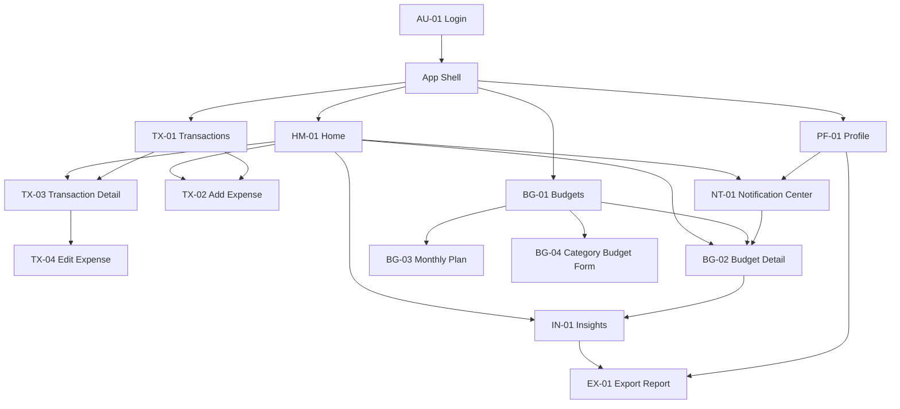

# Information Architecture

> English version: [../../en/ux/information-architecture.md](../../en/ux/information-architecture.md).

## 1. Mục đích

Tài liệu này là nguồn chính cho cấu trúc điều hướng, quan hệ giữa các màn hình và screen catalogue của Expense Tracker. Ba luồng thao tác chính được mô tả riêng tại [User Flows](user-flows.md).

Dialog, Snackbar, loading, empty và error là state hoặc overlay, không được tính thành màn hình riêng.

## 2. Cấu trúc điều hướng



Bottom Navigation gồm Home, Giao dịch, Ngân sách và Hồ sơ. Bốn destination nằm cùng cấp dưới App Shell và duy trì lịch sử điều hướng riêng. `Thêm khoản chi` là primary action trên Home và Transactions, không phải destination của Bottom Navigation.

```text
Login
└── App Shell
    ├── Home
    │   ├── Tổng quan tháng
    │   ├── Danh mục cần chú ý
    │   ├── Giao dịch gần đây
    │   ├── Add Expense
    │   ├── Insights
    │   └── Notification Center
    │       └── Budget Detail
    ├── Transactions
    │   ├── Search, Filter, Sort
    │   ├── Add Expense
    │   └── Transaction Detail
    │       ├── Edit Expense
    │       └── Delete Confirmation
    ├── Budgets
    │   ├── Monthly Plan
    │   ├── Category Budget Form
    │   └── Budget Detail
    │       └── Insights
    └── Profile
        ├── Notification Center
        ├── Export Report
        └── Sign Out Confirmation
```

## 3. Screen catalogue

| ID | Màn hình | Mục đích | State bắt buộc |
| --- | --- | --- | --- |
| AU-01 | Login | Google Sign-In | Idle, loading, error |
| HM-01 | Home | Tổng quan kỳ | Loading, empty, populated, error, no plan |
| TX-01 | Transactions | Tìm và rà soát | Loading, empty, populated, filtered empty, error, Undo |
| TX-02 | Add Expense | Ghi khoản chi | Default, validation error, saving, save failed |
| TX-03 | Transaction Detail | Xem, sửa, xóa | Default, delete dialog |
| TX-04 | Edit Expense | Sửa giao dịch | Default, validation error, saving, save failed |
| BG-01 | Budgets | Xem kế hoạch và phân bổ | No plan, safe, warning, exceeded, error |
| BG-02 | Budget Detail | Hiểu một category budget | Safe, warning, exceeded, no source data |
| BG-03 | Monthly Plan | Tạo hoặc sửa hạn mức tháng | Default, validation error, saving |
| BG-04 | Category Budget Form | Tạo hoặc sửa sub-cap | Default, allocation exceeded, duplicate, saving |
| IN-01 | Insights | Xem phân bổ theo kỳ | Loading, empty, populated, error |
| EX-01 | Export Report | Tạo và mở PDF | Empty, ready, processing, failed, generated |
| NT-01 | Notification Center | Xem cảnh báo | Loading, empty, populated, error |
| PF-01 | Profile | Tài khoản và action phụ | Default, sign-out dialog |

Có 14 màn hình phân biệt. Dialog và state variant không được cộng vào con số này.

## 4. Quy tắc điều hướng

- Login thành công mở HM-01 và không còn nằm trong back stack của App Shell.
- Chuyển Bottom Navigation giữ trạng thái của từng destination, gồm period, search, filter, sort và vị trí danh sách.
- Back quay về destination đứng trước trong lịch sử của flow hiện tại.
- Action mở chi tiết phải truyền đúng record ID, category và period cần thiết.
- EX-01 quay về đúng nguồn: IN-01 nếu mở từ Insights, PF-01 nếu mở từ Profile.
- Dialog và Snackbar là overlay; đóng overlay không tự thay đổi destination hiện tại.
- Không destination nào được kết thúc mà thiếu action tiếp tục, thử lại hoặc quay về.

## 5. Quan hệ với User Flow

Các screen ID trong tài liệu này là định danh chính thức dùng trong [User Flows](user-flows.md), wireframe, Final UI, prototype và handoff. Khi thêm, đổi tên hoặc bỏ màn hình, phải cập nhật screen catalogue trước rồi kiểm tra lại flow-to-screen matrix.
