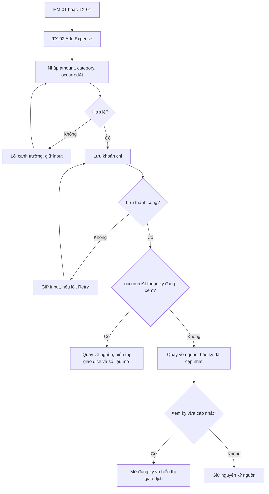
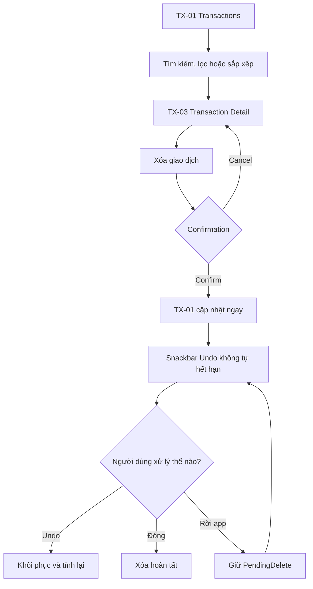
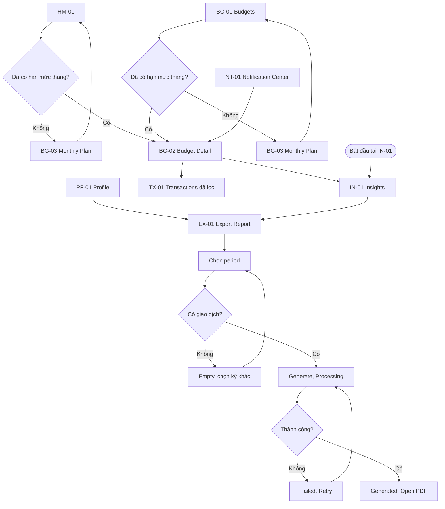

# User Flows

> English version: [../../en/ux/user-flows.md](../../en/ux/user-flows.md).

## 1. Mục đích

Đây là nguồn chính cho ba user flow của Expense Tracker. Tài liệu dựa trên [Lab 2](../requirements/lab2.md), [SRS](../requirements/expense-tracker-srs.md), [Information Architecture](information-architecture.md) và [proto-persona](../research/personas/README.md).

Các sơ đồ được dùng cho Figma page `01 User Flow`. Screen ID và quan hệ điều hướng được quản lý trong tài liệu Information Architecture.

## 2. Nguyên tắc UX

1. Ghi nhanh: form ưu tiên amount, category và occurredAt.
2. Có ngữ cảnh: số liệu luôn đi cùng kỳ, hạn mức và trạng thái.
3. Có phục hồi: validation giữ input, lỗi lưu có Retry, xóa có confirmation và Undo.
4. Không có ngõ cụt: mọi state đều có action tiếp tục, thử lại hoặc quay về.
5. Back quay về đúng nguồn và giữ search, filter, sort, period của phiên hiện tại.

## 3. FL-01 Thêm khoản chi

| Thuộc tính | Nội dung |
| --- | --- |
| Persona | P01 Nguyễn Minh |
| Starting point | HM-01 hoặc TX-01 |
| Mục tiêu | Lưu khoản chi và thấy số liệu cập nhật |
| End state | Giao dịch được lưu đúng một lần trong kỳ của occurredAt; người dùng biết kỳ nào vừa được cập nhật |
| Trace | FR-03, BR-20 đến BR-27, SC-01 |

### Happy path

1. Mở TX-02 từ Home hoặc Transactions.
2. Nhập amount, category và occurredAt; merchant và note là tùy chọn.
3. Chọn `Lưu khoản chi`; button chuyển sang loading và chặn bấm lặp.
4. App quay về màn hình nguồn sau khi lưu bền vững.
5. Nếu `occurredAt` thuộc kỳ đang xem, giao dịch xuất hiện đúng một lần và các số liệu được tính lại.
6. App thông báo lưu thành công để người dùng biết thao tác đã hoàn tất.

### Alternative và recovery

| ID | Điều kiện | Hành vi |
| --- | --- | --- |
| FL-01-A | Input không hợp lệ | Hiện lỗi bằng chữ tại trường, đưa focus đến lỗi đầu tiên, giữ input và cho sửa |
| FL-01-B | Lưu thất bại | Giữ input, nêu nguyên nhân, Retry không tạo bản ghi trùng |
| FL-01-C | Back khi form đã đổi | Xác nhận Discard; Stay giữ nguyên form |
| FL-01-D | occurredAt thuộc kỳ khác | Lưu vào kỳ của occurredAt, báo rõ kỳ đã cập nhật và cung cấp action `Xem kỳ này` |

Back từ form chưa đổi quay về nguồn. Sau Save, Back không được mở lại form đã submit.

## 4. FL-02 Xóa và khôi phục

| Thuộc tính | Nội dung |
| --- | --- |
| Persona | P03 Lê Huy |
| Starting point | TX-01 |
| Mục tiêu | Xóa có kiểm soát hoặc khôi phục khi nhầm |
| End state | TX-01 phản ánh trạng thái cuối cùng |
| Trace | FR-03.14, BR-35 đến BR-40, SC-03 |

### Happy path

1. Từ TX-01, dùng search, filter hoặc sort để tìm giao dịch cần kiểm tra.
2. Mở TX-03 và chọn `Xóa giao dịch`.
3. Dialog nêu amount, category, date và tác động.
4. Confirm đưa người dùng về TX-01, ẩn giao dịch và tính lại số liệu ngay.
5. Snackbar hiển thị `Đã xóa khoản chi` và action Undo cho đến khi người dùng xử lý.
6. Đóng Snackbar hoàn tất việc xóa; chọn Undo khôi phục giao dịch.

Snackbar được đặt ở cấp App Shell, không tự hết hạn và vẫn hiện khi người dùng chuyển destination.

### Alternative và recovery

| ID | Điều kiện | Hành vi |
| --- | --- | --- |
| FL-02-A | Chọn Cancel hoặc Back ở dialog | Đóng dialog, không đổi dữ liệu |
| FL-02-B | Chọn Undo | Khôi phục đúng một giao dịch và tính lại số liệu |
| FL-02-C | Đóng Snackbar | Hoàn tất xóa và không còn cung cấp Undo cho giao dịch đó |
| FL-02-D | Rời hoặc đóng ứng dụng khi Snackbar còn mở | Giữ PendingDelete và hiển thị lại Snackbar ở phiên tiếp theo |
| FL-02-E | Restore thất bại | Giữ PendingDelete, nêu nguyên nhân và cho Retry |

Back từ TX-03 quay về đúng danh sách nguồn và giữ search, filter, sort.

## 5. FL-03 Kiểm tra ngân sách và xuất PDF

| Thuộc tính | Nội dung |
| --- | --- |
| Persona | P02 Trần Thảo và P03 Lê Huy |
| Starting point | HM-01, BG-01, NT-01, IN-01 hoặc PF-01 |
| Mục tiêu | Hiểu trạng thái kỳ và mở PDF |
| End state | PDF mở hoặc người dùng quay về nguồn |
| Trace | FR-05, FR-07, FR-08, BR-41 đến BR-46, SC-02, SC-04 |

### Entry routes

| Nguồn | Đường đi | Back behavior |
| --- | --- | --- |
| HM-01 | Chọn danh mục cần chú ý → BG-02 → IN-01 | BG-02 quay về Home; IN-01 quay về BG-02 |
| BG-01 | Chọn category budget → BG-02 → IN-01 | BG-02 quay về Budgets; IN-01 quay về BG-02 |
| NT-01 | Chọn cảnh báo → BG-02 đúng category và period → IN-01 | BG-02 quay về Notification Center; IN-01 quay về BG-02 |
| IN-01 | Chọn `Xuất báo cáo` → EX-01 | EX-01 quay về Insights và giữ period |
| PF-01 | Chọn `Xuất báo cáo` → EX-01 | EX-01 quay về Profile |

### Shared happy path

1. Từ Home, Budgets hoặc Notification Center, mở BG-02 để xem hạn mức, đã chi, còn lại hoặc số vượt và giao dịch nguồn.
2. Nếu xuất phát từ Home hoặc Budgets mà kỳ chưa có hạn mức tháng, mở BG-03; lưu xong quay lại đúng màn hình nguồn với số liệu đã tính.
3. Mở IN-01 từ BG-02, hoặc bắt đầu trực tiếp tại IN-01 hay PF-01.
4. Mở EX-01; kỳ đang xem được chọn mặc định.
5. Generate chuyển sang Processing và chặn thao tác lặp.
6. Generated cung cấp `Mở PDF`; PDF có kỳ, generatedAt, summary, breakdown và transaction list.

### Alternative và recovery

| ID | Điều kiện | Hành vi |
| --- | --- | --- |
| FL-03-A | Kỳ không có giao dịch | Disable Generate, hiện Empty, cho chọn kỳ khác |
| FL-03-B | Tạo PDF thất bại | Giữ kỳ, nêu lỗi, Retry quay lại Processing |
| FL-03-C | Không có ứng dụng mở PDF | Giữ Generated, giải thích lỗi, cho Retry hoặc Share |
| FL-03-D | Mở EX-01 từ Profile | Bỏ qua Budget Detail và Insights; Back về Profile |
| FL-03-E | Kỳ chưa có hạn mức tháng | Từ HM-01 hoặc BG-01, mở BG-03, lưu hạn mức rồi quay lại đúng nguồn và đúng kỳ; trạng thái này không chặn xuất PDF nếu kỳ có giao dịch |
| FL-03-F | Mở từ cảnh báo | NT-01 mở đúng BG-02 và period; nếu đích không còn tồn tại thì về BG-01 kèm giải thích |
| FL-03-G | Chọn xem giao dịch nguồn | Mở TX-01 đã lọc đúng category và period; Back trả về BG-02 và giữ bộ lọc |

Back tuân theo bảng entry routes và lịch sử màn hình thực tế. Processing không được tạo ngõ cụt; nếu không thể rời an toàn, Back cần xác nhận hủy.

## 6. Flow-to-screen matrix

| Screen | FL-01 | FL-02 | FL-03 |
| --- | :---: | :---: | :---: |
| HM-01 | ✓ |  | ✓ |
| TX-01 | ✓ | ✓ | Alternative |
| TX-02 | ✓ |  |  |
| TX-03 |  | ✓ |  |
| BG-01 |  |  | Alternative |
| BG-02 |  |  | ✓ |
| BG-03 |  |  | Alternative |
| IN-01 |  |  | ✓ |
| EX-01 |  |  | ✓ |
| NT-01 |  |  | Alternative |
| PF-01 |  |  | Alternative |

TX-04 và BG-04 thuộc MVP nhưng không nằm trên happy path demo. Chúng vẫn cần Final UI và handoff nếu được giữ trong danh sách màn hình nộp bài.

## 7. Prototype states

| State / overlay | Flow |
| --- | --- |
| Unsaved changes dialog | FL-01 |
| Validation error, Save failed, Retry | FL-01 |
| Delete confirmation dialog | FL-02 |
| Snackbar Undo | FL-02 |
| Empty period | FL-03 |
| PDF Processing, Failed, Retry, Generated | FL-03 |

Prototype phải thể hiện confirmation dialog của FL-02 và chuyển cảnh Processing sang Generated hoặc Failed của FL-03.

## 8. Checklist trước wireframe

- [ ] Figma page `01 User Flow` có IA và ba flow.
- [ ] Mỗi flow có starting point, goal, happy path và end state.
- [ ] Mỗi flow có ít nhất một alternative branch.
- [ ] Validation, Save Failed, Undo và PDF Failed có recovery.
- [ ] Back behavior được ghi trên connector quan trọng.
- [ ] Flow-to-screen matrix khớp ID frame dự kiến.
- [ ] Dialog và state không bị tính thành màn hình riêng.
- [ ] Không có node kết thúc thiếu action hoặc đường quay lại.
